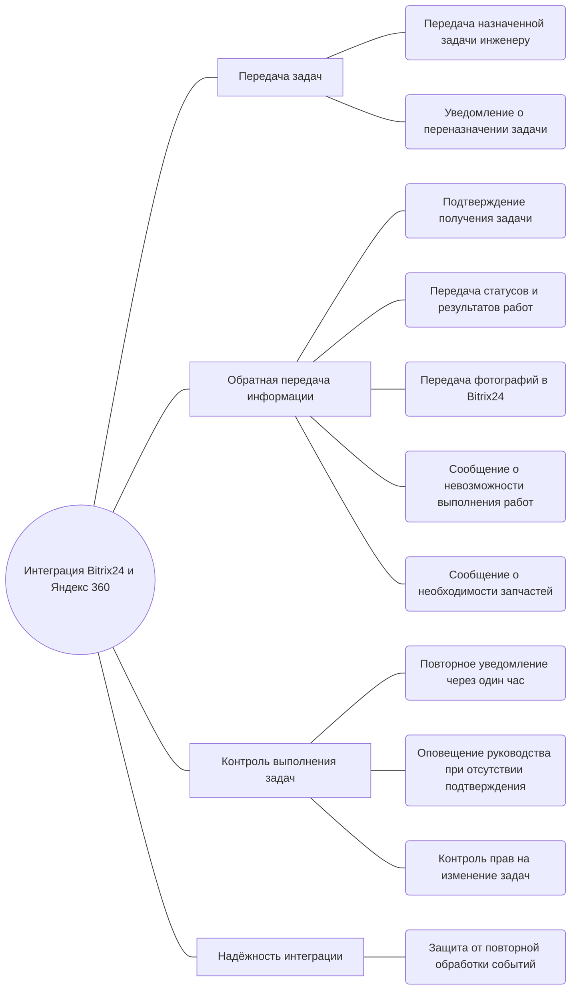

## Документ о концепции и границах кейса

| Поле | Значение |
|------|----------|
| Кейс | Интеграция Bitrix24 и Яндекс 360 для выездных инженеров |
| Индустриальный партнер | Служба поддержки ООО «РИАТПО-Сервис»  |
| Версия | `v0.1-draft` |
| Дата | 2026-10-23 |
| Статус | Черновик |
| Авторы | Жданов Роман Геннадьевич, Манукян Нарек Вагаршакович |

## 1. Введение

Компания использует Bitrix24 для управления задачами и взаимодействия с клиентами, однако выездные инженеры, работающие в Зареченске и Октябрьском, не имеют доступа к порталу. Из-за этого офисным сотрудникам приходится вручную передавать инженерам информацию о назначенных работах, пересылать скриншоты и дополнительно уточнять детали. При этом результаты выполнения работ, фотографии и изменения статусов не всегда своевременно возвращаются в CRM, а переназначение задач может не доходить до исполнителя.

Интеграция Bitrix24 и Яндекс 360 решает эти проблемы: она обеспечивает передачу информации о задачах выездным инженерам через Яндекс 360 и возвращает в Bitrix24 сведения о ходе и результатах выполнения работ. Инженеры получают уведомления о назначенных и переназначенных задачах, подтверждают их получение, сообщают о выполнении работ и передают необходимые фотографии. Если инженер не подтверждает получение задачи или сталкивается с трудностями, система уведомляет руководство.

В отличие от текущего способа работы, при котором информация передаётся вручную и может теряться при обмене между офисом и инженерами, решение автоматизирует взаимодействие между Bitrix24 и Яндекс 360. Это позволяет сократить объём ручной передачи данных, повысить своевременность получения заданий и обеспечить более надёжный возврат информации о результатах работ в CRM.

## 2. Бизнес-контекст и цели

### 2.1. Исходные данные

В настоящее время взаимодействие между офисными сотрудниками и выездными инженерами организовано неудобно. Инженеры, работающие в Зареченске и Октябрьском, не имеют доступа к порталу Bitrix24, поэтому офисным сотрудникам приходится вручную передавать им информацию о назначенных задачах, пересылать скриншоты и дополнительно уточнять детали работ.

Из-за ручной передачи данных часть информации может теряться. Изменения статусов, фотографии и результаты выполнения работ не всегда своевременно возвращаются в CRM. При переназначении задачи уведомление может не дойти до нового исполнителя, а офисные сотрудники не всегда имеют актуальную информацию о ходе выполнения работ. В результате задачи могут задерживаться, а сроки выполнения и соблюдение SLA становится сложнее контролировать.

Дополнительную проблему создаёт отсутствие своевременного подтверждения получения задания инженером. Если исполнитель не отвечает или сталкивается с трудностями, например не может выполнить работу без необходимых запчастей, руководству приходится выяснять ситуацию вручную.

### 2.2. Возможности бизнеса

Внедрение интеграции позволит автоматизировать обмен информацией между Bitrix24 и Яндекс 360. Выездные инженеры смогут получать сведения о назначенных задачах, подтверждать их получение, сообщать о ходе и результатах выполнения работ, а также передавать фотографии через предусмотренные каналы взаимодействия.

Офисные сотрудники смогут получать актуальную информацию о выполнении задач непосредственно в Bitrix24, не перенося данные вручную. При переназначении задачи система сможет уведомлять участников процесса, а при отсутствии подтверждения получения задания — повторно уведомлять инженера и затем информировать руководство.

Решение также позволит повысить прозрачность выполнения работ: руководство будет получать информацию о проблемах, задержках и ситуациях, требующих вмешательства. 

В дальнейшем решение можно расширить дополнительными сценариями взаимодействия между офисом и выездными инженерами, если такая необходимость будет подтверждена бизнесом.

### 2.3. Бизнес-цели

| ID | Цель | Масштаб | Способ измерения | База | План | Обязательный порог | Срок |
|----|------|---------|------------------|------|------|--------------------|------|
| BO-1 | Сократить объём ручной передачи информации о задачах между офисом и выездными инженерами | Трудозатраты офисных сотрудников | Сравнение количества ручных операций до и после внедрения | Ручная передача информации | Сокращение ручных операций | Большая часть предусмотренных сценариев передачи данных автоматизирована | После внедрения интеграции |
| BO-2 | Обеспечить своевременное получение инженерами назначенных задач и уведомлений о переназначении | Процесс назначения и передачи задач | Проверка доставки уведомлений и обработки подтверждений получения | Уведомления передаются вручную, возможны пропуски | Автоматическая передача уведомлений и контроль подтверждений | Реализованы уведомление, повторная попытка и оповещение руководства при отсутствии подтверждения | К моменту приёмки интеграции |
| BO-3 | Обеспечить возврат статусов, результатов выполнения работ и фотографий в Bitrix24 | Полнота и актуальность данных CRM | Проверка соответствия информации в Bitrix24 данным, переданным инженером | Данные могут возвращаться несвоевременно или не полностью | Автоматизированный обмен предусмотренными данными | Все предусмотренные сценарии передачи результатов успешно обрабатываются | К моменту приёмки интеграции |
| BO-4 | Повысить прозрачность выполнения задач и своевременно выявлять проблемы | Контроль выполнения работ и соблюдения SLA | Проверка уведомлений о проблемах, отсутствии подтверждения и необходимости вмешательства руководства | Ситуации требуют дополнительного ручного контроля | Автоматическое информирование о предусмотренных проблемных ситуациях | Руководство получает уведомления по всем предусмотренным сценариям эскалации | После внедрения интеграции |

### 2.4. Видение решения

Для офисных сотрудников и руководства, которым необходимо управлять задачами выездных инженеров и контролировать выполнение работ, интеграция Bitrix24 и Яндекс 360 — это решение для автоматизированного обмена информацией между CRM и инженерами, не имеющими доступа к порталу Bitrix24. Оно передаёт сведения о назначенных задачах и их изменениях, позволяет инженерам подтверждать получение заданий и сообщать о результатах выполнения работ, а также возвращает предусмотренные данные в Bitrix24.

В отличие от ручной передачи информации, решение обеспечивает контролируемый обмен данными, обработку переназначений и уведомление руководства о ситуациях, требующих внимания.

## 3. Бизнес-контекст и стейкхолдеры

### 3.1 Профили заинтересованных лиц

| Стейкхолдер | Описание и роль в проекте | Главная ценность от системы |
| ---- | ---- | ---- |
| **Руководитель бизнес-процесса / заказчик** | Определяет требования к процессу взаимодействия офиса и выездных инженеров, согласовывает бизнес-правила и принимает результат работы. | Сокращение задержек, уменьшение потерь данных, повышение прозрачности выполнения задач и контроля соблюдения SLA. |
| **Офисные сотрудники** | Работают с CRM и задачами в Bitrix24, передают задания инженерам и контролируют получение результатов выполнения работ. | Актуальные статусы задач, своевременное получение отчётов и фотографий, сокращение ручной передачи информации. |
| **Выездные инженеры** | Основные пользователи интеграции со стороны Яндекс 360. Получают назначенные задания, подтверждают их получение, сообщают о ходе и результатах работ. | Получение заданий и возможность отчитываться через Яндекс 360 без доступа к порталу Bitrix24. |
| **Администратор Bitrix24** | Обеспечивает корректную работу CRM, задач, полей и стадий, а также предоставляет необходимую техническую информацию и права для интеграции. | Сохранение корректности данных CRM, задач и бизнес-процессов при автоматическом обмене информацией. |
| **Администратор Яндекс 360** | Обеспечивает настройку и доступность интеграции со стороны Яндекс 360, включая доставку сообщений и обработку вложений. | Надёжная доставка сообщений и корректная работа используемых возможностей Яндекс 360. |
| **Разработчик / сопровождающий интеграцию** | Реализует и поддерживает интеграцию между Bitrix24 и Яндекс 360, обеспечивает обработку событий, контроль ошибок и восстановление после сбоев. | Надёжность, безопасность, диагностируемость ошибок и предсказуемое поведение интеграции. |

### 3.2 Матрица влияния / интереса

| Стейкхолдер | Влияние | Интерес | Стратегия взаимодействия |
| ---- | ---- | ---- | ---- |
| Руководитель бизнес-процесса / заказчик | Высокое | Высокий | **Плотно взаимодействовать**. Согласовывать требования, бизнес-правила, сценарии обработки проблем и критерии приёмки. |
| Офисные сотрудники | Высокое | Высокий | **Плотно взаимодействовать**. Обсуждать рабочие сценарии, проверять корректность передачи задач и получения результатов. |
| Выездные инженеры | Среднее | Высокий | **Информировать и вовлекать**. Выяснять потребности, проверять удобство получения заданий, подтверждения и отправки отчётов. |
| Администратор Bitrix24 | Высокое | Средний | **Удовлетворять потребности**. Согласовывать технические требования, доступы, структуру задач и правила взаимодействия с CRM. |
| Администратор Яндекс 360 | Высокое | Средний | **Удовлетворять потребности**. Согласовывать настройки интеграции, доставку сообщений и обработку вложений. |
| Разработчик / сопровождающий интеграцию | Среднее | Высокий | **Учитывать при проектировании и реализации**. Обеспечивать обработку ошибок, защиту от дублирования событий, диагностику и восстановление после сбоев. |

## 4. Функциональные требования

### 4.1. Основные функции

| ID | Функция | Краткое описание |
|----|---------|------------------|
| FE-1 | Передача назначенных задач инженерам | Автоматическая передача информации о назначенных задачах из Bitrix24 выездным инженерам через Яндекс 360. |
| FE-2 | Подтверждение получения задачи | Инженер подтверждает получение задания. Если подтверждение не поступает, система повторно уведомляет инженера через один час, а при отсутствии ответа информирует руководство. |
| FE-3 | Уведомления о переназначении задачи | При переназначении задачи система уведомляет соответствующих участников. |
| FE-4 | Передача статусов и результатов выполнения работ | Инженер сообщает о ходе и результате выполнения назначенной задачи, а информация передаётся обратно в Bitrix24. |
| FE-5 | Передача фотографий по задаче | Инженер может передавать фотографии, связанные с выполнением работ, для сохранения в задаче Bitrix24. |
| FE-6 | Обработка проблем при выполнении задачи | Если инженер не может выполнить работу или ему необходимы запчасти, он сообщает об этом для дальнейшего информирования руководства и организации необходимых действий. |
| FE-7 | Контроль прав на изменение задач | Инженер может изменять статус только назначенной ему задачи и не может самостоятельно изменять стадии CRM. |
| FE-8 | Защита от повторной обработки событий | Система предотвращает повторную обработку одного и того же события, чтобы избежать дублирования действий и сообщений. |

### 4.2. Дерево функций

### 4.3. Пользовательские истории / варианты использования

|ID| Основное действующее лицо | Варианты использования |
|---------------------------|------------------------|------------------------|
| US-1 | Выездной инженер | Как выездной инженер, я хочу получать информацию о назначенной мне задаче через Яндекс 360, чтобы знать, какие работы необходимо выполнить, не имея доступа к порталу Bitrix24. |
| US-2 | Выездной инженер | Как выездной инженер, я хочу подтверждать получение задачи, чтобы руководство знало, что я получил задание. |
| US-3 | Руководитель | Как руководитель, я хочу получать уведомление, если инженер не подтвердил получение задачи после повторного уведомления через один час, чтобы своевременно реагировать на возможные задержки. |
| US-4 | Выездной инженер | Как выездной инженер, я хочу получать уведомление о переназначении задачи, чтобы знать об изменениях в назначенных мне работах. |
| US-5 | Выездной инженер | Как выездной инженер, я хочу передавать статусы и результаты выполнения работ через Яндекс 360, чтобы информация автоматически возвращалась в Bitrix24. |
| US-6 | Выездной инженер | Как выездной инженер, я хочу отправлять фотографии, связанные с выполнением работ, чтобы они сохранялись в соответствующей задаче Bitrix24. |
| US-7 | Выездной инженер | Как выездной инженер, я хочу сообщать о невозможности выполнения работы или необходимости запчастей, чтобы руководство могло организовать дальнейшие действия. |
| US-8 | Администратор Bitrix24 | Как администратор Bitrix24, я хочу, чтобы инженер мог изменять статус только назначенной ему задачи и не мог самостоятельно менять стадии CRM, чтобы сохранялись установленные права доступа. |
| US-9 | Разработчик / сопровождающий интеграцию | Как разработчик интеграции, я хочу, чтобы система предотвращала повторную обработку одного и того же события, чтобы не возникали дублирующиеся действия и сообщения. |

### 4.4. Детальный сценарий (UC-1, UC-2)

#### UC-1. Передача задачи выездному инженеру и контроль подтверждения получения

| Поле | Значение |
|------|----------|
| Автор / дата | Аналитик команды / 2026-10-23 |
| Основное действующее лицо | Офисный сотрудник |
| Дополнительные действующие лица | Выездной инженер, руководитель, Bitrix24, Яндекс 360 |
| Описание | Система автоматически передаёт выездному инженеру информацию о назначенной задаче из Bitrix24 через Яндекс 360, получает подтверждение её получения и контролирует отсутствие ответа. |
| Условие-триггер | В Bitrix24 создана задача для выездного инженера или изменён её исполнитель. |
| Предварительные условия | PRE-1. В Bitrix24 существует задача, назначенная выездному инженеру. PRE-2. Интеграция между Bitrix24 и Яндекс 360 настроена и имеет необходимые права доступа. PRE-3. Для инженера определён соответствующий пользователь Яндекс 360. |
| Выходные условия | POST-1. Инженер получил информацию о назначенной задаче через Яндекс 360. POST-2. Подтверждение получения задачи обработано системой, если инженер ответил. POST-3. Если подтверждение не получено, система повторно уведомила инженера через один час, а при отсутствии ответа проинформировала руководство. |
| Приоритет | Высокий |
| Частота использования | При назначении и переназначении задач выездным инженерам. |
| Бизнес-правила | BR-1. Инженер должен иметь возможность подтвердить получение задачи через Яндекс 360. BR-2. Если подтверждение не поступило, система повторно уведомляет инженера через один час. BR-3. Если подтверждение отсутствует и после повторного уведомления, система информирует руководство. BR-4. Повторная обработка одного и того же события не должна приводить к дублированию действий и сообщений. |

**Нормальное направление**

1. Офисный сотрудник создаёт или назначает задачу выездному инженеру в Bitrix24.
2. Bitrix24 формирует событие о назначении задачи.
3. Интеграция получает событие и проверяет, не обрабатывалось ли оно ранее.
4. Система определяет назначенного инженера и соответствующего пользователя Яндекс 360.
5. Система формирует сообщение с информацией о задаче и отправляет его инженеру через Яндекс 360.
6. Инженер получает сообщение и подтверждает получение задания.
7. Система обрабатывает подтверждение и фиксирует факт получения задачи.
8. Система завершает сценарий, поскольку получение задания подтверждено.

**Альтернативные направления**

- 6.1. *Отсутствие подтверждения:* Если инженер не подтвердил получение задачи, система ожидает один час с момента первоначального уведомления.
- 6.2. *Повторное уведомление:* Если подтверждение не поступило в течение одного часа, система повторно отправляет инженеру уведомление о задаче.
- 6.3. *Эскалация руководству:* Если инженер не подтвердил получение задачи и после повторного уведомления, система информирует руководство о необходимости обратить внимание на задачу.
- 1.1. *Переназначение задачи:* Если задача назначена другому инженеру, система обрабатывает изменение исполнителя и отправляет уведомление соответствующему инженеру.

**Исключения**

- 3.0.E1. *Повторное событие:* Если система получает событие, которое уже было обработано, повторные действия и сообщения не выполняются.
- 4.0.E1. *Не удалось определить пользователя Яндекс 360:* Система не может корректно определить адресата уведомления. Дальнейшая обработка требует устранения проблемы сопоставления пользователя.
- 5.0.E1. *Ошибка передачи сообщения:* Если сообщение не удалось передать через Яндекс 360, факт успешной доставки не фиксируется. Необходимо предусмотреть регистрацию ошибки и её дальнейшую обработку.

**Другая информация**

- Инженер взаимодействует с задачами через Яндекс 360 и не получает доступ к порталу Bitrix24.
- Механизм обработки технических ошибок и восстановления после сбоев Bitrix24 или Яндекс 360 относится к зоне ответственности соответствующей технической поддержки.

**Предположения**

- Предполагается, что инженер может ответить на сообщение через предусмотренный канал взаимодействия в Яндекс 360.
- Конкретный формат сообщения, способ фиксации подтверждения и правила повторной обработки технических ошибок должны быть уточнены при проектировании интеграции.

#### UC-2. Передача результатов выполнения задачи и фотографий в Bitrix24

| Поле | Значение |
|------|----------|
| Автор / дата | Аналитик команды / 2026-10-23 |
| Основное действующее лицо | Выездной инженер |
| Дополнительные действующие лица | Офисный сотрудник, руководитель, Bitrix24, Яндекс 360 |
| Описание | Выездной инженер передаёт через Яндекс 360 сведения о ходе и результате выполнения назначенной задачи, а также фотографии выполненных работ. Интеграция обрабатывает полученную информацию и передаёт её в соответствующую задачу Bitrix24. |
| Условие-триггер | Выездной инженер сообщает о ходе или результате выполнения назначенной задачи либо отправляет фотографии, связанные с работами. |
| Предварительные условия | PRE-1. Задача существует в Bitrix24 и назначена соответствующему инженеру. PRE-2. Интеграция между Bitrix24 и Яндекс 360 настроена и имеет необходимые права доступа. PRE-3. Инженер может отправлять сообщения через предусмотренный канал взаимодействия в Яндекс 360. |
| Выходные условия | POST-1. Полученные сведения о ходе или результате выполнения работ переданы в соответствующую задачу Bitrix24. POST-2. Переданные фотографии сохранены в соответствующей задаче Bitrix24. POST-3. Статус задачи изменён только в пределах разрешённых инженеру действий. |
| Приоритет | Высокий |
| Частота использования | При передаче инженером сведений о ходе и результатах выполнения назначенных задач. |
| Бизнес-правила | BR-5. Инженер может изменять статус только назначенной ему задачи. BR-6. Инженер не может самостоятельно изменять стадии CRM. BR-7. Фотографии должны быть связаны с соответствующей задачей Bitrix24. BR-8. Если инженер не может выполнить работу или ему необходимы запчасти, он сообщает об этом для дальнейшего информирования руководства и организации необходимых действий. BR-9. Повторная обработка одного и того же события не должна приводить к дублированию действий и сообщений. |

**Нормальное направление**

1. Выездной инженер выполняет назначенную ему работу.
2. Инженер отправляет через Яндекс 360 сообщение о ходе или результате выполнения задачи.
3. Если необходимо подтвердить выполнение работ фотографиями, инженер прикрепляет их к сообщению.
4. Интеграция получает сообщение и проверяет, не обрабатывалось ли соответствующее событие ранее.
5. Система определяет задачу Bitrix24, к которой относится сообщение.
6. Система проверяет, что задача назначена соответствующему инженеру и что запрошенное изменение статуса находится в пределах его прав.
7. Система передаёт сведения о ходе или результате выполнения работ в Bitrix24.
8. Если сообщение содержит фотографии, система передаёт их в соответствующую задачу Bitrix24.
9. Система завершает обработку сообщения после выполнения предусмотренных операций.

**Альтернативные направления**

- 2.1. *Передача только статуса или результата:* Если сообщение не содержит фотографий, система передаёт в Bitrix24 только предусмотренные сведения о ходе или результате выполнения задачи.
- 3.1. *Передача фотографий:* Если инженер отправляет фотографии отдельно от текстового отчёта, система обрабатывает их и сохраняет в соответствующей задаче Bitrix24.
- 2.2. *Невозможность выполнения работы:* Если инженер сообщает, что не может выполнить задачу, система передаёт информацию для дальнейшего информирования руководства и организации необходимых действий.
- 2.3. *Необходимость запчастей:* Если инженер сообщает о необходимости запчастей, система передаёт эту информацию для организации дальнейших действий.
- 6.1. *Попытка изменения стадии CRM:* Если действие предполагает изменение стадии CRM, система не выполняет его, поскольку инженер не имеет соответствующих полномочий.

**Исключения**

- 4.0.E1. *Повторное событие:* Если полученное сообщение уже было обработано, система не выполняет повторную обработку, способную привести к дублированию действий или сообщений.
- 5.0.E1. *Не удалось определить соответствующую задачу:* Система не может однозначно связать сообщение с задачей Bitrix24. Передача данных не выполняется до выяснения соответствия.
- 6.0.E1. *Недостаточно прав:* Если инженер пытается изменить статус задачи, которая ему не назначена, система отклоняет изменение.
- 7.0.E1. *Ошибка передачи данных в Bitrix24:* Если сведения о результате выполнения работ не удалось передать, успешное завершение операции не фиксируется. Необходимо предусмотреть регистрацию ошибки и дальнейшую обработку.
- 8.0.E1. *Ошибка передачи фотографии:* Если фотографию не удалось сохранить в соответствующей задаче Bitrix24, операция считается неуспешной и требует дальнейшей обработки.

**Другая информация**

- Фотографии хранятся в соответствующей задаче Bitrix24.
- Интеграция не должна предоставлять инженеру возможность самостоятельно менять стадии CRM.
- Технические сбои самих систем Bitrix24 и Яндекс 360 относятся к зоне ответственности соответствующей технической поддержки.

**Предположения**

- Предполагается, что сообщения инженера можно связать с конкретной задачей Bitrix24.
- Конкретный формат передачи отчёта, правила определения задачи по сообщению и обработка ошибок передачи фотографий должны быть уточнены при проектировании интеграции.

### 4.5. Сжатые Use Cases (UC-3–UC-9)

#### UC-3. _Уведомление о переназначении задачи_

- Описание: При изменении исполнителя задачи в Bitrix24 система определяет нового инженера и отправляет ему уведомление через Яндекс 360, чтобы он своевременно узнал о назначенном задании.
- Исключения: Если не удалось определить нового исполнителя или отправить уведомление, система регистрирует ошибку для дальнейшей обработки.
- Приоритет: Высокий.
- Бизнес-правила: При переназначении задачи уведомление должно направляться соответствующему новому исполнителю. Повторная обработка одного события не должна приводить к дублированию уведомлений.
- Другая информация: Инженер получает информацию через Яндекс 360 и не имеет доступа к порталу Bitrix24.

#### UC-4. _Передача статусов и результатов выполнения работ_

- Описание: Выездной инженер отправляет через Яндекс 360 информацию о ходе или результате выполнения задачи. Система передаёт полученные данные в соответствующую задачу Bitrix24.
- Исключения: Если не удалось определить задачу или передать сведения в Bitrix24, система регистрирует ошибку, а данные требуют дальнейшей обработки.
- Приоритет: Высокий.
- Бизнес-правила: Инженер может изменять статус только назначенной ему задачи и не может самостоятельно изменять стадии CRM.
- Другая информация: Передача результатов выполнения работ позволяет офисным сотрудникам отслеживать состояние задач непосредственно в Bitrix24.

#### UC-5. _Передача фотографий по задаче_

- Описание: Выездной инженер отправляет фотографии выполненных работ через Яндекс 360. Система передаёт фотографии в соответствующую задачу Bitrix24.
- Исключения: Если не удалось определить задачу или сохранить фотографии в Bitrix24, система регистрирует ошибку, а передача фотографий требует дальнейшей обработки.
- Приоритет: Высокий.
- Бизнес-правила: Фотографии должны быть связаны с соответствующей задачей Bitrix24.
- Другая информация: Фотографии хранятся в задаче Bitrix24. Отдельные ограничения на количество фотографий в исходных требованиях не указаны.

#### UC-6. _Сообщение о невозможности выполнения работы_

- Описание: Если выездной инженер не может выполнить назначенную задачу, он сообщает об этом через Яндекс 360. Система передаёт информацию для уведомления руководства и организации дальнейших действий.
- Исключения: Если сообщение не удалось обработать или передать, система регистрирует ошибку для дальнейшей обработки.
- Приоритет: Высокий.
- Бизнес-правила: Информация о невозможности выполнения работы должна быть передана для дальнейшего информирования руководства.
- Другая информация: Причины невозможности выполнения работы могут потребовать дополнительного рассмотрения со стороны руководства.

#### UC-7. _Сообщение о необходимости запчастей_

- Описание: Если для выполнения задачи инженеру необходимы запчасти, он отправляет соответствующее сообщение через Яндекс 360. Система передаёт информацию для информирования руководства и организации необходимых действий.
- Исключения: Если сообщение не удалось обработать или передать, система регистрирует ошибку для дальнейшей обработки.
- Приоритет: Высокий.
- Бизнес-правила: Информация о необходимости запчастей должна передаваться для организации дальнейших действий.
- Другая информация: Закупка, заказ и доставка запчастей не относятся к явно определённым функциям интеграции.

#### UC-8. _Контроль прав на изменение задач_

- Описание: Когда инженер пытается изменить статус задачи, система проверяет, назначена ли ему эта задача и разрешено ли соответствующее действие. Инженер может изменять статус только назначенной ему задачи.
- Исключения: Если задача не назначена инженеру или действие не разрешено, система отклоняет изменение.
- Приоритет: Высокий.
- Бизнес-правила: Инженер может изменять статус только назначенной ему задачи. Инженер не может самостоятельно изменять стадии CRM.
- Другая информация: Контроль прав необходим для сохранения установленных правил работы с задачами и CRM.

#### UC-9. _Защита от повторной обработки событий_

- Описание: При получении события из Bitrix24 или Яндекс 360 система проверяет, обрабатывалось ли оно ранее. Если событие уже было обработано, система предотвращает повторное выполнение действий и отправку дублирующихся сообщений.
- Исключения: Если невозможно определить, обрабатывалось ли событие ранее, система должна избегать неконтролируемого повторного выполнения действий и регистрировать возникшую проблему.
- Приоритет: Высокий.
- Бизнес-правила: Одно и то же событие не должно приводить к повторному выполнению операций, созданию дублирующих действий или отправке повторных сообщений.
- Другая информация: Защита от повторной обработки применяется к событиям интеграции между Bitrix24 и Яндекс 360.

## 5. Нефункциональные требования (NFR)

| ID | Категория | Требование | Метрика / порог |
|----|-----------|------------|-----------------|
| NFR-P1 | Производительность | Система должна обеспечивать своевременную передачу информации о назначенных задачах из Bitrix24 в Яндекс 360 и результатов выполнения работ обратно в Bitrix24. | Количественные показатели времени передачи данных требуют уточнения. |
| NFR-P2 | Производительность | Система должна обеспечивать передачу фотографий, связанных с выполнением работ, в соответствующие задачи Bitrix24. | Ограничения на размер и количество фотографий требуют уточнения. |
| NFR-A1 | Доступность и Надёжность | Система должна контролировать получение инженером назначенной задачи и повторно уведомлять его при отсутствии подтверждения. | Повторное уведомление через 1 час после первоначального уведомления. |
| NFR-A2 | Доступность и Надёжность | При отсутствии подтверждения получения задачи после повторного уведомления система должна информировать руководство. | Оповещение руководства при отсутствии подтверждения после повторного уведомления. |
| NFR-A3 | Доступность и Надёжность | Система должна предотвращать повторную обработку одного и того же события, чтобы исключить дублирование действий и сообщений. | Повторная обработка одного события не должна приводить к дублированию действий и сообщений. |
| NFR-S1 | Безопасность | Интеграция должна обеспечивать передачу информации инженерам через Яндекс 360 без предоставления им доступа к порталу Bitrix24. | Доступ инженеров к порталу Bitrix24 не предоставляется. |
| NFR-S2 | Безопасность | Система должна ограничивать возможность инженера изменять данные задач в соответствии с установленными правами. | Инженер может изменять статус только назначенной ему задачи. |
| NFR-S3 | Безопасность | Система не должна предоставлять инженеру возможность самостоятельно изменять стадии CRM. | Самостоятельное изменение стадий CRM инженером запрещено. |
| NFR-S4 | Безопасность | Система не должна передавать коды доступа через групповые чаты и комментарии к задачам. Передача кодов допускается только через личный чат с инженером или по телефонному звонку в центр. | Код доступа передаётся только по предусмотренным каналам. Передача паролей через Яндекс 360 запрещена. |
| NFR-C1 | Совместимость | Система должна обеспечивать взаимодействие между Bitrix24 и Яндекс 360 для передачи задач, уведомлений, статусов, результатов выполнения работ и фотографий. | Поддержка всех предусмотренных сценариев обмена данными. |
| NFR-C2 | Совместимость | Система должна учитывать переназначение задач в Bitrix24 и передавать соответствующие уведомления новому исполнителю. | Уведомление нового исполнителя при переназначении задачи. |
| NFR-C3 | Совместимость | Интеграция должна использовать существующий процесс работы с задачами в Bitrix24 и не создавать дублирующие задачи. | Интеграция не создаёт повторную задачу для уже обрабатываемого назначения. |
| NFR-U1 | Удобство использования | Система должна сокращать объём ручной передачи информации между офисными сотрудниками и выездными инженерами. | Передача предусмотренной информации автоматизирована; количественный целевой показатель требует уточнения. |
| NFR-U2 | Удобство использования | Выездной инженер должен иметь возможность получать задания, подтверждать их получение и передавать результаты работ через Яндекс 360 без входа в Bitrix24. | Все предусмотренные действия инженера доступны через Яндекс 360. |
| NFR-M1 | Сопровождаемость | Система должна обеспечивать регистрацию ошибок обработки и передачи данных, чтобы упростить диагностику проблем интеграции. | Ошибки интеграции регистрируются для последующего анализа. |

## 6. Границы кейса

### 6.1. In Scope

- Автоматическая передача информации о назначенных задачах из Bitrix24 выездным инженерам через Яндекс 360 без предоставления инженерам доступа к порталу Bitrix24 (FE-1).
- Подтверждение получения задачи инженером, повторное уведомление через один час при отсутствии подтверждения и информирование руководства, если подтверждение не получено после повторного уведомления (FE-2).
- Уведомление нового исполнителя через Яндекс 360 при переназначении задачи в Bitrix24 (FE-3).
- Передача статусов и результатов выполнения работ от выездных инженеров в соответствующие задачи Bitrix24 (FE-4).
- Передача фотографий, связанных с выполнением работ, через Яндекс 360 с сохранением фотографий в соответствующих задачах Bitrix24 (FE-5).
- Передача информации о невозможности выполнения работы или необходимости запчастей для информирования руководства и организации дальнейших действий (FE-6).
- Контроль прав инженеров при работе с задачами: возможность изменять статус только назначенной им задачи и запрет на самостоятельное изменение стадий CRM (FE-7).
- Защита от повторной обработки событий, предотвращающая дублирование действий и сообщений при обмене данными между Bitrix24 и Яндекс 360 (FE-8).

### 6.2. Out of Scope

- LI-1. Разработка самостоятельных мобильных приложений для выездных инженеров не входит в проект. Получение заданий, подтверждение их получения и передача результатов работ выполняются через Яндекс 360.
- LI-2. Предоставление выездным инженерам доступа к порталу Bitrix24 не входит в проект. Инженеры взаимодействуют с задачами через Яндекс 360, а информация об их работе передаётся в Bitrix24 средствами интеграции.
- LI-3. Изменение стадий CRM выездными инженерами не входит в проект. Инженер может изменять статус только назначенной ему задачи в пределах установленных прав.
- LI-4. Изменение существующей линии работы с обращениями или создание дополнительной очереди не входит в проект.
- LI-5. Передача кодов доступа через групповые чаты и комментарии к задачам запрещена. Код доступа может передаваться только через личный чат с инженером или по телефонному звонку в центр. Передача паролей через Яндекс 360 не допускается.
- LI-6. Закупка, заказ и доставка запчастей не входят в функциональность интеграции. Система обеспечивает передачу информации о необходимости запчастей для последующего информирования руководства и организации дальнейших действий.
- LI-7. Устранение сбоев самих платформ Bitrix24 и Яндекс 360 не входит в границы интеграции. Такие сбои передаются на обработку службе поддержки («отделу заботы»).
- LI-8. Использование VPN и обходных способов получения доступа к Bitrix24 не входит в проект. Интеграция должна работать в рамках установленных ограничений.
- LI-9. Параллельное ведение задач в электронных таблицах и сторонних чатах не входит в целевой процесс. Bitrix24 остаётся системой учёта задач, а Яндекс 360 используется для взаимодействия с выездными инженерами.

### 6.3. Состав первого и последующих выпусков

| Функция | Выпуск 1 | Выпуск 2 | Выпуск 3 |
|---------|----------|----------|----------|
| FE-1. Передача назначенных задач | Автоматическая отправка инженеру сообщения о новой назначенной задаче через Яндекс 360 с указанием необходимых сведений о работе. | Повторная отправка уведомления, если первая попытка доставки завершилась ошибкой. | Уведомление офисного сотрудника, если система не может определить получателя задачи или подготовить сообщение для отправки. |
| FE-2. Подтверждение получения задачи | Инженер подтверждает получение задачи через Яндекс 360. Если подтверждение не поступает, система повторно уведомляет инженера через один час, а при отсутствии ответа информирует руководство. | Сохранение времени подтверждения получения задачи в Bitrix24 для последующего просмотра офисными сотрудниками. | Возможность руководству вручную повторно отправить инженеру запрос на подтверждение получения задачи через Яндекс 360. |
| FE-3. Уведомления о переназначении | Отправка уведомления новому исполнителю при изменении ответственного за задачу в Bitrix24. | Уведомление прежнего исполнителя об отмене его назначения, если это допускается действующим процессом работы. | Отправка уведомления офисному сотруднику о невозможности доставить сообщение новому исполнителю. |
| FE-4. Передача статусов и результатов | Передача статуса и текстового результата выполнения работы из Яндекс 360 в соответствующую задачу Bitrix24. | Повторная отправка данных в Bitrix24 после временной ошибки передачи с защитой от повторного применения уже обработанного события. | Возможность передать результат выполнения работы по согласованному шаблону с отдельными полями для статуса и комментария инженера. |
| FE-5. Передача фотографий | Передача фотографий от инженера через Яндекс 360 с сохранением в соответствующей задаче Bitrix24. | Повторная попытка передачи фотографий, если их сохранение в Bitrix24 завершилось ошибкой. | Отправка инженеру подтверждения об успешном сохранении фотографий в задаче Bitrix24. |
| FE-6. Сообщения о проблемах и запчастях | Инженер может сообщить через Яндекс 360 о невозможности выполнить работу или о необходимости запчастей; система передаёт информацию руководству. | Передача сообщения с указанием задачи, инженера и причины обращения, если эти сведения доступны системе. | Предоставление инженеру возможности выбрать причину невозможности выполнения работы из заранее согласованного списка. |
| FE-7. Контроль прав на изменение задач | Инженер может изменять статус только назначенной ему задачи; изменение стадий CRM через интеграцию запрещено. | Проверка актуального исполнителя и допустимости изменения статуса непосредственно перед внесением изменения в Bitrix24. | Настройка перечня статусов задачи, которые инженер может устанавливать через Яндекс 360. |
| FE-8. Защита от повторной обработки событий | Проверка уникальности события перед обработкой, чтобы одно событие не приводило к повторной отправке сообщений или повторному изменению данных. | Обработка повторных попыток после ошибок без повторного выполнения уже успешно завершённых операций. | Просмотр журнала ошибок интеграции ответственным сотрудником для выявления событий, которые не удалось обработать автоматически. |

## 7. Ограничения и допущения

### 7.1. Ограничения и исключения

| ID | Формулировка |
|----|--------------|
| LI-1 | |

### 7.2. Предположения и зависимости

| ID | Тип | Формулировка |
|----|-----|--------------|
| AS-1 | допущение | |
| DE-1 | зависимость | |

### 7.3. Приоритеты проекта

| Область | Ограничения | Движущая сила | Степень свободы |
|---------|-------------|---------------|-----------------|
| Функции | | | |
| Качество | | | |
| Сроки | | | |
| Расходы | | | |
| Персонал | | | |

### 7.4. Особенности развертывания

Стек, инфраструктура, обучение пользователей, необходимые изменения смежных систем.

## 8. Риски

| ID | Риск | Вероятность (0–1) | Ущерб (1–10) | Митигация |
|----|------|-------------------|--------------|-----------|
| RI-1 | | | | |

> [!WARNING]
> Риски, которые могут сорвать приемку выпуска 1, вынесите сюда явно.

## 9. Критерии приемки

| ID | Критерий | Как проверяется | Порог | Срок |
|----|----------|-----------------|-------|------|
| SM-1 | | | | |
| AC-1 | | | | |

Партнер принимает работу, если выполнены все критерии со статусом «обязательный» и закрыты In Scope функции выпуска 1.
