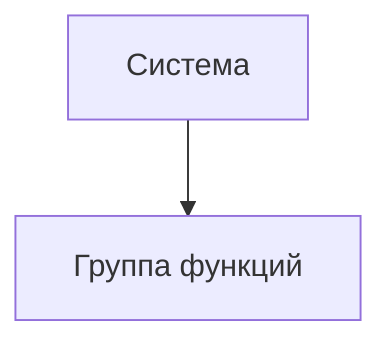

## Документ о концепции и границах кейса

| Поле | Значение |
|------|----------|
| Кейс | Интеграция Bitrix24 и Яндекс 360 для выездных инженеров |
| Индустриальный партнер | Служба поддержки ООО «РИАТПО-Сервис»  |
| Версия | `v0.1-draft` |
| Дата | 2026-10-23 |
| Статус | Черновик |
| Авторы | Жданов Роман Геннадьевич, Манукян Нарек Вагаршакович |

## 1. Введение

Компания использует Bitrix24 для управления задачами и взаимодействия с клиентами, однако выездные инженеры, работающие в Зареченске и Октябрьском, не имеют доступа к порталу. Из-за этого офисным сотрудникам приходится вручную передавать инженерам информацию о назначенных работах, пересылать скриншоты и дополнительно уточнять детали. При этом результаты выполнения работ, фотографии и изменения статусов не всегда своевременно возвращаются в CRM, а переназначение задач может не доходить до исполнителя.

Интеграция Bitrix24 и Яндекс 360 решает эти проблемы: она обеспечивает передачу информации о задачах выездным инженерам через Яндекс 360 и возвращает в Bitrix24 сведения о ходе и результатах выполнения работ. Инженеры получают уведомления о назначенных и переназначенных задачах, подтверждают их получение, сообщают о выполнении работ и передают необходимые фотографии. Если инженер не подтверждает получение задачи или сталкивается с трудностями, система уведомляет руководство.

В отличие от текущего способа работы, при котором информация передаётся вручную и может теряться при обмене между офисом и инженерами, решение автоматизирует взаимодействие между Bitrix24 и Яндекс 360. Это позволяет сократить объём ручной передачи данных, повысить своевременность получения заданий и обеспечить более надёжный возврат информации о результатах работ в CRM.

## 2. Бизнес-контекст и цели

### 2.1. Исходные данные

В настоящее время взаимодействие между офисными сотрудниками и выездными инженерами организовано неудобно. Инженеры, работающие в Зареченске и Октябрьском, не имеют доступа к порталу Bitrix24, поэтому офисным сотрудникам приходится вручную передавать им информацию о назначенных задачах, пересылать скриншоты и дополнительно уточнять детали работ.

Из-за ручной передачи данных часть информации может теряться. Изменения статусов, фотографии и результаты выполнения работ не всегда своевременно возвращаются в CRM. При переназначении задачи уведомление может не дойти до нового исполнителя, а офисные сотрудники не всегда имеют актуальную информацию о ходе выполнения работ. В результате задачи могут задерживаться, а сроки выполнения и соблюдение SLA становится сложнее контролировать.

Дополнительную проблему создаёт отсутствие своевременного подтверждения получения задания инженером. Если исполнитель не отвечает или сталкивается с трудностями, например не может выполнить работу без необходимых запчастей, руководству приходится выяснять ситуацию вручную.

### 2.2. Возможности бизнеса

Внедрение интеграции позволит автоматизировать обмен информацией между Bitrix24 и Яндекс 360. Выездные инженеры смогут получать сведения о назначенных задачах, подтверждать их получение, сообщать о ходе и результатах выполнения работ, а также передавать фотографии через предусмотренные каналы взаимодействия.

Офисные сотрудники смогут получать актуальную информацию о выполнении задач непосредственно в Bitrix24, не перенося данные вручную. При переназначении задачи система сможет уведомлять участников процесса, а при отсутствии подтверждения получения задания — повторно уведомлять инженера и затем информировать руководство.

Решение также позволит повысить прозрачность выполнения работ: руководство будет получать информацию о проблемах, задержках и ситуациях, требующих вмешательства. 

В дальнейшем решение можно расширить дополнительными сценариями взаимодействия между офисом и выездными инженерами, если такая необходимость будет подтверждена бизнесом.

### 2.3. Бизнес-цели

| ID | Цель | Масштаб | Способ измерения | База | План | Обязательный порог | Срок |
|----|------|---------|------------------|------|------|--------------------|------|
| BO-1 | Сократить объём ручной передачи информации о задачах между офисом и выездными инженерами | Трудозатраты офисных сотрудников | Сравнение количества ручных операций до и после внедрения | Ручная передача информации | Сокращение ручных операций | Большая часть предусмотренных сценариев передачи данных автоматизирована | После внедрения интеграции |
| BO-2 | Обеспечить своевременное получение инженерами назначенных задач и уведомлений о переназначении | Процесс назначения и передачи задач | Проверка доставки уведомлений и обработки подтверждений получения | Уведомления передаются вручную, возможны пропуски | Автоматическая передача уведомлений и контроль подтверждений | Реализованы уведомление, повторная попытка и оповещение руководства при отсутствии подтверждения | К моменту приёмки интеграции |
| BO-3 | Обеспечить возврат статусов, результатов выполнения работ и фотографий в Bitrix24 | Полнота и актуальность данных CRM | Проверка соответствия информации в Bitrix24 данным, переданным инженером | Данные могут возвращаться несвоевременно или не полностью | Автоматизированный обмен предусмотренными данными | Все предусмотренные сценарии передачи результатов успешно обрабатываются | К моменту приёмки интеграции |
| BO-4 | Повысить прозрачность выполнения задач и своевременно выявлять проблемы | Контроль выполнения работ и соблюдения SLA | Проверка уведомлений о проблемах, отсутствии подтверждения и необходимости вмешательства руководства | Ситуации требуют дополнительного ручного контроля | Автоматическое информирование о предусмотренных проблемных ситуациях | Руководство получает уведомления по всем предусмотренным сценариям эскалации | После внедрения интеграции |

### 2.4. Видение решения

Для офисных сотрудников и руководства, которым необходимо управлять задачами выездных инженеров и контролировать выполнение работ, интеграция Bitrix24 и Яндекс 360 — это решение для автоматизированного обмена информацией между CRM и инженерами, не имеющими доступа к порталу Bitrix24. Оно передаёт сведения о назначенных задачах и их изменениях, позволяет инженерам подтверждать получение заданий и сообщать о результатах выполнения работ, а также возвращает предусмотренные данные в Bitrix24.

В отличие от ручной передачи информации, решение обеспечивает контролируемый обмен данными, обработку переназначений и уведомление руководства о ситуациях, требующих внимания.

## 3. Бизнес-контекст и стейкхолдеры

### 3.1 Профили заинтересованных лиц

| Стейкхолдер | Описание и роль в проекте | Главная ценность от системы |
| ---- | ---- | ---- |
| **Руководитель бизнес-процесса / заказчик** | Определяет требования к процессу взаимодействия офиса и выездных инженеров, согласовывает бизнес-правила и принимает результат работы. | Сокращение задержек, уменьшение потерь данных, повышение прозрачности выполнения задач и контроля соблюдения SLA. |
| **Офисные сотрудники** | Работают с CRM и задачами в Bitrix24, передают задания инженерам и контролируют получение результатов выполнения работ. | Актуальные статусы задач, своевременное получение отчётов и фотографий, сокращение ручной передачи информации. |
| **Выездные инженеры** | Основные пользователи интеграции со стороны Яндекс 360. Получают назначенные задания, подтверждают их получение, сообщают о ходе и результатах работ. | Получение заданий и возможность отчитываться через Яндекс 360 без доступа к порталу Bitrix24. |
| **Администратор Bitrix24** | Обеспечивает корректную работу CRM, задач, полей и стадий, а также предоставляет необходимую техническую информацию и права для интеграции. | Сохранение корректности данных CRM, задач и бизнес-процессов при автоматическом обмене информацией. |
| **Администратор Яндекс 360** | Обеспечивает настройку и доступность интеграции со стороны Яндекс 360, включая доставку сообщений и обработку вложений. | Надёжная доставка сообщений и корректная работа используемых возможностей Яндекс 360. |
| **Разработчик / сопровождающий интеграцию** | Реализует и поддерживает интеграцию между Bitrix24 и Яндекс 360, обеспечивает обработку событий, контроль ошибок и восстановление после сбоев. | Надёжность, безопасность, диагностируемость ошибок и предсказуемое поведение интеграции. |

### 3.2 Матрица влияния / интереса

| Стейкхолдер | Влияние | Интерес | Стратегия взаимодействия |
| ---- | ---- | ---- | ---- |
| Руководитель бизнес-процесса / заказчик | Высокое | Высокий | **Плотно взаимодействовать**. Согласовывать требования, бизнес-правила, сценарии обработки проблем и критерии приёмки. |
| Офисные сотрудники | Высокое | Высокий | **Плотно взаимодействовать**. Обсуждать рабочие сценарии, проверять корректность передачи задач и получения результатов. |
| Выездные инженеры | Среднее | Высокий | **Информировать и вовлекать**. Выяснять потребности, проверять удобство получения заданий, подтверждения и отправки отчётов. |
| Администратор Bitrix24 | Высокое | Средний | **Удовлетворять потребности**. Согласовывать технические требования, доступы, структуру задач и правила взаимодействия с CRM. |
| Администратор Яндекс 360 | Высокое | Средний | **Удовлетворять потребности**. Согласовывать настройки интеграции, доставку сообщений и обработку вложений. |
| Разработчик / сопровождающий интеграцию | Среднее | Высокий | **Учитывать при проектировании и реализации**. Обеспечивать обработку ошибок, защиту от дублирования событий, диагностику и восстановление после сбоев. |

## 4. Функциональные требования

### 4.1. Основные функции

| ID | Функция | Краткое описание |
|----|---------|------------------|
| FE-1 | | |
| FE-2 | | |

### 4.2. Дерево функций

### 4.3. Пользовательские истории / варианты использования

| Основное действующее лицо | Варианты использования |
|---------------------------|------------------------|
| | |

### 4.4. Детальный сценарий (минимум один)

#### UC-1. _Название_

| Поле | Значение |
|------|----------|
| Автор / дата | |
| Основное действующее лицо | |
| Дополнительные действующие лица | |
| Описание | |
| Условие-триггер | |
| Предварительные условия | PRE-1. |
| Выходные условия | POST-1. |
| Приоритет | высокий / средний / низкий |
| Частота использования | |
| Бизнес-правила | BR-… |

**Нормальное направление**

1.
2.

**Альтернативные направления**

- 1.1 …

**Исключения**

- 1.0.E1 …

**Другая информация**

-

**Предположения**

-

### 4.5. Сжатые сценарии (по образцу Вигерса)

Остальные UC можно описать короче, если ключевая информация уже есть в другом источнике.

#### UC-n. _Название_

- Описание:
- Исключения:
- Приоритет:
- Бизнес-правила:
- Другая информация:

## 5. Нефункциональные требования

| ID | Категория | Требование | Метрика / порог |
|----|-----------|------------|-----------------|
| NFR-P1 | Производительность | | |
| NFR-A1 | Доступность | | |
| NFR-S1 | Безопасность | | |
| NFR-C1 | Совместимость / IT-ландшафт | | |
| NFR-U1 | Удобство использования | | |

## 6. Границы кейса

### 6.1. In Scope

- …

### 6.2. Out of Scope

- …

### 6.3. Состав первого и последующих выпусков

| Функция | Выпуск 1 | Выпуск 2 | Выпуск 3 |
|---------|----------|----------|----------|
| FE-1 | | | |
| FE-2 | | | |

## 7. Ограничения и допущения

### 7.1. Ограничения и исключения

| ID | Формулировка |
|----|--------------|
| LI-1 | |

### 7.2. Предположения и зависимости

| ID | Тип | Формулировка |
|----|-----|--------------|
| AS-1 | допущение | |
| DE-1 | зависимость | |

### 7.3. Приоритеты проекта

| Область | Ограничения | Движущая сила | Степень свободы |
|---------|-------------|---------------|-----------------|
| Функции | | | |
| Качество | | | |
| Сроки | | | |
| Расходы | | | |
| Персонал | | | |

### 7.4. Особенности развертывания

Стек, инфраструктура, обучение пользователей, необходимые изменения смежных систем.

## 8. Риски

| ID | Риск | Вероятность (0–1) | Ущерб (1–10) | Митигация |
|----|------|-------------------|--------------|-----------|
| RI-1 | | | | |

> [!WARNING]
> Риски, которые могут сорвать приемку выпуска 1, вынесите сюда явно.

## 9. Критерии приемки

| ID | Критерий | Как проверяется | Порог | Срок |
|----|----------|-----------------|-------|------|
| SM-1 | | | | |
| AC-1 | | | | |

Партнер принимает работу, если выполнены все критерии со статусом «обязательный» и закрыты In Scope функции выпуска 1.
