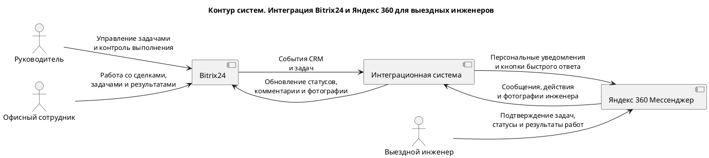
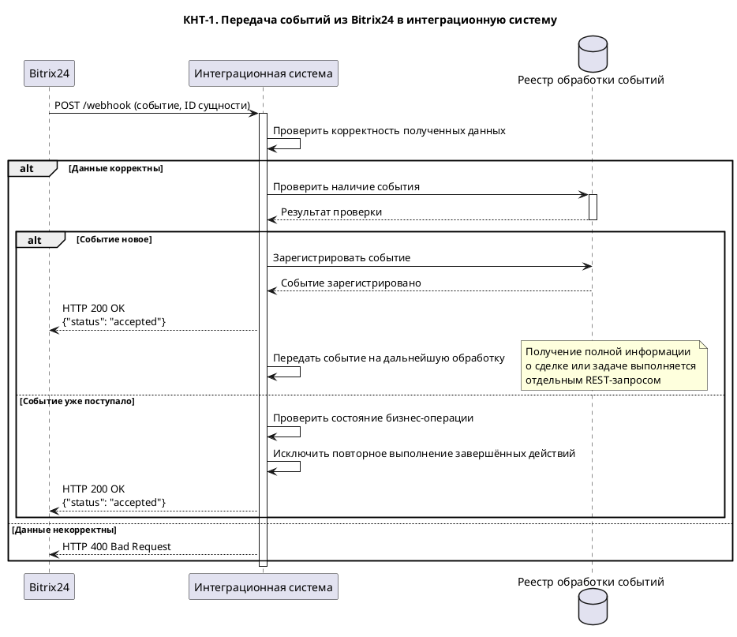
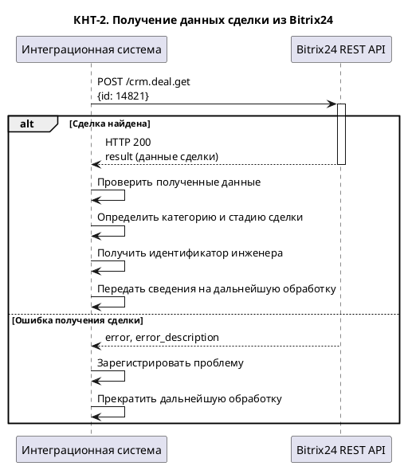
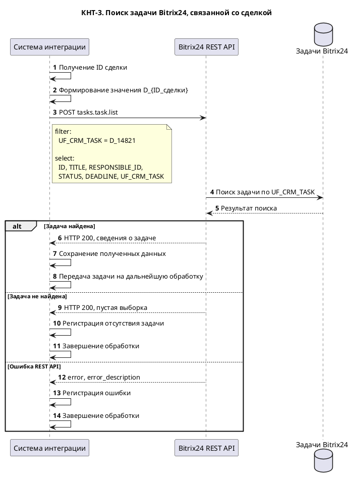
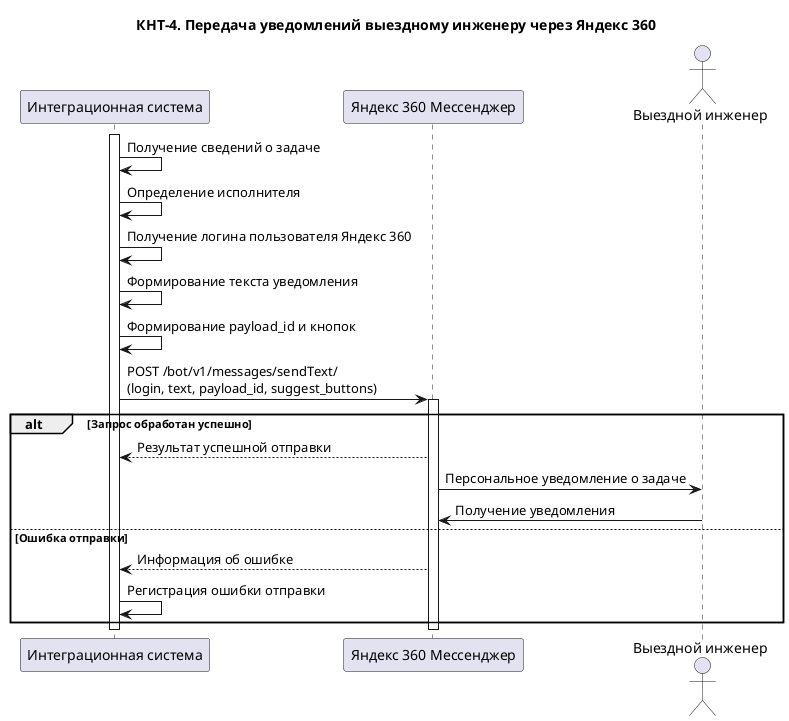
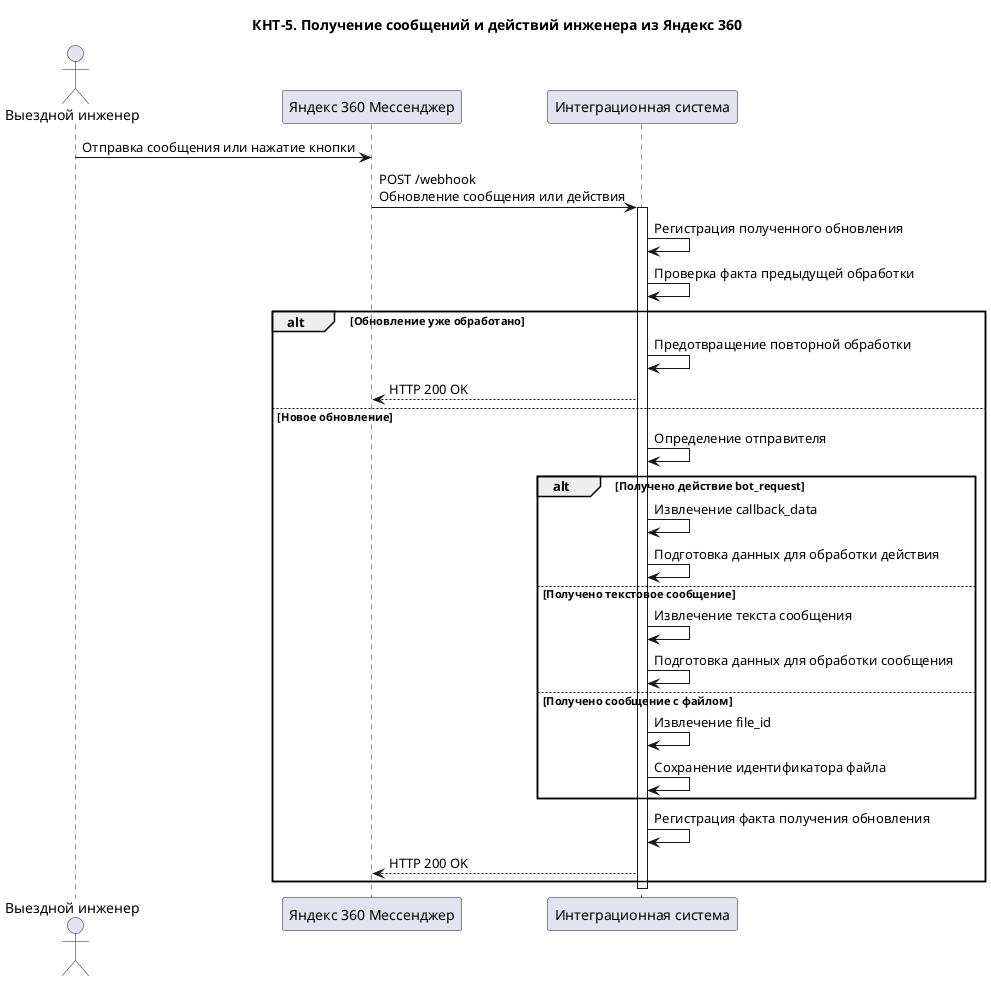
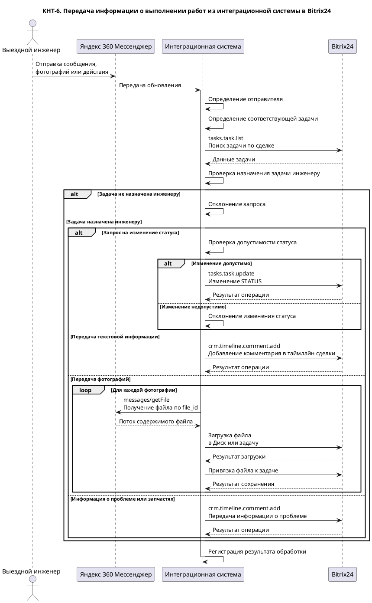

| Поле | Значение |
|---|---|
| Проект | Интеграция Bitrix24 и Яндекс 360 для выездных инженеров |
| Индустриальный партнёр | Служба поддержки ООО «РИАТПО-Сервис» |
| Версия документа | `v0.1-draft` |
| Дата | 2026-11-27 |
| Авторы | Жданов Роман Геннадьевич, Манукян Нарек Вагаршакович |

Диаграмма контура систем представлена в файле `diagrams/landscape.puml`.



## 1. Нефункциональные требования

| ID | Категория ISO/IEC 25010 | Требование | Метрика | Условия измерения | Связанные ФТ |
|----|-------------------------|------------|---------|-------------------|--------------|
| НФТ-1 | Эффективность производительности | Система должна обеспечивать своевременную передачу текстовой информации и уведомлений между Bitrix24 и Яндекс 360. | Время передачи - не более 30 секунд. | Измеряется время от получения интеграционной системой исходного события до успешной отправки соответствующего сообщения. Проверяется при штатной работе интеграции. | ФТ-1.1–ФТ-1.7, ФТ-2.4, ФТ-3.1–ФТ-3.5, ФТ-5.1–ФТ-5.5 |
| НФТ-2 | Эффективность производительности | Система должна обеспечивать обработку и передачу фотографий между Яндекс 360 и Bitrix24 без существенного увеличения времени обмена данными. | Передача одной фотографии размером до 10 МБ - не более 60 секунд. | Измеряется время от получения фотографии интеграционной системой до её успешного сохранения в соответствующей задаче Bitrix24. Проверяется при штатной работе интеграции. | ФТ-4.1–ФТ-4.5 |
| НФТ-3 | Надёжность | Система должна обеспечивать сохранность данных при обработке и передаче информации между Bitrix24 и Яндекс 360, исключая потерю подтверждённых операций обмена. | Все подтверждённые операции обмена должны завершаться без потери данных. | Проверяется путём моделирования обработки и передачи данных, включая повторное получение событий и временные сбои взаимодействия систем. | ФТ-1.1–ФТ-5.5, ФТ-7.1–ФТ-7.6 |
| НФТ-4 | Надёжность | Система должна обеспечивать целостность данных при передаче информации между Bitrix24 и Яндекс 360, исключая непредусмотренное изменение содержимого передаваемых данных. | Переданные данные должны соответствовать исходным данным. | Проверяется сравнением данных до и после передачи между системами. | ФТ-1.1–ФТ-5.5 |
| НФТ-5 | Надёжность | Система должна обеспечивать устойчивость обмена данными при временной недоступности Bitrix24 или Яндекс 360. | Временная недоступность одного из сервисов не должна приводить к безвозвратной потере данных. | Проверяется моделированием временной недоступности одного из сервисов и последующим восстановлением обмена данными. | ФТ-1.1–ФТ-5.5, ФТ-7.1–ФТ-7.6 |
| НФТ-6 | Защищённость | Система должна обеспечивать конфиденциальность информации, передаваемой между Bitrix24 и Яндекс 360, при взаимодействии участников рабочего процесса. | Передаваемая информация не должна быть доступна неуполномоченным лицам. | Проверяется анализом настроек доступа и механизмов защиты данных. | ФТ-1.1–ФТ-7.6 |
| НФТ-7 | Защищённость | Система должна обеспечивать защиту передаваемой информации от несанкционированного изменения в процессе обмена между Bitrix24 и Яндекс 360. | Не допускается незаметное изменение передаваемых данных. | Проверяется испытаниями механизмов контроля целостности. | ФТ-1.1–ФТ-7.6 |
| НФТ-8 | Совместимость | Интеграция должна обеспечивать корректное взаимодействие с используемыми версиями Bitrix24 и Яндекс 360 без нарушения предусмотренного обмена данными. | Все предусмотренные сценарии взаимодействия должны успешно выполняться на согласованных версиях сервисов. | Проверяется интеграционным тестированием на используемых версиях Bitrix24 и Яндекс 360. | ФТ-1.1–ФТ-5.5, ФТ-7.1–ФТ-7.6 |
| НФТ-9 | Совместимость | Интеграция должна обеспечивать совместимость с существующими процессами обработки задач в Bitrix24 без нарушения их штатной работы. | Все проверяемые основные бизнес-сценарии должны выполняться без нарушения существующего порядка обработки задач. | Проверяется тестированием основных сценариев работы с задачами в Bitrix24 до и после подключения интеграции. | ФТ-1.1–ФТ-7.6 |
| НФТ-10 | Удобство использования | Система должна обеспечивать удобство взаимодействия между офисными сотрудниками и выездными инженерами за счёт минимизации необходимости ручной передачи информации при выполнении рабочих процессов. | Не менее 90% предусмотренной информации должно передаваться без ручного участия офисных сотрудников. | Проверяется анализом предусмотренных процессов передачи информации и определением доли операций, выполняемых без ручного участия офисных сотрудников. | ФТ-1.1–ФТ-5.5 |
| НФТ-11 | Сопровождаемость | Система должна обеспечивать возможность диагностики неисправностей интеграции и определения причин возникновения ошибок при обмене данными. | Информация о возникающих ошибках должна быть достаточной для определения их причин. | Проверяется моделированием типовых ошибок и последующей диагностикой. | ФТ-7.1–ФТ-7.6 |

## 2. Группы из названия работы

| Группа | Связанные требования и материалы | Описание |
|---|---|---|
| Аутентификация | ФТ-6.1, технические материалы Bitrix24 и Яндекс 360 | Используется авторизация взаимодействия систем через OAuth-токен Яндекс 360 и секрет входящего вебхука Bitrix24. Отправитель сообщения инженера определяется по учётной записи Яндекс 360. |
| Авторизация | ФТ-6.1–ФТ-6.7 | Система проверяет личность инженера, назначение задачи и допустимость изменения её статуса. Изменение стадий CRM инженером запрещено. |
| Структуры хранения | ФТ-2.2, ФТ-4.1–ФТ-4.5, ФТ-7.2–ФТ-7.5 | Bitrix24 остаётся основной системой хранения задач и результатов работ. Предусмотрена фиксация подтверждений, фотографий и фактов обработки событий. |
| Политики защиты | НФТ-6, НФТ-7 | Обеспечиваются конфиденциальность и целостность передаваемых данных. Пароли запрещено передавать через Яндекс 360. Коды доступа разрешено передавать только в личном чате или по телефону. |
| Развёртывание | Технический материал «Белый список и ограничения доступа» | Интеграционный сервер должен иметь сетевой доступ к Bitrix24 и Яндекс 360. Адреса для получения вебхука должны быть доступны соответствующим внешним сервисам. |
| Эксплуатация | НФТ-3, НФТ-5, НФТ-11; ФТ-7.6 | Предусмотрены сохранность данных при сбоях, восстановление обмена после временной недоступности сервисов и регистрация проблем интеграции. |
| Протоколы | Технические материалы Bitrix24 REST и Яндекс 360 Bot API | Для взаимодействия используются HTTPS, REST API, JSON и webhook. Для получения обновлений Яндекс 360 предусмотрены webhook или polling. |
| Потоки данных | НФТ-1–НФТ-5 | Обеспечивается передача назначенных задач, уведомлений, подтверждений, статусов, результатов выполнения работ и фотографий между Bitrix24 и Яндекс 360. |
| Балансировка нагрузки | Вне рамок проекта | В материалах проекта не предусмотрена необходимость распределения нагрузки между несколькими экземплярами интеграционного сервиса. |

## 3. Матрица трассировки

| ID | Тип | Источник | Связанные ФТ | Связанные НФТ | Приоритет | Критерий приёмки |
|---|---|---|---|---|---|---|
| US-1 | Пользовательское | Выездной инженер | ФТ-1.1–ФТ-1.7 | НФТ-1, НФТ-3, НФТ-4, НФТ-5, НФТ-6, НФТ-7, НФТ-8, НФТ-9, НФТ-10 | Must | Передача текстовой информации и уведомлений выполняется не более чем за 30 секунд. Не менее 90% предусмотренной информации передаётся без ручного участия офисных сотрудников. |
| US-2 | Пользовательское | Выездной инженер; Руководитель бизнес-процесса | ФТ-2.1–ФТ-2.6, ФТ-7.1–ФТ-7.6 | НФТ-1, НФТ-3, НФТ-5, НФТ-6, НФТ-7, НФТ-8, НФТ-11 | Must | Подтверждение получения задачи обрабатывается без потери данных. При отсутствии подтверждения выполняется повторное уведомление через один час, а после его отсутствия информируется руководство. |
| US-3 | Пользовательское | Выездной инженер; Офисные сотрудники | ФТ-3.1–ФТ-3.5, ФТ-6.1–ФТ-6.7, ФТ-7.1–ФТ-7.6 | НФТ-1, НФТ-3, НФТ-4, НФТ-5, НФТ-6, НФТ-7, НФТ-8, НФТ-9, НФТ-10 | Must | Информация о ходе и результате выполнения работ передаётся в соответствующую задачу Bitrix24 без непредусмотренного изменения данных. |
| US-4 | Пользовательское | Выездной инженер; Офисные сотрудники | ФТ-4.1–ФТ-4.5, ФТ-7.1–ФТ-7.6 | НФТ-2, НФТ-3, НФТ-4, НФТ-5, НФТ-6, НФТ-7, НФТ-8, НФТ-9, НФТ-10 | Must | Фотография размером до 10 МБ передаётся и сохраняется в соответствующей задаче Bitrix24 не более чем за 60 секунд. |
| US-5 | Пользовательское | Выездной инженер; Руководитель бизнес-процесса | ФТ-5.1–ФТ-5.5, ФТ-7.1–ФТ-7.6 | НФТ-1, НФТ-3, НФТ-4, НФТ-5, НФТ-6, НФТ-7, НФТ-8, НФТ-9, НФТ-10, НФТ-11 | Must | Сообщения о невозможности выполнения работ и необходимости запчастей передаются ответственным офисным сотрудникам без потери и непредусмотренного изменения данных. |
| US-6 | Пользовательское | Администратор Bitrix24; Выездной инженер | ФТ-6.1–ФТ-6.7 | НФТ-6, НФТ-7, НФТ-8, НФТ-9 | Must | Инженер может изменять статус только назначенной ему задачи и не может самостоятельно изменять стадии CRM. |
| US-7 | Пользовательское | Разработчик | ФТ-7.1–ФТ-7.6 | НФТ-3, НФТ-4, НФТ-5, НФТ-7, НФТ-11 | Must | Повторное получение обработанного события не приводит к повторному выполнению операций. Ошибки, связанные с обработкой событий, регистрируются и позволяют определить причину сбоя. |

## 4. Приоритеты нефункциональных требований (MoSCoW)

| ID НФТ | Требование | Приоритет | Обоснование |
|---|---|---|---|
| НФТ-1 | Своевременная передача текстовой информации и уведомлений между Bitrix24 и Яндекс 360. | Must | Задержки уведомлений могут нарушить взаимодействие офисных сотрудников и выездных инженеров. |
| НФТ-2 | Обработка и передача фотографий между Яндекс 360 и Bitrix24 в установленные сроки. | Must | Фотографии являются частью отчётности о выполненных работах. |
| НФТ-3 | Сохранность данных при обработке и передаче информации. | Must | Потеря подтверждённых операций может привести к нарушению учёта задач и результатов работ. |
| НФТ-4 | Обеспечение целостности передаваемых данных. | Must | Изменение данных может привести к некорректному отображению информации о задачах и выполненных работах. |
| НФТ-5 | Устойчивость обмена данными при временной недоступности сервисов. | Must | Интеграция должна сохранять возможность завершения обмена после восстановления доступности сервисов. |
| НФТ-6 | Обеспечение конфиденциальности передаваемой информации. | Must | Передаваемые сведения не должны становиться доступными неуполномоченным лицам. |
| НФТ-7 | Защита передаваемой информации от несанкционированного изменения. | Must | Необходимо исключить возможность незаметного изменения данных при обмене между системами. |
| НФТ-8 | Совместимость с используемыми версиями Bitrix24 и Яндекс 360. | Must | Без корректного взаимодействия с обеими системами интеграция не сможет выполнять своё основное назначение. |
| НФТ-9 | Совместимость с существующими процессами обработки задач в Bitrix24. | Must | Интеграция не должна нарушать действующие процессы обработки задач и CRM. |
| НФТ-10 | Минимизация необходимости ручного участия офисных сотрудников при передаче информации. | Should | Высокая степень автоматизации повышает эффективность работы, однако базовый обмен данными возможен и при частичном ручном участии. |
| НФТ-11 | Обеспечение возможности диагностики неисправностей интеграции. | Should | Диагностика упрощает сопровождение системы, но не является непосредственным условием выполнения основных пользовательских сценариев. |

## 5. Критерии приёмки 

| ID НФТ | Given | When | Then |
|---|---|---|---|
| НФТ-1 | Интеграционная система работает в штатном режиме и получает событие от одной из систем. | Система обрабатывает событие и отправляет соответствующее текстовое сообщение. | Сообщение успешно отправляется не более чем за 30 секунд с момента получения исходного события. |
| НФТ-2 | Интеграционная система получает фотографию размером до 10 МБ. | Система обрабатывает фотографию и передаёт её в Bitrix24. | Фотография успешно сохраняется в соответствующей задаче не более чем за 60 секунд. |
| НФТ-3 | Интеграционная система получила подтверждённое событие. | Происходит повторное получение события или временный сбой взаимодействия систем. | Подтверждённая операция не теряется и не приводит к потере данных. |
| НФТ-4 | В интеграционную систему поступают исходные данные для передачи. | Данные передаются между Bitrix24 и Яндекс 360. | Полученные данные соответствуют исходным и не содержат непредусмотренных изменений. |
| НФТ-5 | Bitrix24 или Яндекс 360 временно недоступны. | Интеграционная система пытается выполнить обмен данными, а затем восстанавливает взаимодействие после устранения сбоя. | Данные не теряются безвозвратно, обмен возобновляется после восстановления доступности сервиса. |
| НФТ-6 | Пользователь или внешний участник не имеет полномочий на получение передаваемой информации. | Предпринимается попытка получить доступ к информации. | Доступ к информации не предоставляется неуполномоченному лицу. |
| НФТ-7 | Данные передаются между Bitrix24 и Яндекс 360. | Предпринимается попытка несанкционированного изменения передаваемых данных. | Интеграционная система отклоняет изменённые данные и не передаёт их в целевую систему. |
| НФТ-8 | Интеграционная система настроена для работы с согласованными версиями Bitrix24 и Яндекс 360. | Выполняются предусмотренные сценарии взаимодействия систем. | Все проверяемые сценарии выполняются корректно. |
| НФТ-9 | Интеграция подключена к Bitrix24 с существующими процессами обработки задач. | Инженер выполняет предусмотренные действия с назначенной ему задачей через Яндекс 360. | Действующие процессы обработки задач сохраняются, стадии CRM не изменяются инженером. |
| НФТ-10 | Выполняются предусмотренные проектом процессы передачи информации между офисными сотрудниками и инженерами. | Система обрабатывает и передаёт информацию в рамках этих процессов. | Не менее 90% предусмотренных операций передачи информации выполняются без ручного участия офисных сотрудников. |
| НФТ-11 | В процессе работы интеграционной системы возникает ошибка. | Ошибка регистрируется в системе журналирования. | В журнале сохраняется информация, достаточная для определения причины возникновения ошибки. |

## 6. Две оценки

Для каждого нефункционального требования определены две оценки: функциональный размер связанных функциональных требований (FP) и относительная трудоёмкость реализации самого нефункционального требования (Planning Poker Points).

Функциональные точки рассчитаны на основании оценок функциональных требований из лабораторной работы №3. 

Оценки Planning Poker являются предварительными и отражают предполагаемую трудоёмкость реализации соответствующих ограничений.

| ID | Связанные ФТ | Функциональные точки этих ФТ | Карты покера | Пользовательские поинты на реализацию | Что раздувает оценку |
|---|---|---:|---|---:|---|
| НФТ-1 | ФТ-1.1–ФТ-1.7, ФТ-2.4, ФТ-3.1–ФТ-3.5, ФТ-5.1–ФТ-5.5 | 54 FP | 5, 8 | 8 | Обеспечение своевременной обработки событий, формирования и отправки сообщений через API двух систем. |
| НФТ-2 | ФТ-4.1–ФТ-4.5 | 13 FP | 5, 8 | 8 | Обработка фотографий, передача файлов размером до 10 МБ и контроль успешного сохранения в Bitrix24. |
| НФТ-3 | ФТ-1.1–ФТ-5.5, ФТ-7.1–ФТ-7.6 | 97 FP | 8, 13 | 13 | Обеспечение сохранности операций при сбоях, фиксация полученных событий и предотвращение потери данных. |
| НФТ-4 | ФТ-1.1–ФТ-5.5 | 85 FP | 5, 8 | 8 | Проверка корректности передаваемых данных и предотвращение их непредусмотренного изменения при обработке. |
| НФТ-5 | ФТ-1.1–ФТ-5.5, ФТ-7.1–ФТ-7.6 | 97 FP | 8, 13 | 13 | Обработка временной недоступности внешних сервисов, повторные попытки передачи и восстановление обмена. |
| НФТ-6 | ФТ-1.1–ФТ-7.6 | 112 FP | 8, 13 | 13 | Проверка полномочий участников, защита учётных данных и ограничение доступа к информации. |
| НФТ-7 | ФТ-1.1–ФТ-7.6 | 112 FP | 5, 8 | 8 | Обнаружение несанкционированного изменения данных и проверка их целостности при взаимодействии систем. |
| НФТ-8 | ФТ-1.1–ФТ-5.5, ФТ-7.1–ФТ-7.6 | 97 FP | 3, 5 | 5 | Проверка совместимости API и тестирование взаимодействия с согласованными версиями Bitrix24 и Яндекс 360. |
| НФТ-9 | ФТ-1.1–ФТ-7.6 | 112 FP | 3, 5 | 5 | Проверка совместимости интеграции с существующими процессами Bitrix24 и предотвращение нарушения порядка обработки задач. |
| НФТ-10 | ФТ-1.1–ФТ-5.5 | 85 FP | 3, 5 | 5 | Автоматизация передачи информации между офисными сотрудниками и инженерами, сокращение ручных операций. |
| НФТ-11 | ФТ-7.1–ФТ-7.6 | 12 FP | 5, 8 | 8 | Разработка механизма журналирования, сохранение сведений об ошибках и обеспечение возможности диагностики сбоев. |

## 7. Выводы

По результатам анализа нефункциональных требований определены ограничения, обязательные для реализации в ближайшем выпуске системы. К ним относятся НФТ-1–НФТ-9, которым присвоен приоритет Must. Данные требования обеспечивают необходимый уровень производительности, надёжности, безопасности и совместимости интеграции Bitrix24 и Яндекс 360.

Требования НФТ-10 и НФТ-11 имеют приоритет Should. Они направлены на повышение удобства взаимодействия офисных сотрудников и выездных инженеров, а также на упрощение диагностики и сопровождения интеграционной системы.

Согласно оценкам функциональных требований, обязательные нефункциональные ограничения охватывают все 41 функциональное требование проекта с общей оценкой 111 FP по транзакционным функциям. С учётом внутренних и внешних групп данных общий функциональный размер системы составляет 140 FP.

Сопоставление функциональных точек и пользовательских поинтов показывает, что трудоёмкость реализации нефункциональных требований не находится в прямой зависимости от охватываемого функционального объёма. Например, НФТ-2 охватывает 13 FP и оценивается в 8 пользовательских поинтов, тогда как НФТ-11 охватывает только 12 FP, но также требует 8 поинтов. При этом НФТ-3 и НФТ-5 охватывают по 96 FP и оцениваются в 13 поинтов каждое.

Таким образом, приоритетными для ближайшего выпуска являются требования, обеспечивающие корректный и безопасный обмен данными между Bitrix24 и Яндекс 360. Отдельное внимание при реализации следует уделить сохранности данных, устойчивости взаимодействия систем и контролю доступа. Оценки FP характеризуют функциональный объём затрагиваемых требований, а Planning Poker Points — относительную трудоёмкость реализации соответствующих ограничений.

## 8. Контракты взаимодействия

### 8.1. КНТ-1. Передача событий из Bitrix24 в интеграционную систему

**Назначение:** передача событий о создании и изменении сделок и задач Bitrix24 в интеграционную систему для последующей обработки.

#### 8.1.1. Участники взаимодействия

| Параметр | Значение |
|---|---|
| Поставщик | Bitrix24 |
| Потребитель | Интеграционная система |
| Инициатор | Bitrix24 |
| Получатель | Сервер интеграционной системы |
| Протокол | HTTPS |
| Метод передачи | POST |
| Формат данных | JSON |

#### 8.1.2. Требования и обязательства

Bitrix24 должен передавать события на URL интеграционной системы при возникновении предусмотренных событий CRM и задач.

Интеграционная система должна:
- принимать поступившие события;
- определять тип события и соответствующую сущность;
- проверять, обрабатывалось ли событие ранее;
- передавать новое событие на дальнейшую обработку;
- предотвращать повторное выполнение действий при повторной доставке одного события;
- регистрировать проблему, если невозможно определить факт предыдущей обработки.

Событие содержит идентификатор сущности, но не полную информацию о сделке или задаче. Для получения подробных сведений интеграционная система должна выполнить отдельный запрос к REST API Bitrix24.

#### 8.1.3. Поддерживаемые события

| Событие | Назначение |
|---|---|
| ONCRMDEALADD | Создание сделки |
| ONCRMDEALUPDATE | Изменение сделки |
| ONTASKADD | Создание задачи |
| ONTASKUPDATE | Изменение задачи |

В рамках проекта события используются для обнаружения назначения и переназначения задач, а также изменений связанных с выездом сделок.

Перечисленные события доступны для настройки в Bitrix24. Их фактическое подключение должно быть выполнено при настройке интеграции.

#### 8.1.4. Данные запроса

**Метод:** POST  
**Формат:** JSON

| Поле | Тип | Обязательность | Описание |
|---|---|---|---|
| Тип события | Строка | Да | Определяет вид произошедшего события |
| Идентификатор сущности | Числовой | Да | Идентификатор сделки или задачи, к которой относится событие |

#### 8.1.5. Данные ответа

После успешной регистрации поступившего события интеграционная система возвращает HTTP `200 OK`.

**Формат ответа:** JSON.

| Поле | Тип | Обязательность | Описание |
|---|---|---|---|
| status | Строка | Да | Результат приёма события. Значение `accepted` означает, что событие принято и зарегистрировано |

Пример успешного ответа:

```json
{
  "status": "accepted"
}
```

Если запрос содержит некорректные или недостаточные данные, интеграционная система возвращает HTTP `400 Bad Request`.

Если интеграционная система временно не может принять и зарегистрировать событие, возвращается HTTP `500 Internal Server Error`.

Успешный ответ означает, что событие надёжно зарегистрировано и принято в обработку. Завершение последующих операций с Bitrix24 и Яндекс 360 происходит отдельно.

#### 8.1.6. Предусловия

- В Bitrix24 настроена отправка предусмотренных событий.
- Для интеграционной системы определён URL обработчика событий.
- URL доступен из облачной инфраструктуры Bitrix24.
- Интеграционный сервер доступен для обработки входящих HTTPS-запросов.
- В интеграционной системе функционирует реестр обработки событий.

#### 8.1.7. Постусловия

**При успешном приёме события:**
- событие принято интеграционной системой;
- определены тип события и идентификатор соответствующей сущности;
- событие зарегистрировано в реестре обработки;
- событие передано на дальнейшую обработку;
- Bitrix24 получает ответ HTTP `200 OK`.

**При повторном получении события:**
- интеграционная система проверяет состояние соответствующей бизнес-операции;
- повторное выполнение уже завершённых действий не производится;
- событие не приводит к созданию дублирующих задач, комментариев или других операций.

**При некорректном запросе:**
- событие не передаётся на обработку;
- интеграционная система возвращает HTTP `400 Bad Request`.

**При невозможности зарегистрировать событие:**
- событие не считается принятым;
- информация о проблеме фиксируется в журнале;
- интеграционная система возвращает HTTP `500 Internal Server Error`.

#### 8.1.8. Связанные функциональные требования

| Требование | Связь с контрактом |
|---|---|
| ФТ-1.1 | Получение информации о создании задачи или назначении инженера в Bitrix24 |
| ФТ-7.1 | Получение события от внешней системы |
| ФТ-7.2 | Проверка факта предыдущей обработки события |
| ФТ-7.4 | Фиксация факта успешной обработки события |
| ФТ-7.5 | Предотвращение повторного выполнения действий |
| ФТ-7.6 | Регистрация проблемы при возникновении ошибки обработки |

#### 8.1.9. Сценарии GWT

**Сценарий 1. Получение нового события**

- **Given:** Bitrix24 сформировал событие о создании или изменении сделки либо задачи, а URL интеграционной системы доступен.
- **When:** Bitrix24 отправляет событие методом POST.
- **Then:** интеграционная система принимает уведомление, определяет тип события и идентификатор сущности, регистрирует событие в реестре и передаёт его на дальнейшую обработку. Bitrix24 получает ответ HTTP `200 OK`.

**Сценарий 2. Повторное получение события**

- **Given:** интеграционная система ранее получила событие и выполнила связанные с ним бизнес-операции.
- **When:** Bitrix24 повторно отправляет уведомление о том же событии.
- **Then:** интеграционная система проверяет состояние соответствующей бизнес-операции и не выполняет уже завершённые действия повторно. Bitrix24 получает ответ HTTP `200 OK`.

#### 8.1.10. Диаграмма последовательности



### 8.2. КНТ-2. Получение данных сделки из Bitrix24

**Назначение:** получение полной информации о сделке из Bitrix24 для определения её текущего состояния, назначенного выездного инженера и сведений, необходимых для организации выезда.

#### 8.2.1. Участники взаимодействия

| Параметр | Значение |
|---|---|
| Поставщик | Bitrix24 |
| Потребитель | Интеграционная система |
| Инициатор | Интеграционная система |
| Получатель | REST API Bitrix24 |
| Протокол | HTTPS |
| Метод передачи | POST |
| Формат данных | JSON |
| Операция | `crm.deal.get` |

#### 8.2.2. Требования и обязательства

Интеграционная система должна получать полную информацию о сделке из Bitrix24 по её идентификатору после получения соответствующего события.

Для получения данных используется метод `crm.deal.get`.

Интеграционная система должна:
- передавать идентификатор сделки в запросе;
- получать данные карточки сделки;
- проверять принадлежность сделки к категории выездного обслуживания C12;
- определять текущую стадию сделки;
- получать идентификатор назначенного выездного инженера;
- получать сведения об объекте, адресе, сроках выполнения и характере работ;
- использовать полученные данные для формирования уведомления инженеру и дальнейшей обработки выезда;
- регистрировать ошибки, возникающие при получении данных.

Идентификатор выездного инженера хранится в поле `UF_CRM_12_ENGINEER`. Для определения соответствующего логина Яндекс 360 интеграционная система использует отдельный справочник сопоставления пользователей.

Поле `ASSIGNED_BY_ID` содержит идентификатор ответственного сотрудника Bitrix24 и не должно использоваться вместо идентификатора выездного инженера.

#### 8.2.3. Поддерживаемая операция

| Операция | Назначение |
|---|---|
| `crm.deal.get` | Получение полной информации о сделке по её идентификатору |

Операция используется после получения события от Bitrix24, содержащего идентификатор сделки.

Получение данных сделки не изменяет её состояние и не запускает дополнительные действия в CRM.

#### 8.2.4. Данные запроса

**Метод:** POST  
**Адрес:** `https://riatpo-service.bitrix24.ru/rest/1/<секрет>/crm.deal.get`  
**Формат:** JSON

| Поле | Тип | Обязательность | Описание |
|---|---|---|---|
| id | Числовой | Да | Идентификатор сделки, данные которой необходимо получить |

Пример запроса:

```json
{
  "id": 14821
}
```

Авторизация выполняется с использованием входящего вебхука Bitrix24 с правами чтения CRM. Секрет вебхука хранится в защищённых настройках интеграционной системы и не включается в исходный код проекта.

#### 8.2.5. Данные ответа

При успешном выполнении операции Bitrix24 возвращает объект `result`, содержащий данные карточки сделки.

Интеграционная система использует следующие поля:

| Поле | Тип | Обязательность | Описание |
|---|---|---|---|
| `ID` | Строка | Да | Идентификатор сделки |
| `TITLE` | Строка | Да | Название сделки |
| `CATEGORY_ID` | Строка | Да | Идентификатор категории сделки |
| `STAGE_ID` | Строка | Да | Текущая стадия сделки |
| `ASSIGNED_BY_ID` | Строка | Да | Идентификатор ответственного сотрудника линии |
| `UF_CRM_12_ENGINEER` | Строка | Да | Идентификатор назначенного выездного инженера |
| `UF_CRM_12_ADDRESS` | Строка | Да | Адрес объекта |
| `UF_CRM_12_SLOT` | Строка | Да | Временной интервал проведения работ |
| `UF_CRM_12_ONSITE` | Строка | Да | Контактное лицо на объекте |
| `UF_CRM_12_SYMPTOM` | Строка | Да | Описание проблемы и необходимых работ |
| `UF_CRM_12_PARTS` | Строка | Нет | Сведения о необходимых запчастях |
| `UF_CRM_12_INV` | Строка | Нет | Инвентарный или серийный номер оборудования |
| `UF_CRM_12_SLA` | Дата и время | Да | Срок выполнения работ по SLA |
| `UF_CRM_12_OBJTYPE` | Строка | Да | Тип обслуживаемого объекта |
| `UF_CRM_12_ACCESS` | Строка | Нет | Код доступа к объекту |

Пример успешного ответа:

```json
{
  "result": {
    "ID": "14821",
    "TITLE": "ТЦ Горизонт — касса не фискалит",
    "CATEGORY_ID": "12",
    "STAGE_ID": "C12:VISIT",
    "ASSIGNED_BY_ID": "12",
    "UF_CRM_12_ENGINEER": "31",
    "UF_CRM_12_ADDRESS": "ул. Советская 18, пав. 12",
    "UF_CRM_12_SLOT": "07.09 09:00–18:00",
    "UF_CRM_12_ONSITE": "Администратор объекта",
    "UF_CRM_12_SYMPTOM": "Касса не фискалит",
    "UF_CRM_12_PARTS": "Плата ФР",
    "UF_CRM_12_INV": "КС-4412",
    "UF_CRM_12_SLA": "2026-09-07T18:00:00+03:00",
    "UF_CRM_12_OBJTYPE": "Касса"
  }
}
```

Поле `UF_CRM_12_ACCESS` обрабатывается отдельно с учётом ограничений доступа. Код доступа не должен передаваться в обычном уведомлении инженеру или размещаться в общедоступном комментарии таймлайна сделки.

При возникновении ошибки Bitrix24 возвращает объект с полями `error` и `error_description`.

Пример ответа с ошибкой:

```json
{
  "error": "ERROR_NOT_FOUND",
  "error_description": "Not found"
}
```

#### 8.2.6. Предусловия

- Интеграционная система получила событие Bitrix24 с идентификатором сделки.
- Сделка существует в Bitrix24.
- Интеграционный сервер имеет доступ к REST API Bitrix24.
- Для входящего вебхука настроены необходимые права чтения CRM.
- Интеграционная система располагает справочником сопоставления идентификаторов пользователей Bitrix24 и логинов Яндекс 360.

#### 8.2.7. Постусловия

**При успешном получении данных:**
- интеграционная система получила карточку сделки;
- определены категория и текущая стадия сделки;
- получен идентификатор назначенного выездного инженера;
- получены необходимые сведения об объекте и предстоящих работах;
- данные переданы на дальнейшую обработку.

**При получении сделки другой категории:**
- интеграционная система определяет, что сделка не относится к категории выездного обслуживания C12;
- дальнейшая обработка по сценарию выездного обслуживания не выполняется.

**При ошибке получения данных:**
- интеграционная система получает информацию об ошибке Bitrix24;
- сведения об ошибке регистрируются в журнале;
- уведомление инженеру на основании неполных данных не формируется.

#### 8.2.8. Связанные функциональные требования

| Требование | Связь с контрактом |
|---|---|
| ФТ-1 | Получение и передача инженеру информации о выездной задаче |
| ФТ-3 | Использование данных сделки при обработке статусов и результатов работ |
| ФТ-6 | Соблюдение ограничений доступа к данным сделки |
| ФТ-7.1 | Получение события от внешней системы |
| ФТ-7.3 | Получение и использование данных внешней системы |
| ФТ-7.6 | Регистрация проблемы при возникновении ошибки обработки |

#### 8.2.9. Сценарии GWT

**Сценарий 1. Успешное получение данных сделки**

- **Given:** интеграционная система получила событие Bitrix24 с идентификатором существующей сделки категории C12.
- **When:** интеграционная система отправляет запрос `crm.deal.get` с идентификатором этой сделки.
- **Then:** Bitrix24 возвращает данные сделки, включая текущую стадию, идентификатор выездного инженера и сведения об объекте, а интеграционная система передаёт полученные данные на дальнейшую обработку.

**Сценарий 2. Ошибка при получении данных сделки**

- **Given:** интеграционная система получила событие с идентификатором сделки, которую невозможно получить через REST API Bitrix24.
- **When:** интеграционная система выполняет запрос `crm.deal.get`.
- **Then:** Bitrix24 возвращает информацию об ошибке, интеграционная система регистрирует проблему и не формирует уведомление инженеру на основании неполных данных.

#### 8.2.10. Диаграмма последовательности




### 8.3. КНТ-3. Поиск задачи Bitrix24, связанной со сделкой

**Назначение:** Контракт определяет порядок взаимодействия системы интеграции с REST API Bitrix24 для поиска задачи, связанной с конкретной сделкой. 

#### 8.3.1. Участники взаимодействия

| Участник | Роль |
|---|---|
| Система интеграции | Инициатор запроса на поиск задачи |
| Bitrix24 REST API | Получатель запроса и поставщик данных о найденных задачах |
| Задачи Bitrix24 | Источник сведений о задачах, связанных со сделками |

**Способ взаимодействия:**
- Протокол: HTTPS.
- Метод: POST.
- Формат данных: JSON.
- Метод REST API: `tasks.task.list`.
- Авторизация: входящий вебхук Bitrix24 с правами `task`.

#### 8.3.2. Требования и обязательства

1. Система интеграции должна выполнять поиск задачи Bitrix24 по идентификатору связанной сделки.
2. Для поиска должна использоваться привязка задачи к сделке через поле `UF_CRM_TASK`.
3. Идентификатор сделки должен передаваться в формате `D_{ID_сделки}`. 
4. Система должна запрашивать сведения, необходимые для определения найденной задачи и её дальнейшей обработки:
   - идентификатор задачи;
   - название задачи;
   - идентификатор ответственного исполнителя;
   - статус задачи;
   - срок выполнения;
   - привязку к сделке.
5. Система должна использовать полученные сведения для определения соответствующей задачи при обработке сообщений и других данных от инженера.
6. Если задача не найдена, система не должна выполнять дальнейшие действия над другой задачей или произвольно выбирать задачу.
7. При возникновении ошибки REST API система должна зарегистрировать проблему и прекратить обработку запроса.
8. Запрос должен выполняться интеграционным сервером, имеющим доступ к Bitrix24. Телефон инженера непосредственно к REST API Bitrix24 не обращается.

#### 8.3.3. Поддерживаемые события и операции

| Тип | Операция | Назначение |
|---|---|---|
| REST API | `tasks.task.list` | Поиск задачи по значению поля `UF_CRM_TASK` и получение выбранных полей найденной задачи |

Операция используется для определения задачи, связанной с конкретной сделкой Bitrix24.

#### 8.3.4. Данные запроса

**Точка вызова:**

`POST https://riatpo-service.bitrix24.ru/rest/1/<секрет>/tasks.task.list`

**Тело запроса:**

```json
{
  "filter": {
    "UF_CRM_TASK": "D_14821"
  },
  "select": [
    "ID",
    "TITLE",
    "RESPONSIBLE_ID",
    "STATUS",
    "DEADLINE",
    "UF_CRM_TASK"
  ]
}
```

| Параметр | Тип данных | Обязательность | Назначение |
|---|---|---|---|
| `filter` | Объект | Да | Условия поиска задачи |
| `filter.UF_CRM_TASK` | Строка | Да | Привязка задачи к сделке в формате `D_{ID_сделки}` |
| `select` | Массив строк | Да | Перечень полей задачи, которые необходимо получить |
| `select.ID` | Строка | Да | Идентификатор задачи |
| `select.TITLE` | Строка | Да | Название задачи |
| `select.RESPONSIBLE_ID` | Строка | Да | Идентификатор ответственного исполнителя |
| `select.STATUS` | Строка | Да | Текущий статус задачи |
| `select.DEADLINE` | Строка | Да | Срок выполнения задачи |
| `select.UF_CRM_TASK` | Строка | Да | Привязка задачи к сделке |


### 8.3. КНТ-3. Поиск задачи Bitrix24, связанной со сделкой

**Назначение**

Контракт определяет порядок взаимодействия системы интеграции с REST API Bitrix24 для поиска задачи, связанной с конкретной сделкой. Поиск выполняется с использованием метода `tasks.task.list` и поля `UF_CRM_TASK`. Полученные сведения о задаче используются системой интеграции для дальнейшей обработки информации, поступающей от выездного инженера.

#### 8.3.1. Участники взаимодействия

| Участник | Роль |
|---|---|
| Система интеграции | Инициатор запроса на поиск задачи |
| Bitrix24 REST API | Получатель запроса и поставщик данных о найденных задачах |
| Задачи Bitrix24 | Источник сведений о задачах, связанных со сделками |

**Способ взаимодействия:**
- Протокол: HTTPS.
- Метод: POST.
- Формат данных: JSON.
- Метод REST API: `tasks.task.list`.
- Авторизация: входящий вебхук Bitrix24 с правами `task`.

#### 8.3.2. Требования и обязательства

1. Система интеграции должна выполнять поиск задачи Bitrix24 по идентификатору связанной сделки.
2. Для поиска должна использоваться привязка задачи к сделке через поле `UF_CRM_TASK`.
3. Идентификатор сделки должен передаваться в формате `D_{ID_сделки}`. Например, для сделки с ID `14821` значение привязки — `D_14821`.
4. Система должна запрашивать сведения, необходимые для определения найденной задачи и её дальнейшей обработки:
   - идентификатор задачи;
   - название задачи;
   - идентификатор ответственного исполнителя;
   - статус задачи;
   - срок выполнения;
   - привязку к сделке.
5. Система должна использовать полученные сведения для определения соответствующей задачи при обработке сообщений и других данных от инженера.
6. Если задача не найдена, система не должна выполнять дальнейшие действия над другой задачей или произвольно выбирать задачу.
7. При возникновении ошибки REST API система должна зарегистрировать проблему и прекратить обработку запроса.
8. Запрос должен выполняться интеграционным сервером, имеющим доступ к Bitrix24. Телефон инженера непосредственно к REST API Bitrix24 не обращается.

#### 8.3.3. Поддерживаемые события и операции

| Тип | Операция | Назначение |
|---|---|---|
| REST API | `tasks.task.list` | Поиск задачи по значению поля `UF_CRM_TASK` и получение выбранных полей найденной задачи |

Операция используется для определения задачи, связанной с конкретной сделкой Bitrix24.

#### 8.3.4. Данные запроса

**Точка вызова:**

`POST https://riatpo-service.bitrix24.ru/rest/1/<секрет>/tasks.task.list`

**Тело запроса:**

```json
{
  "filter": {
    "UF_CRM_TASK": "D_14821"
  },
  "select": [
    "ID",
    "TITLE",
    "RESPONSIBLE_ID",
    "STATUS",
    "DEADLINE",
    "UF_CRM_TASK"
  ]
}
```

| Параметр | Тип данных | Обязательность | Назначение |
|---|---|---|---|
| `filter` | Объект | Да | Условия поиска задачи |
| `filter.UF_CRM_TASK` | Строка | Да | Привязка задачи к сделке в формате `D_{ID_сделки}` |
| `select` | Массив строк | Да | Перечень полей задачи, которые необходимо получить |
| `select.ID` | Строка | Да | Идентификатор задачи |
| `select.TITLE` | Строка | Да | Название задачи |
| `select.RESPONSIBLE_ID` | Строка | Да | Идентификатор ответственного исполнителя |
| `select.STATUS` | Строка | Да | Текущий статус задачи |
| `select.DEADLINE` | Строка | Да | Срок выполнения задачи |
| `select.UF_CRM_TASK` | Строка | Да | Привязка задачи к сделке |

#### 8.3.5. Данные ответа

В случае успешного выполнения запроса Bitrix24 возвращает HTTP `200`, при этом поле `error` отсутствует.

Результат поиска содержит сведения о найденной задаче в соответствии с перечнем полей, указанным в параметре `select`.

Система интеграции использует следующие данные найденной задачи:

| Поле | Тип данных | Назначение |
|---|---|---|
| `ID` | Число | Идентификатор задачи |
| `TITLE` | Строка | Название задачи |
| `RESPONSIBLE_ID` | Число | Идентификатор ответственного исполнителя |
| `STATUS` | Число | Текущий статус задачи |
| `DEADLINE` | Строка | Срок выполнения задачи |
| `UF_CRM_TASK` | Массив строк | Привязка задачи к сделке |

**Возможные результаты выполнения запроса:**

| Условие | Результат |
|---|---|
| Задача найдена | Система получает сведения о найденной задаче |
| Задача не найдена | Система получает пустую выборку и фиксирует отсутствие связанной задачи |
| Ошибка REST API | Bitrix24 возвращает объект с полями `error` и `error_description` |

Пример структуры ответа при ошибке:

```json
{
  "error": "ERROR_NOT_FOUND",
  "error_description": "Not found"
}
```

#### 8.3.6. Предусловия

1. Система интеграции получила идентификатор сделки Bitrix24, для которой необходимо найти связанную задачу.
2. В Bitrix24 существует сделка с указанным идентификатором.
3. Робот Bitrix24 создал задачу для соответствующей сделки.
4. Задача содержит привязку к сделке в поле `UF_CRM_TASK`.
5. Интеграционный сервер имеет сетевой доступ к REST API Bitrix24.
6. Для входящего вебхука настроены необходимые права доступа к задачам (`task`).
7. Секрет входящего вебхука хранится в защищённой конфигурации системы интеграции.

#### 8.3.7. Постусловия

**При успешном выполнении:**
- Система интеграции получает сведения о задаче, связанной с указанной сделкой.
- Идентификатор задачи и данные об ответственном исполнителе доступны для дальнейшей обработки.
- Система может использовать найденную задачу для сопоставления с сообщением инженера.

**Если задача не найдена:**
- Система фиксирует отсутствие связанной задачи.
- Дальнейшие действия, требующие идентификатора задачи, не выполняются.
- Ситуация передаётся на дальнейшую обработку.

**При ошибке запроса:**
- Система регистрирует сведения об ошибке.
- Полученные некорректные или неполные данные не используются для выполнения дальнейших операций.
- Обработка запроса завершается.

#### 8.3.8. Связанные функциональные требования

Контракт обеспечивает получение сведений о задаче Bitrix24, необходимых для выполнения функциональных требований, связанных с обработкой информации о ходе и результате выездных работ, фотографий и других данных, поступающих от инженера.

#### 8.3.9. Сценарии GWT

**Сценарий 1. Успешный поиск задачи по сделке**

Given: Система интеграции получила идентификатор сделки Bitrix24, для которой необходимо найти связанную задачу, и задача создана роботом портала.

When: Система выполняет запрос `tasks.task.list` с фильтром `UF_CRM_TASK`, содержащим идентификатор сделки в формате `D_{ID_сделки}`.

Then: Bitrix24 возвращает сведения о найденной задаче, а система интеграции получает её идентификатор, название, ответственного исполнителя, статус и срок выполнения.

**Сценарий 2. Задача для сделки не найдена**

Given: Система интеграции получила идентификатор сделки Bitrix24, но связанная с ней задача отсутствует.

When: Система выполняет запрос `tasks.task.list` с фильтром по привязке `UF_CRM_TASK`.

Then: Система получает пустую выборку, фиксирует отсутствие связанной задачи и не выполняет дальнейшие операции над задачей.

#### 8.3.10. Диаграмма последовательности



### 8.4. КНТ-4. Передача уведомлений выездному инженеру через Яндекс 360

**Назначение:** Контракт определяет порядок передачи интеграционной системой уведомлений выездным инженерам через платформу Яндекс 360 Мессенджер.

#### 8.4.1. Участники взаимодействия

| Участник | Описание |
|---|---|
| Интеграционная система | Получает сведения о назначенной задаче, определяет соответствующего инженера, формирует уведомление и передаёт его через API Яндекс 360. |
| Яндекс 360 Мессенджер | Обеспечивает отправку персональных сообщений сотрудникам организации и предоставляет интерфейс для взаимодействия с уведомлениями. |
| Выездной инженер | Получает уведомление о назначенной или переназначенной задаче и взаимодействует с ним посредством интерфейса Яндекс 360 Мессенджер. |

#### 8.4.2. Требования и обязательства

1. Интеграционная система должна использовать API Яндекс 360 Мессенджер для передачи уведомлений выездным инженерам.
2. Для взаимодействия с API должна использоваться OAuth-авторизация.
3. Уведомления должны направляться персонально соответствующему сотруднику организации по логину пользователя Яндекс 360.
4. Интеграционная система должна определять логин пользователя Яндекс 360 на основании данных о назначенном исполнителе и справочника сопоставления сотрудников.
5. Интеграционная система должна формировать текст уведомления с информацией о назначенной задаче.
6. При необходимости уведомление должно содержать кнопки быстрого ответа для передачи инженером информации о получении задачи и ходе выполнения работ.
7. Для передачи кнопок быстрого ответа должен использоваться параметр `suggest_buttons`.
8. При отправке сообщения должен передаваться уникальный идентификатор `payload_id`, позволяющий избежать дублирования сообщений при повторной отправке запроса с тем же идентификатором.
9. При переназначении задачи интеграционная система должна направлять уведомление новому исполнителю и уведомление о переназначении прежнему исполнителю.
10. Интеграционная система должна регистрировать результат отправки уведомления и обрабатывать ошибки взаимодействия с API Яндекс 360.
11. Интеграционная система не должна считать уведомление успешно переданным при получении ошибки от API Яндекс 360.
12. Для отправки уведомлений не должен использоваться общий групповой чат: сообщения направляются непосредственно соответствующим сотрудникам.

#### 8.4.3. Поддерживаемые события и операции

| Событие / операция | Описание |
|---|---|
| Отправка уведомления о назначенной задаче | Передача инженеру персонального сообщения с информацией о новой задаче. |
| Отправка уведомления о переназначении задачи новому исполнителю | Передача новому исполнителю сообщения о назначении задачи. |
| Отправка уведомления о переназначении задачи прежнему исполнителю | Информирование прежнего исполнителя об изменении назначения задачи. |
| Передача кнопок быстрого ответа | Добавление к сообщению кнопок для передачи инженером предусмотренных действий. |
| Повторная отправка уведомления | Повторная передача сообщения в случае возникновения ошибки отправки с соблюдением требований к уникальности `payload_id`. |

Для передачи уведомлений используется метод:

`POST /bot/v1/messages/sendText/`

Базовый адрес API:

`https://botapi.messenger.yandex.net`

#### 8.4.4. Данные запроса

**Метод:** `POST`

**Адрес:** `https://botapi.messenger.yandex.net/bot/v1/messages/sendText/`

**Заголовки:**

| Параметр | Значение | Описание |
|---|---|---|
| `Content-Type` | `application/json` | Формат передаваемых данных. |
| `Authorization` | `OAuth <токен>` | Авторизация запросов к API Яндекс 360. |

**Тело запроса:**

| Параметр | Тип данных | Обязательность | Описание |
|---|---|---|---|
| `login` | Строка | Да | Логин сотрудника Яндекс 360, которому направляется сообщение. |
| `text` | Строка | Да | Текст уведомления с информацией о назначенной задаче. |
| `payload_id` | Строка | Да | Уникальный идентификатор сообщения, используемый для предотвращения дублирования отправки. |
| `suggest_buttons` | Объект | Нет | Набор кнопок быстрого ответа, передаваемых вместе с сообщением. |

Параметр `suggest_buttons` содержит массив кнопок. Каждая кнопка может включать следующие данные:

| Параметр | Тип данных | Описание |
|---|---|---|
| `text` | Строка | Текст, отображаемый на кнопке. |
| `callback_data` | Объект | Данные действия, передаваемые при нажатии кнопки. |

Пример тела запроса:

```json
{
  "login": "d.makarov",
  "text": "Вам назначена задача №14821.\nТЦ Горизонт, касса не фискалит.\nАдрес: ул. Советская, 18, пав. 12.",
  "payload_id": "deal-14821-assign-1",
  "suggest_buttons": {
    "buttons": [
      [
        {
          "text": "Принял",
          "callback_data": {
            "deal": 14821,
            "action": "accept"
          }
        }
      ],
      [
        {
          "text": "Выехал",
          "callback_data": {
            "deal": 14821,
            "action": "enroute"
          }
        },
        {
          "text": "На объекте",
          "callback_data": {
            "deal": 14821,
            "action": "onsite"
          }
        }
      ],
      [
        {
          "text": "Сделал",
          "callback_data": {
            "deal": 14821,
            "action": "done"
          }
        },
        {
          "text": "Не смог",
          "callback_data": {
            "deal": 14821,
            "action": "fail"
          }
        },
        {
          "text": "Жду ТМЦ",
          "callback_data": {
            "deal": 14821,
            "action": "wait_parts"
          }
        }
      ]
    ]
  }
}
```

В примере приведены возможные действия инженера, передаваемые через кнопки быстрого ответа. Фактический набор кнопок определяется содержанием уведомления и предусмотренными сценариями взаимодействия.

Ограничения API:
- максимальная длина текста сообщения `text` — 6000 символов;
- значение `payload_id` должно быть уникальным;
- повторная отправка сообщения с тем же `payload_id` рассматривается API как дублирующая;
- количество кнопок в сообщении не должно превышать 10.

#### 8.4.5. Данные ответа

После отправки запроса Яндекс 360 возвращает результат выполнения операции.

Интеграционная система должна анализировать полученный ответ и определять, была ли операция отправки сообщения выполнена успешно.

| Данные ответа | Описание |
|---|---|
| Результат выполнения операции | Информация о результате обработки запроса API Яндекс 360. |
| Данные сообщения | Информация, возвращаемая API в соответствии с результатом отправки, если она предусмотрена ответом метода. |
| Сведения об ошибке | Информация об ошибке, возникшей при обработке запроса, если операция завершилась неуспешно. |

Конкретная структура JSON-ответа метода `messages/sendText` в используемом проектном описании API не зафиксирована. Поэтому интеграционная система должна обрабатывать фактический ответ API, не опираясь на неподтверждённые имена полей.

**Результат взаимодействия:**

- При успешном выполнении операции уведомление считается переданным через API Яндекс 360.
- При возникновении ошибки отправки интеграционная система регистрирует ошибку и не фиксирует успешную передачу уведомления.
- Если сотрудник не имеет действующей учётной записи Яндекс 360 или не может получать сообщения, интеграционная система должна учитывать невозможность доставки уведомления.

#### 8.4.6. Предусловия

1. В организации настроена платформа Яндекс 360 Мессенджер.
2. Для взаимодействия с API Яндекс 360 получен OAuth-токен.
3. Интеграционная система имеет доступ к API Яндекс 360.
4. В Bitrix24 создана задача и назначен выездной инженер либо изменён исполнитель существующей задачи.
5. Интеграционная система получила необходимые сведения о задаче и её исполнителе.
6. Для назначенного инженера определён соответствующий логин пользователя Яндекс 360.
7. У инженера имеется учётная запись Яндекс 360, позволяющая получать сообщения через Мессенджер.

#### 8.4.7. Постусловия

1. Интеграционная система сформировала уведомление с информацией о назначенной или переназначенной задаче.
2. Запрос на отправку уведомления передан в API Яндекс 360.
3. Результат выполнения операции отправки зарегистрирован интеграционной системой.
4. При успешном выполнении операции уведомление передано соответствующему сотруднику через Яндекс 360 Мессенджер.
5. При переназначении задачи уведомления направлены новому и прежнему исполнителям в соответствии с предусмотренным сценарием.
6. При возникновении ошибки отправки зарегистрирована информация о проблеме для последующей обработки.

#### 8.4.8. Связанные функциональные требования

| Функциональное требование | Описание |
|---|---|
| ФТ-1.2 | Определить назначенного инженера и соответствующего пользователя Яндекс 360. |
| ФТ-1.3 | Сформировать сообщение с информацией о назначенной задаче. |
| ФТ-1.4 | Передать уведомление о назначенной задаче инженеру через Яндекс 360. |
| ФТ-1.5 | Определить нового исполнителя при переназначении задачи. |
| ФТ-1.6 | Передать новому исполнителю уведомление о переназначении задачи. |
| ФТ-1.7 | Передать старому исполнителю уведомление о переназначении задачи. |
| ФТ-2.3 | Определить отсутствие подтверждения в течение одного часа после первоначального уведомления. |
| ФТ-2.4 | Повторно отправить инженеру уведомление о задаче через один час. |
| ФТ-2.5 | Определить отсутствие подтверждения после повторного уведомления. |
| ФТ-2.6 | Передать руководству уведомление об отсутствии подтверждения. |

#### 8.4.9. Сценарии GWT

**Сценарий 1. Отправка уведомления о назначенной задаче**

- **Given:** в Bitrix24 создана задача и назначен выездной инженер, а интеграционная система получила сведения о задаче и определила логин соответствующего пользователя Яндекс 360.
- **When:** интеграционная система формирует сообщение с информацией о задаче и отправляет его посредством метода `messages/sendText`.
- **Then:** Яндекс 360 Мессенджер принимает запрос и передаёт персональное уведомление соответствующему инженеру.

**Сценарий 2. Отправка уведомлений при переназначении задачи**

- **Given:** в Bitrix24 изменён исполнитель существующей задачи, а интеграционная система получила сведения о новом и прежнем исполнителях.
- **When:** интеграционная система формирует уведомления о переназначении задачи и передаёт их через API Яндекс 360.
- **Then:** новый исполнитель получает уведомление о назначении задачи, а прежний исполнитель получает уведомление об изменении назначения.

**Сценарий 3. Повторная отправка уведомления при отсутствии подтверждения**

- **Given:** инженеру было отправлено первоначальное уведомление о назначенной задаче, но в течение одного часа подтверждение о получении задачи не поступило.
- **When:** интеграционная система определяет отсутствие подтверждения и инициирует повторную отправку уведомления через Яндекс 360.
- **Then:** инженеру передаётся повторное уведомление о назначенной задаче, а результат отправки регистрируется интеграционной системой.

#### 8.4.10. Диаграмма последовательности



### 8.5. КНТ-5. Получение сообщений и действий инженера из Яндекс 360

**Назначение:** Контракт определяет порядок получения интеграционной системой сообщений и действий выездного инженера, передаваемых через платформу Яндекс 360 Мессенджер.

#### 8.5.1. Участники взаимодействия

| Участник | Описание |
|---|---|
| Интеграционная система | Принимает обновления от Яндекс 360, обрабатывает сообщения и действия инженеров, определяет соответствующие задачи и проверяет полномочия отправителей. |
| Яндекс 360 Мессенджер | Обеспечивает передачу сообщений и действий инженеров интеграционной системе посредством webhook. |
| Выездной инженер | Отправляет сообщения, фотографии и действия через интерфейс Яндекс 360 Мессенджер. |

#### 8.5.2. Требования и обязательства

1. Интеграционная система должна предоставлять доступный из интернета адрес webhook для получения обновлений от Яндекс 360.
2. Передача обновлений должна осуществляться посредством HTTP POST-запросов.
3. Для взаимодействия с API Яндекс 360 должна использоваться OAuth-авторизация.
4. Интеграционная система должна поддерживать обработку следующих типов взаимодействия:
   - нажатие кнопки с передачей действия через `bot_request`;
   - получение обычного текстового сообщения от инженера;
   - получение сообщения с прикреплённым файлом или фотографией.
5. Интеграционная система должна определять отправителя сообщения или действия и проверять его соответствие назначенному исполнителю задачи.
6. Интеграционная система не должна выполнять изменения по запросам сотрудников, не являющихся назначенными исполнителями соответствующей задачи.
7. Интеграционная система должна проверять факт предыдущей обработки поступившего обновления и предотвращать повторное выполнение предусмотренных действий.
8. При получении обновления с фотографией интеграционная система должна сохранять идентификатор файла (`file_id`) для последующего получения его содержимого через API Яндекс 360.
9. Интеграционная система должна регистрировать ошибки обработки обновлений и обеспечивать возможность последующей обработки сообщений, которые не удалось обработать.
10. После надёжной регистрации полученного обновления интеграционная система должна возвращать успешный HTTP-ответ, чтобы подтвердить получение webhook.

#### 8.5.3. Поддерживаемые события и операции

| Событие / операция | Описание |
|---|---|
| Получение webhook от Яндекс 360 | Передача обновления о новом сообщении или действии инженера посредством HTTP POST-запроса. |
| Получение действия `bot_request` | Передача информации о нажатии инженером кнопки с соответствующим действием. |
| Получение текстового сообщения | Передача текстовой информации, отправленной инженером через Яндекс 360 Мессенджер. |
| Получение сообщения с файлом | Передача информации о сообщении, содержащем прикреплённый файл или фотографию. |
| Получение идентификатора файла `file_id` | Передача идентификатора вложения, необходимого для последующего получения содержимого файла. |

#### 8.5.4. Данные запроса

Запрос формируется платформой Яндекс 360 Мессенджер и направляется на адрес webhook интеграционной системы.

**Метод:** `POST`

**Адрес:** `https://<адрес-интеграционной-системы>/<webhook-путь>`

**Заголовки:**

| Параметр | Значение | Описание |
|---|---|---|
| `Content-Type` | `application/json` | Формат передаваемых данных. |

Тело запроса содержит обновление, структура которого соответствует данным, возвращаемым методом `messages/getUpdates`.

В зависимости от типа взаимодействия обновление может содержать следующие логические данные:

| Данные | Описание |
|---|---|
| Сведения об отправителе | Информация о пользователе, отправившем сообщение или выполнившем действие. |
| Логин пользователя | Логин сотрудника в Яндекс 360, используемый для идентификации инженера. |
| Данные действия `bot_request` | Информация о нажатой кнопке и переданном действии, если инженер взаимодействовал с кнопками сообщения. |
| Текст сообщения | Текстовая информация, отправленная инженером. |
| Идентификатор файла `file_id` | Идентификатор прикреплённого файла, если сообщение содержит вложение. |

Пример значения `callback_data`, передаваемого при нажатии кнопки:

```json
{
  "deal": 14821,
  "action": "accept"
}
```

Приведённые данные описывают логическое содержание обновления. Полная структура JSON webhook зависит от типа обновления и определяется форматом API Яндекс 360 Мессенджер.

#### 8.5.5. Данные ответа

После получения и надёжной регистрации обновления интеграционная система возвращает HTTP-ответ, подтверждающий успешное принятие webhook.

**Успешный ответ:**

| Параметр | Значение |
|---|---|
| HTTP-статус | `200 OK` |
| Тело ответа | `{"status": "accepted"}` |

Пример тела ответа:

```json
{
  "status": "accepted"
}
```

Указанное тело ответа является проектным решением для интеграционной системы, а не обязательной структурой ответа API Яндекс 360.

**Обработка ошибок:**

| Ситуация | Результат |
|---|---|
| Не удалось принять или зарегистрировать обновление | Интеграционная система регистрирует ошибку и не подтверждает успешную обработку обновления. |
| Обновление получено повторно | Интеграционная система определяет факт предыдущей обработки и предотвращает повторное выполнение действий. |
| Отправитель не является назначенным исполнителем задачи | Интеграционная система не выполняет запрошенное изменение и регистрирует результат проверки. |
| Не удалось определить отправителя или соответствующую задачу | Интеграционная система регистрирует проблему для последующего анализа. |

#### 8.5.6. Предусловия

1. В организации настроена платформа Яндекс 360 Мессенджер.
2. Для получения обновлений настроен webhook, указывающий на доступный из интернета адрес интеграционной системы.
3. Интеграционная система имеет необходимые средства авторизации для взаимодействия с API Яндекс 360.
4. Выездной инженер имеет учётную запись в Яндекс 360 и доступ к Мессенджеру.
5. Инженеру ранее было направлено уведомление о задаче либо он инициировал взаимодействие с интеграцией через Яндекс 360.

#### 8.5.7. Постусловия

1. Интеграционная система получает обновление от Яндекс 360.
2. Полученные сведения о сообщении или действии инженера зарегистрированы для дальнейшей обработки.
3. Отправитель сообщения или действия идентифицирован либо зарегистрирована проблема, препятствующая его идентификации.
4. При наличии идентификатора файла `file_id` он сохранён для последующего получения содержимого вложения.
5. Повторная доставка одного и того же обновления не приводит к повторному выполнению уже совершённых действий.
6. При успешной регистрации обновления Яндекс 360 получает подтверждение принятия webhook.

#### 8.5.8. Связанные функциональные требования

| Функциональное требование | Описание |
|---|---|
| ФТ-2.1 | Получить подтверждение инженера о получении задачи через Яндекс 360. |
| ФТ-2.2 | Обработать подтверждение и зафиксировать факт получения задачи. |
| ФТ-3.1 | Получить от инженера информацию о ходе выполнения задачи через Яндекс 360. |
| ФТ-3.2 | Получить от инженера информацию о результате выполнения задачи через Яндекс 360. |
| ФТ-4.1 | Получить сообщение инженера с фотографиями через Яндекс 360. |
| ФТ-5.1 | Получить сообщение инженера о невозможности выполнения работ. |
| ФТ-5.2 | Получить сообщение инженера о необходимости запчастей. |
| ФТ-6.1 | Определить инженера, отправившего запрос на изменение задачи. |
| ФТ-7.1 | Получить событие от Bitrix24 или Яндекс 360. |
| ФТ-7.2 | Проверить факт предыдущей обработки события. |
| ФТ-7.4 | Зафиксировать факт обработки события. |
| ФТ-7.5 | Предотвратить повторное выполнение действий при повторном получении события. |
| ФТ-7.6 | Зарегистрировать проблему, если невозможно определить факт предыдущей обработки. |

#### 8.5.9. Сценарии GWT

**Сценарий 1. Получение подтверждения инженера о принятии задачи**

- **Given:** интеграционная система ранее направила инженеру уведомление о назначенной задаче через Яндекс 360 Мессенджер.
- **When:** инженер нажимает кнопку «Принял», после чего Яндекс 360 передаёт соответствующее обновление на webhook интеграционной системы.
- **Then:** интеграционная система получает действие `bot_request`, определяет отправителя и переданные данные действия, регистрирует полученное обновление и передаёт информацию для дальнейшей обработки подтверждения получения задачи.

**Сценарий 2. Получение сообщения с фотографиями выполненных работ**

- **Given:** инженер является назначенным исполнителем задачи и имеет возможность отправлять сообщения через Яндекс 360 Мессенджер.
- **When:** инженер отправляет сообщение с фотографиями выполненных работ.
- **Then:** Яндекс 360 передаёт обновление на webhook интеграционной системы, которая определяет отправителя, получает идентификаторы прикреплённых файлов `file_id` и сохраняет их для последующего получения содержимого фотографий.

#### 8.5.10. Диаграмма последовательности



### 8.6. КНТ-6. Передача информации о выполнении работ из интеграционной системы в Bitrix24

**Назначение:** Контракт определяет порядок передачи интеграционной системой информации о ходе и результате выполнения работ, фотографий, а также сведений о возникших проблемах и необходимости запчастей в Bitrix24.

#### 8.6.1. Участники взаимодействия

| Участник | Описание |
|---|---|
| Интеграционная система | Обрабатывает полученную от инженера информацию, определяет соответствующую задачу, проверяет полномочия отправителя и передаёт сведения в Bitrix24. |
| Bitrix24 | Принимает запросы на изменение статусов задач, добавление комментариев в таймлайн сделок и сохранение фотографий. |
| Выездной инженер | Передаёт через Яндекс 360 Мессенджер информацию о ходе и результате выполнения работ, фотографии и сведения о возникших проблемах. |
| Офисные сотрудники | Получают доступ к обновлённой информации о выполнении задач, результатах работ, фотографиях и возникших проблемах через Bitrix24. |

#### 8.6.2. Требования и обязательства

1. Интеграционная система должна передавать в Bitrix24 информацию о ходе выполнения работ, полученную от инженера через Яндекс 360 Мессенджер.
2. Интеграционная система должна передавать в Bitrix24 информацию о результате выполнения работ.
3. Для изменения статуса задачи должен использоваться метод `tasks.task.update`.
4. Перед изменением статуса задачи интеграционная система должна определить соответствующую задачу Bitrix24 и проверить, назначена ли она инженеру, отправившему запрос.
5. Интеграционная система должна проверять допустимость запрошенного изменения статуса задачи.
6. Интеграционная система должна отклонять запросы на изменение статуса задач, не назначенных отправителю.
7. Интеграционная система не должна выполнять изменения стадий CRM по запросам инженеров.
8. Текстовая информация о ходе выполнения работ, результатах и возникших проблемах должна передаваться в Bitrix24 посредством добавления комментариев в таймлайн соответствующей сделки.
9. Для добавления комментариев в таймлайн сделки должен использоваться метод `crm.timeline.comment.add`.
10. При получении сообщения с фотографиями интеграционная система должна получить содержимое каждого файла из Яндекс 360 Мессенджера по его идентификатору `file_id`.
11. Полученные фотографии должны передаваться в Bitrix24 и сохраняться в соответствующей задаче.
12. Для передачи и сохранения файлов могут использоваться методы `disk.folder.uploadfile` или `task.item.addfile` с учётом выбранного способа размещения вложений.
13. Интеграционная система должна обрабатывать все фотографии, приложенные к сообщению инженера, и проверять результат передачи каждого файла.
14. Информация о невозможности выполнения работ должна передаваться для информирования руководства и офисных сотрудников.
15. Информация о необходимости запчастей должна передаваться для информирования руководства и офисных сотрудников.
16. При добавлении комментариев в таймлайн сделки запрещается передавать код доступа объекта (`UF_CRM_12_ACCESS`), поскольку данный комментарий доступен наблюдателям сделки.
17. Интеграционная система должна регистрировать результаты выполнения операций и ошибки взаимодействия с Bitrix24.
18. При повторном получении ранее обработанного события интеграционная система должна предотвращать повторное выполнение соответствующих действий.

#### 8.6.3. Поддерживаемые события и операции

| Событие / операция | Описание |
|---|---|
| Обновление статуса задачи | Изменение статуса задачи Bitrix24 на основании информации о ходе или результате выполнения работ. |
| Передача информации о ходе выполнения работ | Добавление комментария с информацией о текущем состоянии выполнения работ в таймлайн соответствующей сделки. |
| Передача информации о результате выполнения работ | Добавление комментария с результатами выполнения работ в таймлайн соответствующей сделки. |
| Получение содержимого фотографии | Получение файла из Яндекс 360 Мессенджера по идентификатору `file_id` посредством метода `messages/getFile`. |
| Передача фотографии в Bitrix24 | Загрузка полученного файла в Диск Bitrix24 или непосредственно в задачу. |
| Сохранение фотографии в задаче | Привязка переданного файла к соответствующей задаче Bitrix24. |
| Передача информации о невозможности выполнения работ | Добавление информации о возникшей проблеме в Bitrix24 для последующего информирования руководства. |
| Передача информации о необходимости запчастей | Добавление информации о потребности в запчастях в Bitrix24 для последующего информирования руководства. |

Для изменения статуса задачи используется метод:

`POST .../tasks.task.update`

Для добавления комментария в таймлайн сделки используется метод:

`POST .../crm.timeline.comment.add`

Для загрузки файлов могут использоваться методы:

- `disk.folder.uploadfile`;
- `task.item.addfile`.

Для получения содержимого фотографий из Яндекс 360 Мессенджера используется метод:

`POST /bot/v1/messages/getFile/`

#### 8.6.4. Данные запроса

Взаимодействие с Bitrix24 осуществляется посредством REST API.

**Базовый адрес:**

`https://riatpo-service.bitrix24.ru/rest/1/<секрет>/`

**Метод передачи:** `POST`

**Формат данных:** JSON.

**Авторизация:** входящий вебхук Bitrix24, имеющий необходимые права на работу с задачами, CRM, Диском и таймлайном.

**1. Изменение статуса задачи**

Метод: `tasks.task.update`

Пример тела запроса:

```json
{
  "taskId": 90211,
  "fields": {
    "STATUS": 4
  }
}
```

| Параметр | Тип данных | Обязательность | Описание |
|---|---|---|---|
| `taskId` | Число | Да | Идентификатор задачи Bitrix24, статус которой необходимо изменить. |
| `fields` | Объект | Да | Набор изменяемых полей задачи. |
| `STATUS` | Число | Да | Новый статус задачи. |

Используемые значения статуса задачи:

| Значение `STATUS` | Описание |
|---|---|
| `2` | Ожидает выполнения. |
| `3` | Ожидает выполнения (после жалобы или контроля, на портале используется редко). |
| `4` | Выполняется. |
| `5` | Условно завершена. |
| `6` | Отложена. |

Конкретное соответствие действий инженера и значений `STATUS` должно определяться правилами обработки сообщений и допустимых переходов статусов. Изменение статуса выполняется только после проверки назначения задачи и допустимости перехода.

**2. Добавление комментария в таймлайн сделки**

Метод: `crm.timeline.comment.add`

Пример тела запроса:

```json
{
  "fields": {
    "ENTITY_ID": 14821,
    "ENTITY_TYPE": "deal",
    "COMMENT": "На объекте. Касса разобрана, выполняется диагностика. Источник: Яндекс 360 Мессенджер."
  }
}
```

| Параметр | Тип данных | Обязательность | Описание |
|---|---|---|---|
| `fields` | Объект | Да | Набор данных добавляемого комментария. |
| `ENTITY_ID` | Число | Да | Идентификатор сделки Bitrix24, в таймлайн которой добавляется комментарий. |
| `ENTITY_TYPE` | Строка | Да | Тип сущности CRM. Для данного сценария используется значение `deal`. |
| `COMMENT` | Строка | Да | Текст комментария с информацией о ходе выполнения работ, результате или возникшей проблеме. |

**3. Получение содержимого фотографии из Яндекс 360 Мессенджера**

Перед загрузкой фотографии в Bitrix24 интеграционная система должна получить её содержимое из Яндекс 360 Мессенджера.

Метод:

`POST https://botapi.messenger.yandex.net/bot/v1/messages/getFile/`

Заголовки:

| Параметр | Значение | Описание |
|---|---|---|
| `Authorization` | `OAuth <токен>` | Авторизация запросов к API Яндекс 360. |

Пример тела запроса:

```json
{
  "file_id": "<id>"
}
```

| Параметр | Тип данных | Обязательность | Описание |
|---|---|---|---|
| `file_id` | Строка | Да | Идентификатор фотографии, полученный в обновлении от Яндекс 360 Мессенджера. |

Результатом выполнения операции является поток содержимого файла, а не JSON-объект. Полученные данные используются для последующей загрузки фотографии в Bitrix24.

**4. Передача и сохранение фотографий в Bitrix24**

Для передачи фотографий используются операции загрузки файлов в Диск Bitrix24 или вложений задачи.

В зависимости от выбранного способа размещения файла могут использоваться:

- `disk.folder.uploadfile` — загрузка файла в папку Диска Bitrix24;
- `task.item.addfile` — добавление файла в задачу Bitrix24.

| Данные | Тип данных | Обязательность | Описание |
|---|---|---|---|
| Идентификатор задачи | Число | Да | Идентификатор задачи, к которой необходимо прикрепить фотографию. |
| Идентификатор сделки | Число | При необходимости | Идентификатор связанной сделки, если файл размещается в папке сделки. |
| Содержимое файла | Файл (бинарное содержимое) | Да | Полученное из Яндекс 360 Мессенджера содержимое фотографии. |
| Имя файла | Строка | Да | Имя передаваемого файла. |

#### 8.6.5. Данные ответа

После выполнения REST-запроса Bitrix24 возвращает результат соответствующей операции.

Успешное выполнение REST-операции определяется следующими признаками:

- HTTP-статус `200 OK`;
- поле `error` отсутствует в ответе.

**1. Ответ на изменение статуса задачи**

Метод: `tasks.task.update`

При успешном выполнении операции статус соответствующей задачи изменяется в Bitrix24.

**2. Ответ на добавление комментария**

Метод: `crm.timeline.comment.add`

При успешном выполнении операции комментарий добавляется в таймлайн соответствующей сделки и становится доступен офисным сотрудникам.

**3. Ответ на загрузку фотографии**

При успешном выполнении операции файл загружается в Bitrix24. После завершения привязки фотографии к задаче она становится доступна для просмотра офисным сотрудникам.

**Обработка ошибок:**

В случае ошибки REST API Bitrix24 возвращает объект с информацией об ошибке.

Пример ответа:

```json
{
  "error": "ERROR_NOT_FOUND",
  "error_description": "Not found"
}
```

| Параметр | Тип данных | Описание |
|---|---|---|
| `error` | Строка | Код возникшей ошибки. |
| `error_description` | Строка | Описание возникшей ошибки. |

**Результат взаимодействия:**

| Ситуация | Результат |
|---|---|
| Статус задачи успешно изменён | Новый статус сохранён в Bitrix24. |
| Комментарий успешно добавлен | Информация о ходе или результате работ доступна в таймлайне сделки. |
| Фотография успешно загружена и прикреплена | Фотография сохранена в соответствующей задаче. |
| Не удалось определить задачу | Изменения в Bitrix24 не выполняются. |
| Задача не назначена отправителю | Запрос на изменение статуса отклоняется. |
| Запрошенный статус недопустим | Изменение статуса не выполняется. |
| Инженер пытается изменить стадию CRM | Запрос отклоняется. |
| Передача комментария или фотографии завершилась ошибкой | Интеграционная система регистрирует ошибку, информация не считается успешно переданной. |

#### 8.6.6. Предусловия

1. В интеграционной системе настроено взаимодействие с REST API Bitrix24.
2. Для выполнения запросов используется действующий входящий вебхук Bitrix24 с необходимыми правами доступа.
3. В Bitrix24 существует соответствующая сделка и связанная с ней задача.
4. Интеграционная система получила сообщение или действие инженера через Яндекс 360 Мессенджер.
5. Интеграционная система определила отправителя сообщения и соответствующую задачу Bitrix24.
6. Для выполнения изменения статуса подтверждено, что задача назначена инженеру, отправившему запрос.
7. Запрошенное изменение статуса соответствует допустимым правилам перехода.
8. Для передачи фотографий интеграционная система получила идентификаторы файлов `file_id` и имеет возможность получить их содержимое через API Яндекс 360 Мессенджера.

#### 8.6.7. Постусловия

1. Информация о ходе выполнения работ передана в Bitrix24 и доступна офисным сотрудникам.
2. Информация о результате выполнения работ передана в таймлайн соответствующей сделки.
3. При наличии запроса на изменение статуса задачи и успешном прохождении проверок статус задачи обновлён в Bitrix24.
4. Полученные фотографии переданы в Bitrix24 и сохранены в соответствующей задаче.
5. Информация о невозможности выполнения работ передана для информирования руководства.
6. Информация о необходимости запчастей передана для информирования руководства.
7. Изменение стадий CRM по запросам инженеров не выполняется.
8. Результаты выполнения операций и возникшие ошибки зарегистрированы интеграционной системой.
9. Повторное получение ранее обработанного события не приводит к повторному выполнению соответствующих действий.

#### 8.6.8. Связанные функциональные требования

| Функциональное требование | Описание |
|---|---|
| ФТ-3.3 | Определить соответствующую задачу Bitrix24. |
| ФТ-3.4 | Передать информацию о ходе выполнения работ в соответствующую задачу Bitrix24. |
| ФТ-3.5 | Передать информацию о результате выполнения работ в соответствующую задачу Bitrix24. |
| ФТ-4.2 | Определить соответствующую задачу Bitrix24 для фотографий. |
| ФТ-4.3 | Обработать все фотографии, приложенные к сообщению. |
| ФТ-4.4 | Передать фотографии в соответствующую задачу Bitrix24. |
| ФТ-4.5 | Сохранить фотографии в задаче Bitrix24. |
| ФТ-5.3 | Обработать сообщение инженера о возникшей проблеме. |
| ФТ-5.4 | Передать информацию о проблеме офисным сотрудникам для информирования руководства. |
| ФТ-5.5 | Передать информацию о необходимости запчастей офисным сотрудникам для информирования руководства. |
| ФТ-6.2 | Определить соответствующую задачу Bitrix24. |
| ФТ-6.3 | Проверить, назначена ли задача данному инженеру. |
| ФТ-6.4 | Проверить допустимость запрошенного изменения статуса задачи. |
| ФТ-6.5 | Разрешить изменение статуса назначенной инженеру задачи. |
| ФТ-6.6 | Отклонить изменение статуса задачи, не назначенной инженеру. |
| ФТ-6.7 | Запретить изменение стадий CRM инженером. |
| ФТ-7.3 | Выполнить предусмотренные действия для нового события. |
| ФТ-7.4 | Зафиксировать факт обработки события. |
| ФТ-7.5 | Предотвратить повторное выполнение действий. |
| ФТ-7.6 | Зарегистрировать проблему, если невозможно определить факт предыдущей обработки. |

#### 8.6.9. Сценарии GWT

**Сценарий 1. Передача информации о ходе выполнения работ**

- **Given:** интеграционная система получила от инженера сообщение о ходе выполнения работ и определила соответствующую задачу Bitrix24.
- **When:** интеграционная система формирует комментарий с информацией о текущем состоянии работ и передаёт его в таймлайн соответствующей сделки посредством метода `crm.timeline.comment.add`.
- **Then:** информация о ходе выполнения работ сохраняется в Bitrix24 и становится доступна офисным сотрудникам.

**Сценарий 2. Передача информации о результате выполнения работ**

- **Given:** инженер завершил выполнение назначенной задачи, а интеграционная система получила информацию о результате работ и определила соответствующую задачу Bitrix24.
- **When:** интеграционная система передаёт информацию о результате выполнения работ в таймлайн соответствующей сделки.
- **Then:** результат выполнения работ сохраняется в Bitrix24 и становится доступен офисным сотрудникам.

**Сценарий 3. Изменение статуса назначенной задачи**

- **Given:** интеграционная система получила от инженера запрос на изменение статуса задачи, определила соответствующую задачу и установила, что она назначена данному инженеру.
- **When:** интеграционная система проверяет допустимость запрошенного изменения и передаёт запрос на обновление статуса посредством метода `tasks.task.update`.
- **Then:** статус задачи изменяется в Bitrix24 в соответствии с допустимым переходом.

**Сценарий 4. Передача фотографий выполненных работ**

- **Given:** интеграционная система получила сообщение инженера с фотографиями, определила соответствующую задачу Bitrix24 и получила идентификаторы файлов `file_id`.
- **When:** интеграционная система получает содержимое фотографий через метод `messages/getFile`, после чего передаёт файлы в Bitrix24 и прикрепляет их к соответствующей задаче.
- **Then:** все успешно переданные фотографии сохраняются в задаче Bitrix24 и становятся доступны офисным сотрудникам.

**Сценарий 5. Передача информации о невозможности выполнения работ**

- **Given:** интеграционная система получила и обработала сообщение инженера о невозможности выполнения назначенных работ.
- **When:** интеграционная система формирует информацию о возникшей проблеме и передаёт её в Bitrix24 посредством добавления комментария в таймлайн соответствующей сделки.
- **Then:** информация о невозможности выполнения работ сохраняется в Bitrix24 и становится доступна офисным сотрудникам для информирования руководства.

**Сценарий 6. Передача информации о необходимости запчастей**

- **Given:** интеграционная система получила и обработала сообщение инженера о необходимости запчастей для выполнения задачи.
- **When:** интеграционная система формирует информацию о потребности в запчастях и передаёт её в Bitrix24 посредством добавления комментария в таймлайн соответствующей сделки.
- **Then:** информация о необходимости запчастей сохраняется в Bitrix24 и становится доступна офисным сотрудникам для информирования руководства.

**Сценарий 7. Отклонение запроса на изменение статуса чужой задачи**

- **Given:** интеграционная система получила запрос инженера на изменение статуса задачи и определила, что задача назначена другому сотруднику.
- **When:** интеграционная система проверяет соответствие отправителя назначенному исполнителю.
- **Then:** запрос на изменение статуса отклоняется, а изменения в Bitrix24 не выполняются.

**Сценарий 8. Запрет изменения стадии CRM инженером**

- **Given:** интеграционная система получила запрос инженера на изменение стадии CRM в Bitrix24.
- **When:** интеграционная система проверяет тип запрошенного изменения.
- **Then:** запрос отклоняется независимо от того, назначена ли соответствующая задача данному инженеру. Стадия сделки CRM остаётся без изменений.

#### 8.6.10. Диаграмма последовательности


