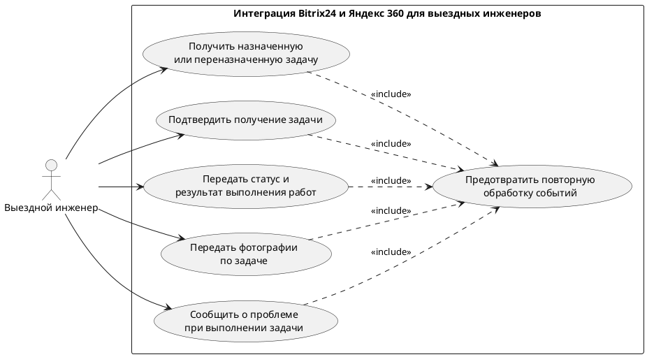

**Вариант:** Интеграция Bitrix24 и Яндекс 360 для выездных инженеров  
**Команда:** Жданов Роман Геннадьевич, Манукян Нарек Вагаршакович  
**Связанный документ концепции:** `case_concept.md` (лабораторная работа 1)  
**Дата:** 2026-11-06

Пользовательское требование фиксируется на уровне эпика. Каждый эпик оформлен и пользовательской историей, и сценарием использования.


## 1. Реинжиниринг дерева функций

Исходное дерево функций взято из раздела 4.2 документа концепции без изменения структуры.

Исходное дерево:

```text
Интеграция Bitrix24 и Яндекс 360
├── Передача задач
│   ├── Передача назначенной задачи инженеру
│   └── Уведомление о переназначении задачи
├── Обратная передача информации
│   ├── Подтверждение получения задачи
│   ├── Передача статусов и результатов работ
│   ├── Передача фотографий в Bitrix24
│   ├── Сообщение о невозможности выполнения работ
│   └── Сообщение о необходимости запчастей
├── Контроль выполнения задач
│   ├── Повторное уведомление через один час
│   ├── Оповещение руководства при отсутствии подтверждения
│   └── Контроль прав на изменение задач
└── Надёжность интеграции
    └── Защита от повторной обработки событий
```

| ID эпика | Пользовательское требование | Узел дерева функций | Есть в дереве | Что сделано |
|---|---|---|---|---|
| EP-1 | Выездной инженер получает информацию о назначенных ему задачах и уведомлениях об их переназначении через Яндекс 360, не используя портал Bitrix24. | Передача назначенной задачи инженеру; Уведомление о переназначении задачи | да | Оба узла оставлены в дереве и объединены одним эпиком, поскольку обеспечивают получение инженером назначенных задач и информации об изменении назначения. |
| EP-2 | Выездной инженер подтверждает получение назначенной задачи, а руководство получает уведомление, если подтверждение не поступает после повторного уведомления. | Подтверждение получения задачи; Повторное уведомление через один час; Оповещение руководства при отсутствии подтверждения | да | Все три узла оставлены в дереве и объединены одним эпиком как части единого процесса подтверждения получения задачи и эскалации. |
| EP-3 | Выездной инженер передаёт статусы и результаты выполнения работ через Яндекс 360, чтобы информация отражалась в соответствующих задачах Bitrix24. | Передача статусов и результатов работ | да | Узел оставлен в дереве. |
| EP-4 | Выездной инженер передаёт фотографии выполненных работ через Яндекс 360, чтобы они сохранялись в соответствующих задачах Bitrix24. | Передача фотографий в Bitrix24 | да | Узел оставлен в дереве. |
| EP-5 | Выездной инженер сообщает о невозможности выполнения работы или необходимости запчастей, чтобы руководство могло организовать дальнейшие действия. | Сообщение о невозможности выполнения работ; Сообщение о необходимости запчастей | да | Оба узла оставлены в дереве и объединены одним эпиком, поскольку обеспечивают информирование руководства о проблемах при выполнении работ. |
| EP-6 | Администратор Bitrix24 обеспечивает соблюдение прав доступа при изменении задач инженерами: изменение статуса только назначенной задачи и запрет самостоятельного изменения стадий CRM. | Контроль прав на изменение задач | да | Узел оставлен в дереве. |
| EP-7 | Разработчик интеграции обеспечивает защиту от повторной обработки событий, чтобы исключить дублирование действий и сообщений. | Защита от повторной обработки событий | да | Узел оставлен в дереве. |

Скорректированное дерево функций:

```text
Интеграция Bitrix24 и Яндекс 360
├── Передача и получение задач
│   ├── Передача назначенной задачи инженеру
│   ├── Уведомление о переназначении задачи
│   ├── Подтверждение получения задачи
│   ├── Повторное уведомление через один час
│   └── Оповещение руководства при отсутствии подтверждения
│
├── Передача информации о выполнении работ
│   ├── Передача статусов и результатов работ
│   └── Передача фотографий в Bitrix24
│
├── Информирование о проблемах при выполнении работ
│   ├── Сообщение о невозможности выполнения работ
│   └── Сообщение о необходимости запчастей
│
└── Контроль и обеспечение надёжности интеграции
    ├── Контроль прав на изменение задач
    └── Защита от повторной обработки событий
```

**Результат реинжиниринга.**

В результате сопоставления пользовательских требований с исходным деревом функций установлено, что все семь сформированных эпиков обеспечены существующими функциональными узлами. Необходимость добавления новых узлов или исключения существующих функций не выявлена.

В скорректированном дереве изменена группировка функциональных узлов для более последовательного отражения пользовательских целей. 

## 2. Диаграмма вариантов использования (Use Case)

Исходник: `diagrams/usecase.puml`



Граница системы:

| Узел дерева | Вариант использования | Актор |
|---|---|---|
| Передача назначенной задачи инженеру | UC-1 Получить назначенную или переназначенную задачу | Выездной инженер |
| Подтверждение получения задачи | UC-2 Подтвердить получение задачи | Выездной инженер |
| Передача статусов и результатов работ | UC-3 Передать статус и результат выполнения работ | Выездной инженер |
| Передача фотографий в Bitrix24 | UC-4 Передать фотографии по задаче | Выездной инженер |
| Сообщение о невозможности выполнения работ и необходимости запчастей | UC-5 Сообщить о проблеме при выполнении задачи | Выездной инженер |
| Защита от повторной обработки событий | UC-6 Предотвратить повторную обработку событий | include из UC-1, UC-2, UC-3, UC-4 и UC-5 |

UC-6 не запускается самостоятельно: проверка на повторную обработку событий выполняется в рамках соответствующих сценариев взаимодействия с интеграцией.

## 3. Эпики, пользовательские истории и сценарии

### EP-1. Получать назначенные и переназначенные задачи

- Уровень: эпик
- Узел дерева: Передача назначенной задачи инженеру; Уведомление о переназначении задачи.
- Бизнес-цель из документа концепции: BO-2 — Обеспечить своевременное получение инженерами назначенных задач и уведомлений о переназначении.
- Источник (стейкхолдер): Выездной инженер.
- Приоритет MoSCoW: Must

**Пользовательская история.** Как выездной инженер, я хочу получать информацию о назначенных мне задачах и уведомления об их переназначении через Яндекс 360, чтобы знать, какие работы необходимо выполнить и своевременно узнавать об изменениях в назначенных мне работах без доступа к порталу Bitrix24.

**Сценарий использования UC-1.**

| Поле | Содержание |
|---|---|
| Акторы | Офисный сотрудник, выездной инженер, Bitrix24, Яндекс 360 |
| Предусловия | 1. В Bitrix24 существует задача, назначенная выездному инженеру. 2. Интеграция между Bitrix24 и Яндекс 360 настроена и имеет необходимые права доступа. 3. Для инженера определён соответствующий пользователь Яндекс 360. |
| Триггер | В Bitrix24 создана задача для выездного инженера или изменён её исполнитель. |
| Постусловия успеха | Информация о назначенной задаче или её переназначении передана соответствующему инженеру через Яндекс 360. |
| Постусловия отказа | Не удалось определить соответствующего инженера или передать ему уведомление. Ошибка зарегистрирована и требует дальнейшей обработки. |

Основной поток:

1. Офисный сотрудник создаёт задачу в Bitrix24 и назначает её выездному инженеру.
2. Bitrix24 формирует событие о назначении задачи.
3. Интеграция получает событие и проверяет, не обрабатывалось ли оно ранее.
4. Система определяет назначенного инженера и соответствующего пользователя Яндекс 360.
5. Система формирует сообщение с информацией о задаче и отправляет его инженеру через Яндекс 360.
6. Выездной инженер получает сообщение с информацией о назначенной задаче.
7. Система завершает сценарий после отправки уведомления.

Альтернативы:

1. Переназначение задачи. Если исполнитель задачи изменён, система определяет нового инженера и отправляет ему уведомление о переназначении задачи через Яндекс 360.
2. Повторное назначение задачи. Если задача назначена инженеру, которому ранее уже направлялось уведомление, система обрабатывает новое событие назначения в соответствии с правилами защиты от повторной обработки.

Исключения:

1. Повторное событие. Если система получает событие, которое уже было обработано, повторные действия и сообщения не выполняются.
2. Не удалось определить пользователя Яндекс 360. Система не может корректно определить адресата уведомления. Дальнейшая обработка требует устранения проблемы сопоставления пользователя.
3. Ошибка передачи сообщения. Если сообщение не удалось передать через Яндекс 360, успешная передача не фиксируется. Необходимо зарегистрировать ошибку и предусмотреть её дальнейшую обработку.

### EP-2. Подтверждение получения задачи и оповещение руководства при отсутствии подтверждения

- Уровень: эпик
- Узел дерева: Подтверждение получения задачи; Повторное уведомление через один час; Оповещение руководства при отсутствии подтверждения
- Бизнес-цель из документа концепции: BO-2 - Обеспечить своевременное получение инженерами назначенных задач и уведомлений о переназначении.
- Источник (стейкхолдер): Выездной инженер; Руководитель бизнес-процесса.
- Приоритет MoSCoW: Must

**Пользовательская история.** Как выездной инженер, я хочу подтверждать получение назначенной задачи через Яндекс 360, чтобы руководство знало, что я получил задание, а при отсутствии подтверждения после повторного уведомления руководство получало информацию о возможной задержке.

**Сценарий использования UC-2.**

| Поле | Содержание |
|---|---|
| Акторы | Выездной инженер, руководитель, Яндекс 360, система интеграции |
| Предусловия | Задача назначена выездному инженеру; инженер получил первоначальное уведомление о задаче через Яндекс 360; интеграция между Bitrix24 и Яндекс 360 настроена и имеет необходимые права доступа. |
| Триггер | Инженер получает уведомление о назначенной задаче через Яндекс 360. |
| Постусловия успеха | Система обработала подтверждение получения задачи. Если подтверждение не поступило после повторного уведомления, руководство проинформировано об отсутствии подтверждения. |
| Постусловия отказа | Подтверждение получения задачи не обработано либо руководство не проинформировано об отсутствии подтверждения. |

**Основной поток:**
1. Выездной инженер получает уведомление о назначенной задаче через Яндекс 360.
2. Инженер подтверждает получение задачи.
3. Система получает и обрабатывает подтверждение.
4. Система фиксирует факт получения задачи инженером.
5. Сценарий завершается.

**Альтернативы:**
1. Если инженер не подтверждает получение задачи, система ожидает один час с момента первоначального уведомления.
2. Если по истечении одного часа подтверждение не поступило, система повторно отправляет инженеру уведомление о задаче.
3. Если инженер не подтверждает получение задачи и после повторного уведомления, система информирует руководство об отсутствии подтверждения.

**Исключения:**
1. Если система получает повторное событие, которое уже было обработано, повторные действия не выполняются.
2. Если система не может обработать подтверждение получения задачи, факт получения задачи не фиксируется.

### EP-3. Передача статусов и результатов выполнения работ в Bitrix24

- Уровень: эпик
- Узел дерева: Передача статусов и результатов работ
- Бизнес-цель из документа концепции: BO-3 - Обеспечить возврат статусов, результатов выполнения работ и фотографий в Bitrix24.
- Источник (стейкхолдер): Выездной инженер; Офисные сотрудники.
- Приоритет MoSCoW: Must

**Пользовательская история.** Как выездной инженер, я хочу передавать информацию о ходе и результате выполнения назначенной задачи через Яндекс 360, чтобы сведения автоматически появлялись в соответствующей задаче Bitrix24 и офисные сотрудники могли отслеживать выполнение работ.

**Сценарий использования UC-3.**

| Поле | Содержание |
|---|---|
| Акторы | Выездной инженер, офисный сотрудник, Яндекс 360, Bitrix24, система интеграции |
| Предусловия | В Bitrix24 существует задача, назначенная выездному инженеру; интеграция между Bitrix24 и Яндекс 360 настроена и имеет необходимые права доступа; инженер может отправлять сообщения через предусмотренный канал взаимодействия в Яндекс 360. |
| Триггер | Выездной инженер отправляет через Яндекс 360 информацию о ходе или результате выполнения назначенной задачи. |
| Постусловия успеха | Информация о ходе или результате выполнения работ передана в соответствующую задачу Bitrix24. Офисные сотрудники могут ознакомиться с актуальными сведениями о выполнении задачи. |
| Постусловия отказа | Информация о ходе или результате выполнения работ не передана в соответствующую задачу Bitrix24. |

**Основной поток:**
1. Выездной инженер выполняет назначенную задачу.
2. Инженер формирует сообщение с информацией о ходе или результате выполнения работ.
3. Инженер отправляет сообщение через Яндекс 360.
4. Система интеграции получает сообщение и определяет соответствующую задачу в Bitrix24.
5. Система передаёт полученную информацию в соответствующую задачу Bitrix24.
6. Офисные сотрудники получают возможность ознакомиться с переданными сведениями.
7. Сценарий завершается.

**Альтернативы:**
1. Если инженер сообщает только о ходе выполнения работ, система передаёт сведения о текущем ходе выполнения задачи в Bitrix24.
2. Если инженер сообщает о завершении работ, система передаёт сведения о результате выполнения задачи в Bitrix24.

**Исключения:**
1. Если система не может определить соответствующую задачу Bitrix24, передача информации не выполняется.
2. Если при передаче информации в Bitrix24 возникает ошибка, сведения о выполнении работ не обновляются в соответствующей задаче.

### EP-4. Передача фотографий выполненных работ в Bitrix24

- Уровень: эпик
- Узел дерева: Передача фотографий в Bitrix24
- Бизнес-цель из документа концепции: BO-3 - Обеспечить возврат статусов, результатов выполнения работ и фотографий в Bitrix24.
- Источник (стейкхолдер): Выездной инженер; Офисные сотрудники.
- Приоритет MoSCoW: Must

**Пользовательская история.** Как выездной инженер, я хочу отправлять фотографии выполненных работ через Яндекс 360, чтобы они сохранялись в соответствующей задаче Bitrix24 и офисные сотрудники могли ознакомиться с результатами работ.

**Сценарий использования UC-4.**

| Поле | Содержание |
|---|---|
| Акторы | Выездной инженер, офисный сотрудник, Яндекс 360, Bitrix24, система интеграции |
| Предусловия | В Bitrix24 существует задача, назначенная выездному инженеру; интеграция между Bitrix24 и Яндекс 360 настроена и имеет необходимые права доступа; инженер может отправлять сообщения с вложениями через предусмотренный канал взаимодействия в Яндекс 360. |
| Триггер | Выездной инженер прикрепляет фотографии выполненных работ к сообщению и отправляет его через Яндекс 360. |
| Постусловия успеха | Фотографии переданы и сохранены в соответствующей задаче Bitrix24. Офисные сотрудники могут ознакомиться с фотографиями. |
| Постусловия отказа | Фотографии не переданы или не сохранены в соответствующей задаче Bitrix24. |

**Основной поток:**
1. Выездной инженер выполняет назначенную задачу.
2. Инженер подготавливает фотографии, подтверждающие выполнение работ.
3. Инженер прикрепляет фотографии к сообщению в Яндекс 360.
4. Инженер отправляет сообщение.
5. Система интеграции получает сообщение с фотографиями.
6. Система определяет задачу Bitrix24, к которой относятся фотографии.
7. Система передаёт фотографии в Bitrix24.
8. Фотографии сохраняются в соответствующей задаче.
9. Сценарий завершается.

**Альтернативы:**
1. Если инженер отправляет несколько фотографий в одном сообщении, система обрабатывает все приложенные фотографии и передаёт их в соответствующую задачу Bitrix24.

**Исключения:**
1. Если система не может определить соответствующую задачу Bitrix24, передача фотографий не выполняется.
2. Если при передаче фотографий в Bitrix24 возникает ошибка, фотографии не сохраняются в соответствующей задаче. Ошибка регистрируется для дальнейшей обработки.

### EP-5. Информирование руководства о проблемах при выполнении задач

- Уровень: эпик
- Узел дерева: Сообщение о невозможности выполнения работ; Сообщение о необходимости запчастей
- Бизнес-цель из документа концепции: BO-4 - Повысить прозрачность выполнения задач и своевременно выявлять проблемы.
- Источник (стейкхолдер): Выездной инженер; Руководитель бизнес-процесса / заказчик.
- Приоритет MoSCoW: Must

**Пользовательская история.** Как выездной инженер, я хочу сообщать через Яндекс 360 о невозможности выполнения назначенной задачи или необходимости запчастей, чтобы руководство своевременно получало информацию о проблемах и могло организовать дальнейшие действия.

**Сценарий использования UC-5.**

| Поле | Содержание |
|---|---|
| Акторы | Выездной инженер, руководитель, Яндекс 360, система интеграции |
| Предусловия | Задача существует в Bitrix24 и назначена выездному инженеру; интеграция между Bitrix24 и Яндекс 360 настроена; инженер может отправлять сообщения через предусмотренный канал взаимодействия в Яндекс 360. |
| Триггер | При выполнении задачи инженер обнаруживает, что не может продолжить работу без дополнительного вмешательства либо что для выполнения работ необходимы запчасти. |
| Постусловия успеха | Информация о невозможности выполнения работы или необходимости запчастей передана для информирования руководства и организации дальнейших действий. |
| Постусловия отказа | Сообщение инженера не обработано или информация не передана для дальнейшего информирования руководства. |

**Основной поток:**
1. Выездной инженер выполняет назначенную задачу.
2. Инженер обнаруживает проблему, препятствующую выполнению работы, либо необходимость запчастей.
3. Инженер формирует сообщение с описанием возникшей ситуации.
4. Инженер отправляет сообщение через Яндекс 360.
5. Система интеграции получает и обрабатывает сообщение.
6. Система передаёт информацию для дальнейшего информирования руководства и организации необходимых действий.
7. Сценарий завершается.

**Альтернативы:**
1. *Невозможность выполнения работы:* Если инженер не может выполнить назначенную задачу, он сообщает об этом через Яндекс 360. Система передаёт информацию для уведомления руководства и организации дальнейших действий.
2. *Необходимость запчастей:* Если для выполнения задачи инженеру необходимы запчасти, он отправляет соответствующее сообщение через Яндекс 360. Система передаёт информацию для информирования руководства и организации необходимых действий.

**Исключения:**
1. Если сообщение не удалось обработать, система регистрирует ошибку для дальнейшей обработки.
2. Если сообщение не удалось передать, система регистрирует ошибку для дальнейшей обработки.

### EP-6. Контроль прав инженеров при изменении задач

- Уровень: эпик
- Узел дерева: Контроль прав на изменение задач
- Бизнес-цель из документа концепции: Прямая связь с конкретной бизнес-целью в концепции не выделена. Требование направлено на сохранение установленных прав доступа и корректности работы с задачами и CRM.
- Источник (стейкхолдер): Администратор Bitrix24; Выездной инженер.
- Приоритет MoSCoW: Must

**Пользовательская история.** Как администратор Bitrix24, я хочу, чтобы система контролировала права выездных инженеров при изменении задач, разрешая им менять статус только назначенных им задач и запрещая самостоятельно изменять стадии CRM, чтобы сохранялись установленные права доступа.

**Сценарий использования UC-6.**

| Поле | Содержание |
|---|---|
| Акторы | Выездной инженер, администратор Bitrix24, Bitrix24, система интеграции |
| Предусловия | Задача существует в Bitrix24 и назначена определённому инженеру; интеграция между Bitrix24 и Яндекс 360 настроена и имеет необходимые права доступа; система располагает информацией об исполнителе задачи и допустимых действиях. |
| Триггер | Выездной инженер отправляет через Яндекс 360 запрос на изменение статуса задачи. |
| Постусловия успеха | Статус задачи изменён в Bitrix24, если задача назначена данному инженеру и запрошенное действие разрешено. |
| Постусловия отказа | Изменение не выполнено, если задача не назначена инженеру либо запрошенное действие предполагает изменение стадии CRM. |

**Основной поток:**
1. Выездной инженер отправляет через Яндекс 360 запрос на изменение статуса задачи.
2. Система интеграции получает запрос.
3. Система определяет инженера и соответствующую задачу Bitrix24.
4. Система проверяет, назначена ли задача данному инженеру.
5. Система проверяет, относится ли запрошенное действие к разрешённому изменению статуса задачи.
6. Система передаёт разрешённое изменение в Bitrix24.
7. Bitrix24 изменяет статус задачи.
8. Сценарий завершается.

**Альтернативы:**
1. *Попытка изменить стадию CRM:* Если запрос предполагает изменение стадии CRM, система отклоняет действие, поскольку инженер не имеет соответствующих полномочий.

**Исключения:**
1. *Недостаточно прав:* Если задача не назначена инженеру, система отклоняет изменение её статуса.
2. *Ошибка определения задачи:* Если система не может определить соответствующую задачу Bitrix24, изменение не выполняется.

### EP-7. Защита от повторной обработки событий интеграции

- Уровень: эпик
- Узел дерева: Защита от повторной обработки событий
- Бизнес-цель из документа концепции: Прямая связь с конкретной бизнес-целью в концепции не выделена. Требование направлено на предотвращение дублирования действий и сообщений при обмене данными между Bitrix24 и Яндекс 360.
- Источник (стейкхолдер): Разработчик / сопровождающий интеграцию.
- Приоритет MoSCoW: Must

**Пользовательская история.** Как разработчик интеграции, я хочу, чтобы система распознавала уже обработанные события и предотвращала их повторную обработку, чтобы не возникали дублирующиеся действия и сообщения.

**Сценарий использования UC-7.**

| Поле | Содержание |
|---|---|
| Акторы | Разработчик / сопровождающий интеграцию, Bitrix24, Яндекс 360, система интеграции |
| Предусловия | Интеграция между Bitrix24 и Яндекс 360 настроена; система получает события от участвующих сервисов и располагает механизмом проверки факта их предыдущей обработки. |
| Триггер | Система получает событие от Bitrix24 или Яндекс 360. |
| Постусловия успеха | Событие обработано один раз. При повторном получении уже обработанного события система предотвращает повторное выполнение связанных действий и отправку дублирующихся сообщений. |
| Постусловия отказа | Система не смогла определить, обрабатывалось ли событие ранее, и не может гарантировать отсутствие повторных действий. |

**Основной поток:**
1. Bitrix24 или Яндекс 360 формирует событие, связанное с работой интеграции.
2. Система интеграции получает событие.
3. Система проверяет, обрабатывалось ли данное событие ранее.
4. Система определяет, что событие ещё не обрабатывалось.
5. Система выполняет предусмотренные для данного события действия.
6. Система фиксирует факт обработки события.
7. Сценарий завершается.

**Альтернативы:**
1. *Повторное получение события:* Если система определяет, что событие уже было обработано, повторное выполнение связанных действий и отправка дублирующих сообщений не производятся. Сценарий завершается.

**Исключения:**
1. *Невозможно определить факт предыдущей обработки:* Если система не может определить, обрабатывалось ли событие ранее, она не должна допускать неконтролируемого повторного выполнения действий и регистрирует возникшую проблему.

## 4. Анализ сущностей и логическая схема данных

## 5. Анализ качества пользовательских требований

## 6. Чек-листы по эпикам

## 7. Итоговый перечень требований