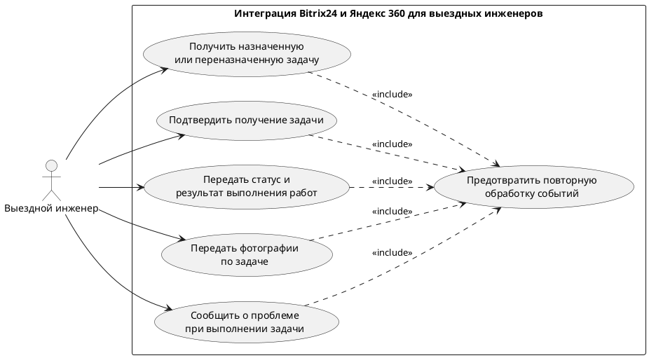

**Вариант:** Интеграция Bitrix24 и Яндекс 360 для выездных инженеров  
**Команда:** Жданов Роман Геннадьевич, Манукян Нарек Вагаршакович  
**Связанный документ концепции:** `case_concept.md` (лабораторная работа 1)  
**Дата:** 2026-11-06

Пользовательское требование фиксируется на уровне эпика. Каждый эпик оформлен и пользовательской историей, и сценарием использования.


## 1. Реинжиниринг дерева функций

Исходное дерево функций взято из раздела 4.2 документа концепции без изменения структуры.

Исходное дерево:

```text
Интеграция Bitrix24 и Яндекс 360
├── Передача задач
│   ├── Передача назначенной задачи инженеру
│   └── Уведомление о переназначении задачи
├── Обратная передача информации
│   ├── Подтверждение получения задачи
│   ├── Передача статусов и результатов работ
│   ├── Передача фотографий в Bitrix24
│   ├── Сообщение о невозможности выполнения работ
│   └── Сообщение о необходимости запчастей
├── Контроль выполнения задач
│   ├── Повторное уведомление через один час
│   ├── Оповещение руководства при отсутствии подтверждения
│   └── Контроль прав на изменение задач
└── Надёжность интеграции
    └── Защита от повторной обработки событий
```

| ID эпика | Пользовательское требование | Узел дерева функций | Есть в дереве | Что сделано |
|---|---|---|---|---|
| EP-1 | Выездной инженер получает информацию о назначенных ему задачах и уведомлениях об их переназначении через Яндекс 360, не используя портал Bitrix24. | Передача назначенной задачи инженеру; Уведомление о переназначении задачи | да | Оба узла оставлены в дереве и объединены одним эпиком, поскольку обеспечивают получение инженером назначенных задач и информации об изменении назначения. |
| EP-2 | Выездной инженер подтверждает получение назначенной задачи, а руководство получает уведомление, если подтверждение не поступает после повторного уведомления. | Подтверждение получения задачи; Повторное уведомление через один час; Оповещение руководства при отсутствии подтверждения | да | Все три узла оставлены в дереве и объединены одним эпиком как части единого процесса подтверждения получения задачи и эскалации. |
| EP-3 | Выездной инженер передаёт статусы и результаты выполнения работ через Яндекс 360, чтобы информация отражалась в соответствующих задачах Bitrix24. | Передача статусов и результатов работ | да | Узел оставлен в дереве. |
| EP-4 | Выездной инженер передаёт фотографии выполненных работ через Яндекс 360, чтобы они сохранялись в соответствующих задачах Bitrix24. | Передача фотографий в Bitrix24 | да | Узел оставлен в дереве. |
| EP-5 | Выездной инженер сообщает о невозможности выполнения работы или необходимости запчастей, чтобы руководство могло организовать дальнейшие действия. | Сообщение о невозможности выполнения работ; Сообщение о необходимости запчастей | да | Оба узла оставлены в дереве и объединены одним эпиком, поскольку обеспечивают информирование руководства о проблемах при выполнении работ. |
| EP-6 | Администратор Bitrix24 обеспечивает соблюдение прав доступа при изменении задач инженерами: изменение статуса только назначенной задачи и запрет самостоятельного изменения стадий CRM. | Контроль прав на изменение задач | да | Узел оставлен в дереве. |
| EP-7 | Разработчик интеграции обеспечивает защиту от повторной обработки событий, чтобы исключить дублирование действий и сообщений. | Защита от повторной обработки событий | да | Узел оставлен в дереве. |

Скорректированное дерево функций:

```text
Интеграция Bitrix24 и Яндекс 360
├── Передача и получение задач
│   ├── Передача назначенной задачи инженеру
│   ├── Уведомление о переназначении задачи
│   ├── Подтверждение получения задачи
│   ├── Повторное уведомление через один час
│   └── Оповещение руководства при отсутствии подтверждения
│
├── Передача информации о выполнении работ
│   ├── Передача статусов и результатов работ
│   └── Передача фотографий в Bitrix24
│
├── Информирование о проблемах при выполнении работ
│   ├── Сообщение о невозможности выполнения работ
│   └── Сообщение о необходимости запчастей
│
└── Контроль и обеспечение надёжности интеграции
    ├── Контроль прав на изменение задач
    └── Защита от повторной обработки событий
```

**Результат реинжиниринга.**

В результате сопоставления пользовательских требований с исходным деревом функций установлено, что все семь сформированных эпиков обеспечены существующими функциональными узлами. Необходимость добавления новых узлов или исключения существующих функций не выявлена.

В скорректированном дереве изменена группировка функциональных узлов для более последовательного отражения пользовательских целей. 

## 2. Диаграмма вариантов использования (Use Case)

Исходник: `diagrams/usecase.puml`


Граница системы:
| Узел дерева | Вариант использования | Актор |
|---|---|---|
| Передача назначенной задачи инженеру | UC-1 Получить назначенную или переназначенную задачу | Выездной инженер |
| Подтверждение получения задачи | UC-2 Подтвердить получение задачи | Выездной инженер |
| Передача статусов и результатов работ | UC-3 Передать статус и результат выполнения работ | Выездной инженер |
| Передача фотографий в Bitrix24 | UC-4 Передать фотографии по задаче | Выездной инженер |
| Сообщение о невозможности выполнения работ и необходимости запчастей | UC-5 Сообщить о проблеме при выполнении задачи | Выездной инженер |
| Защита от повторной обработки событий | UC-6 Предотвратить повторную обработку событий | include из UC-1, UC-2, UC-3, UC-4 и UC-5 |

UC-6 не запускается самостоятельно: проверка на повторную обработку событий выполняется в рамках соответствующих сценариев взаимодействия с интеграцией.

## 3. Эпики, пользовательские истории и сценарии

## 4. Анализ сущностей и логическая схема данных

## 5. Анализ качества пользовательских требований

## 6. Чек-листы по эпикам

## 7. Итоговый перечень требований