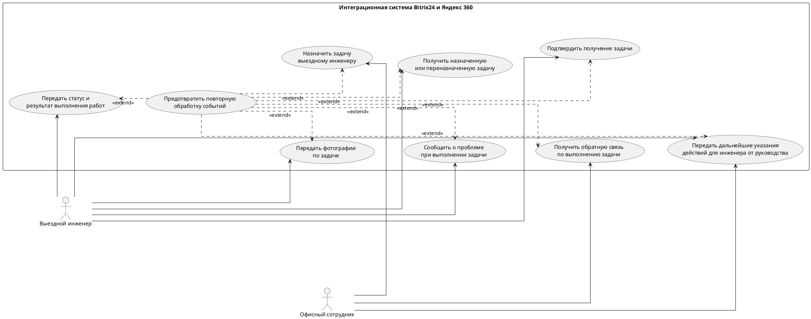
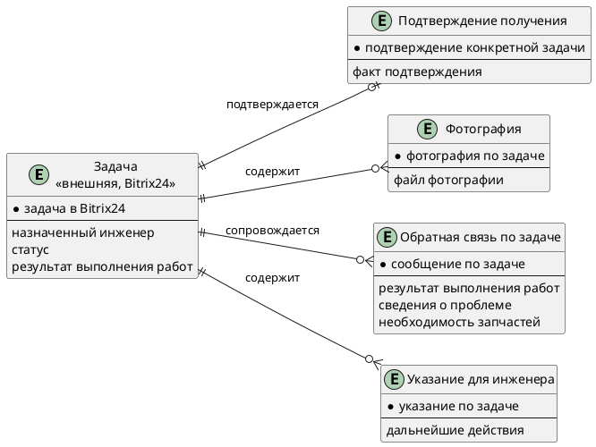

**Вариант:** Интеграция Bitrix24 и Яндекс 360 для выездных инженеров  
**Команда:** Жданов Роман Геннадьевич, Манукян Нарек Вагаршакович  
**Связанный документ концепции:** `case_concept.md` (лабораторная работа 1)  
**Дата:** 2026-11-06

Пользовательское требование фиксируется на уровне эпика. Каждый эпик оформлен и пользовательской историей, и сценарием использования.


## 1. Реинжиниринг дерева функций

Исходное дерево функций взято из раздела 4.2 документа концепции без изменения структуры.

Исходное дерево:

```text
Интеграция Bitrix24 и Яндекс 360
├── Передача задач
│   ├── Передача назначенной задачи инженеру
│   └── Уведомление о переназначении задачи
├── Обратная передача информации
│   ├── Подтверждение получения задачи
│   ├── Передача статусов и результатов работ
│   ├── Передача фотографий в Bitrix24
│   ├── Сообщение о невозможности выполнения работ
│   └── Сообщение о необходимости запчастей
├── Контроль выполнения задач
│   ├── Повторное уведомление через один час
│   ├── Оповещение руководства при отсутствии подтверждения
│   └── Контроль прав на изменение задач
└── Надёжность интеграции
    └── Защита от повторной обработки событий
```

| ID эпика | Пользовательское требование | Узел дерева функций | Есть в дереве | Что сделано |
|---|---|---|---|---|
| EP-1 | Выездной инженер получает информацию о назначенных ему задачах и уведомлениях об их переназначении через Яндекс 360, не используя портал Bitrix24. | Передача назначенной задачи инженеру; Уведомление о переназначении задачи | да | Оба узла оставлены в дереве и объединены одним эпиком, поскольку обеспечивают получение инженером назначенных задач и информации об изменении назначения. |
| EP-2 | Выездной инженер подтверждает получение назначенной задачи, а руководство получает уведомление, если подтверждение не поступает после повторного уведомления. | Подтверждение получения задачи; Повторное уведомление через один час; Оповещение руководства при отсутствии подтверждения | да | Все три узла оставлены в дереве и объединены одним эпиком как части единого процесса подтверждения получения задачи и эскалации. |
| EP-3 | Выездной инженер передаёт статусы и результаты выполнения работ через Яндекс 360, чтобы информация отражалась в соответствующих задачах Bitrix24. | Передача статусов и результатов работ | да | Узел оставлен в дереве. |
| EP-4 | Выездной инженер передаёт фотографии выполненных работ через Яндекс 360, чтобы они сохранялись в соответствующих задачах Bitrix24. | Передача фотографий в Bitrix24 | да | Узел оставлен в дереве. |
| EP-5 | Выездной инженер сообщает о невозможности выполнения работы или необходимости запчастей, чтобы руководство могло организовать дальнейшие действия. | Сообщение о невозможности выполнения работ; Сообщение о необходимости запчастей | да | Оба узла оставлены в дереве и объединены одним эпиком, поскольку обеспечивают информирование руководства о проблемах при выполнении работ. |
| EP-6 | Администратор Bitrix24 обеспечивает соблюдение прав доступа при изменении задач инженерами: изменение статуса только назначенной задачи и запрет самостоятельного изменения стадий CRM. | Контроль прав на изменение задач | да | Узел оставлен в дереве. |
| EP-7 | Разработчик интеграции обеспечивает защиту от повторной обработки событий, чтобы исключить дублирование действий и сообщений. | Защита от повторной обработки событий | да | Узел оставлен в дереве. |

Скорректированное дерево функций:

```text
Интеграция Bitrix24 и Яндекс 360
├── Передача и получение задач
│   ├── Передача назначенной задачи инженеру
│   ├── Уведомление о переназначении задачи
│   ├── Подтверждение получения задачи
│   ├── Повторное уведомление через один час
│   └── Оповещение руководства при отсутствии подтверждения
│
├── Передача информации о выполнении работ
│   ├── Передача статусов и результатов работ
│   └── Передача фотографий в Bitrix24
│
├── Информирование о проблемах при выполнении работ
│   ├── Сообщение о невозможности выполнения работ
│   └── Сообщение о необходимости запчастей
│
└── Контроль и обеспечение надёжности интеграции
    ├── Контроль прав на изменение задач
    └── Защита от повторной обработки событий
```

**Результат реинжиниринга.**

В результате сопоставления пользовательских требований с исходным деревом функций установлено, что все семь сформированных эпиков обеспечены существующими функциональными узлами. Необходимость добавления новых узлов или исключения существующих функций не выявлена.

В скорректированном дереве изменена группировка функциональных узлов для более последовательного отражения пользовательских целей. 

## 2. Диаграмма вариантов использования (Use Case)

Исходник: `diagrams/usecase.puml`





Граница системы:

| Узел дерева | Вариант использования | Актор |
|---|---|---|
| Передача назначенной задачи инженеру | UC-1 Получить назначенную или переназначенную задачу | Выездной инженер |
| Подтверждение получения задачи | UC-2 Подтвердить получение задачи | Выездной инженер |
| Передача статусов и результатов работ | UC-3 Передать статус и результат выполнения работ | Выездной инженер |
| Передача фотографий в Bitrix24 | UC-4 Передать фотографии по задаче | Выездной инженер |
| Сообщение о невозможности выполнения работ и необходимости запчастей | UC-5 Сообщить о проблеме при выполнении задачи | Выездной инженер |
| Защита от повторной обработки событий | UC-6 Предотвратить повторную обработку событий | include из UC-1, UC-2, UC-3, UC-4 и UC-5 |

UC-6 не запускается самостоятельно: проверка на повторную обработку событий выполняется в рамках соответствующих сценариев взаимодействия с интеграцией.

## 3. Эпики, пользовательские истории и сценарии

### EP-1. Получать назначенные и переназначенные задачи

- Уровень: эпик
- Узел дерева: Передача назначенной задачи инженеру; Уведомление о переназначении задачи.
- Бизнес-цель из документа концепции: BO-2 — Обеспечить своевременное получение инженерами назначенных задач и уведомлений о переназначении.
- Источник (стейкхолдер): Выездной инженер.
- Приоритет MoSCoW: Must

**Пользовательская история.** Как выездной инженер, я хочу получать информацию о назначенных мне задачах и уведомления об их переназначении через Яндекс 360, чтобы знать, какие работы необходимо выполнить и своевременно узнавать об изменениях в назначенных мне работах без доступа к порталу Bitrix24.

**Сценарий использования UC-1.**

| Поле | Содержание |
|---|---|
| Акторы | Офисный сотрудник, выездной инженер, Bitrix24, Яндекс 360 |
| Предусловия | 1. В Bitrix24 существует задача, назначенная выездному инженеру. 2. Интеграция между Bitrix24 и Яндекс 360 настроена и имеет необходимые права доступа. 3. Для инженера определён соответствующий пользователь Яндекс 360. |
| Триггер | В Bitrix24 создана задача для выездного инженера или изменён её исполнитель. |
| Постусловия успеха | Информация о назначенной задаче или её переназначении передана соответствующему инженеру через Яндекс 360. |
| Постусловия отказа | Не удалось определить соответствующего инженера или передать ему уведомление. Ошибка зарегистрирована и требует дальнейшей обработки. |

Основной поток:

1. Офисный сотрудник создаёт задачу в Bitrix24 и назначает её выездному инженеру.
2. Bitrix24 формирует событие о назначении задачи.
3. Интеграция получает событие и проверяет, не обрабатывалось ли оно ранее.
4. Система определяет назначенного инженера и соответствующего пользователя Яндекс 360.
5. Система формирует сообщение с информацией о задаче и отправляет его инженеру через Яндекс 360.
6. Выездной инженер получает сообщение с информацией о назначенной задаче.
7. Система завершает сценарий после отправки уведомления.

Альтернативы:

1. Переназначение задачи. Если исполнитель задачи изменён, система определяет нового инженера и отправляет ему уведомление о переназначении задачи через Яндекс 360.
2. Повторное назначение задачи. Если задача назначена инженеру, которому ранее уже направлялось уведомление, система обрабатывает новое событие назначения в соответствии с правилами защиты от повторной обработки.

Исключения:

1. Повторное событие. Если система получает событие, которое уже было обработано, повторные действия и сообщения не выполняются.
2. Не удалось определить пользователя Яндекс 360. Система не может корректно определить адресата уведомления. Дальнейшая обработка требует устранения проблемы сопоставления пользователя.
3. Ошибка передачи сообщения. Если сообщение не удалось передать через Яндекс 360, успешная передача не фиксируется. Необходимо зарегистрировать ошибку и предусмотреть её дальнейшую обработку.

### EP-2. Подтверждение получения задачи и оповещение руководства при отсутствии подтверждения

- Уровень: эпик
- Узел дерева: Подтверждение получения задачи; Повторное уведомление через один час; Оповещение руководства при отсутствии подтверждения
- Бизнес-цель из документа концепции: BO-2 - Обеспечить своевременное получение инженерами назначенных задач и уведомлений о переназначении.
- Источник (стейкхолдер): Выездной инженер; Руководитель бизнес-процесса.
- Приоритет MoSCoW: Must

**Пользовательская история.** Как выездной инженер, я хочу подтверждать получение назначенной задачи через Яндекс 360, чтобы руководство знало, что я получил задание, а при отсутствии подтверждения после повторного уведомления руководство получало информацию о возможной задержке.

**Сценарий использования UC-2.**

| Поле | Содержание |
|---|---|
| Акторы | Выездной инженер, руководитель, Яндекс 360, система интеграции |
| Предусловия | Задача назначена выездному инженеру; инженер получил первоначальное уведомление о задаче через Яндекс 360; интеграция между Bitrix24 и Яндекс 360 настроена и имеет необходимые права доступа. |
| Триггер | Инженер получает уведомление о назначенной задаче через Яндекс 360. |
| Постусловия успеха | Система обработала подтверждение получения задачи. Если подтверждение не поступило после повторного уведомления, руководство проинформировано об отсутствии подтверждения. |
| Постусловия отказа | Подтверждение получения задачи не обработано либо руководство не проинформировано об отсутствии подтверждения. |

**Основной поток:**
1. Выездной инженер получает уведомление о назначенной задаче через Яндекс 360.
2. Инженер подтверждает получение задачи.
3. Система получает и обрабатывает подтверждение.
4. Система фиксирует факт получения задачи инженером.
5. Сценарий завершается.

**Альтернативы:**
1. Если инженер не подтверждает получение задачи, система ожидает один час с момента первоначального уведомления.
2. Если по истечении одного часа подтверждение не поступило, система повторно отправляет инженеру уведомление о задаче.
3. Если инженер не подтверждает получение задачи и после повторного уведомления, система информирует руководство об отсутствии подтверждения.

**Исключения:**
1. Если система получает повторное событие, которое уже было обработано, повторные действия не выполняются.
2. Если система не может обработать подтверждение получения задачи, факт получения задачи не фиксируется.

### EP-3. Передача статусов и результатов выполнения работ в Bitrix24

- Уровень: эпик
- Узел дерева: Передача статусов и результатов работ
- Бизнес-цель из документа концепции: BO-3 - Обеспечить возврат статусов, результатов выполнения работ и фотографий в Bitrix24.
- Источник (стейкхолдер): Выездной инженер; Офисные сотрудники.
- Приоритет MoSCoW: Must

**Пользовательская история.** Как выездной инженер, я хочу передавать информацию о ходе и результате выполнения назначенной задачи через Яндекс 360, чтобы сведения автоматически появлялись в соответствующей задаче Bitrix24 и офисные сотрудники могли отслеживать выполнение работ.

**Сценарий использования UC-3.**

| Поле | Содержание |
|---|---|
| Акторы | Выездной инженер, офисный сотрудник, Яндекс 360, Bitrix24, система интеграции |
| Предусловия | В Bitrix24 существует задача, назначенная выездному инженеру; интеграция между Bitrix24 и Яндекс 360 настроена и имеет необходимые права доступа; инженер может отправлять сообщения через предусмотренный канал взаимодействия в Яндекс 360. |
| Триггер | Выездной инженер отправляет через Яндекс 360 информацию о ходе или результате выполнения назначенной задачи. |
| Постусловия успеха | Информация о ходе или результате выполнения работ передана в соответствующую задачу Bitrix24. Офисные сотрудники могут ознакомиться с актуальными сведениями о выполнении задачи. |
| Постусловия отказа | Информация о ходе или результате выполнения работ не передана в соответствующую задачу Bitrix24. |

**Основной поток:**
1. Выездной инженер выполняет назначенную задачу.
2. Инженер формирует сообщение с информацией о ходе или результате выполнения работ.
3. Инженер отправляет сообщение через Яндекс 360.
4. Система интеграции получает сообщение и определяет соответствующую задачу в Bitrix24.
5. Система передаёт полученную информацию в соответствующую задачу Bitrix24.
6. Офисные сотрудники получают возможность ознакомиться с переданными сведениями.
7. Сценарий завершается.

**Альтернативы:**
1. Если инженер сообщает только о ходе выполнения работ, система передаёт сведения о текущем ходе выполнения задачи в Bitrix24.
2. Если инженер сообщает о завершении работ, система передаёт сведения о результате выполнения задачи в Bitrix24.

**Исключения:**
1. Если система не может определить соответствующую задачу Bitrix24, передача информации не выполняется.
2. Если при передаче информации в Bitrix24 возникает ошибка, сведения о выполнении работ не обновляются в соответствующей задаче.

### EP-4. Передача фотографий выполненных работ в Bitrix24

- Уровень: эпик
- Узел дерева: Передача фотографий в Bitrix24
- Бизнес-цель из документа концепции: BO-3 - Обеспечить возврат статусов, результатов выполнения работ и фотографий в Bitrix24.
- Источник (стейкхолдер): Выездной инженер; Офисные сотрудники.
- Приоритет MoSCoW: Must

**Пользовательская история.** Как выездной инженер, я хочу отправлять фотографии выполненных работ через Яндекс 360, чтобы они сохранялись в соответствующей задаче Bitrix24 и офисные сотрудники могли ознакомиться с результатами работ.

**Сценарий использования UC-4.**

| Поле | Содержание |
|---|---|
| Акторы | Выездной инженер, офисный сотрудник, Яндекс 360, Bitrix24, система интеграции |
| Предусловия | В Bitrix24 существует задача, назначенная выездному инженеру; интеграция между Bitrix24 и Яндекс 360 настроена и имеет необходимые права доступа; инженер может отправлять сообщения с вложениями через предусмотренный канал взаимодействия в Яндекс 360. |
| Триггер | Выездной инженер прикрепляет фотографии выполненных работ к сообщению и отправляет его через Яндекс 360. |
| Постусловия успеха | Фотографии переданы и сохранены в соответствующей задаче Bitrix24. Офисные сотрудники могут ознакомиться с фотографиями. |
| Постусловия отказа | Фотографии не переданы или не сохранены в соответствующей задаче Bitrix24. |

**Основной поток:**
1. Выездной инженер выполняет назначенную задачу.
2. Инженер подготавливает фотографии, подтверждающие выполнение работ.
3. Инженер прикрепляет фотографии к сообщению в Яндекс 360.
4. Инженер отправляет сообщение.
5. Система интеграции получает сообщение с фотографиями.
6. Система определяет задачу Bitrix24, к которой относятся фотографии.
7. Система передаёт фотографии в Bitrix24.
8. Фотографии сохраняются в соответствующей задаче.
9. Сценарий завершается.

**Альтернативы:**
1. Если инженер отправляет несколько фотографий в одном сообщении, система обрабатывает все приложенные фотографии и передаёт их в соответствующую задачу Bitrix24.

**Исключения:**
1. Если система не может определить соответствующую задачу Bitrix24, передача фотографий не выполняется.
2. Если при передаче фотографий в Bitrix24 возникает ошибка, фотографии не сохраняются в соответствующей задаче. Ошибка регистрируется для дальнейшей обработки.

### EP-5. Информирование руководства о проблемах при выполнении задач

- Уровень: эпик
- Узел дерева: Сообщение о невозможности выполнения работ; Сообщение о необходимости запчастей
- Бизнес-цель из документа концепции: BO-4 - Повысить прозрачность выполнения задач и своевременно выявлять проблемы.
- Источник (стейкхолдер): Выездной инженер; Руководитель бизнес-процесса / заказчик.
- Приоритет MoSCoW: Must

**Пользовательская история.** Как выездной инженер, я хочу сообщать через Яндекс 360 о невозможности выполнения назначенной задачи или необходимости запчастей, чтобы руководство своевременно получало информацию о проблемах и могло организовать дальнейшие действия.

**Сценарий использования UC-5.**

| Поле | Содержание |
|---|---|
| Акторы | Выездной инженер, руководитель, Яндекс 360, система интеграции |
| Предусловия | Задача существует в Bitrix24 и назначена выездному инженеру; интеграция между Bitrix24 и Яндекс 360 настроена; инженер может отправлять сообщения через предусмотренный канал взаимодействия в Яндекс 360. |
| Триггер | При выполнении задачи инженер обнаруживает, что не может продолжить работу без дополнительного вмешательства либо что для выполнения работ необходимы запчасти. |
| Постусловия успеха | Информация о невозможности выполнения работы или необходимости запчастей передана для информирования руководства и организации дальнейших действий. |
| Постусловия отказа | Сообщение инженера не обработано или информация не передана для дальнейшего информирования руководства. |

**Основной поток:**
1. Выездной инженер выполняет назначенную задачу.
2. Инженер обнаруживает проблему, препятствующую выполнению работы, либо необходимость запчастей.
3. Инженер формирует сообщение с описанием возникшей ситуации.
4. Инженер отправляет сообщение через Яндекс 360.
5. Система интеграции получает и обрабатывает сообщение.
6. Система передаёт информацию для дальнейшего информирования руководства и организации необходимых действий.
7. Сценарий завершается.

**Альтернативы:**
1. *Невозможность выполнения работы:* Если инженер не может выполнить назначенную задачу, он сообщает об этом через Яндекс 360. Система передаёт информацию для уведомления руководства и организации дальнейших действий.
2. *Необходимость запчастей:* Если для выполнения задачи инженеру необходимы запчасти, он отправляет соответствующее сообщение через Яндекс 360. Система передаёт информацию для информирования руководства и организации необходимых действий.

**Исключения:**
1. Если сообщение не удалось обработать, система регистрирует ошибку для дальнейшей обработки.
2. Если сообщение не удалось передать, система регистрирует ошибку для дальнейшей обработки.

### EP-6. Контроль прав инженеров при изменении задач

- Уровень: эпик
- Узел дерева: Контроль прав на изменение задач
- Бизнес-цель из документа концепции: Прямая связь с конкретной бизнес-целью в концепции не выделена. Требование направлено на сохранение установленных прав доступа и корректности работы с задачами и CRM.
- Источник (стейкхолдер): Администратор Bitrix24; Выездной инженер.
- Приоритет MoSCoW: Must

**Пользовательская история.** Как администратор Bitrix24, я хочу, чтобы система контролировала права выездных инженеров при изменении задач, разрешая им менять статус только назначенных им задач и запрещая самостоятельно изменять стадии CRM, чтобы сохранялись установленные права доступа.

**Сценарий использования UC-6.**

| Поле | Содержание |
|---|---|
| Акторы | Выездной инженер, администратор Bitrix24, Bitrix24, система интеграции |
| Предусловия | Задача существует в Bitrix24 и назначена определённому инженеру; интеграция между Bitrix24 и Яндекс 360 настроена и имеет необходимые права доступа; система располагает информацией об исполнителе задачи и допустимых действиях. |
| Триггер | Выездной инженер отправляет через Яндекс 360 запрос на изменение статуса задачи. |
| Постусловия успеха | Статус задачи изменён в Bitrix24, если задача назначена данному инженеру и запрошенное действие разрешено. |
| Постусловия отказа | Изменение не выполнено, если задача не назначена инженеру либо запрошенное действие предполагает изменение стадии CRM. |

**Основной поток:**
1. Выездной инженер отправляет через Яндекс 360 запрос на изменение статуса задачи.
2. Система интеграции получает запрос.
3. Система определяет инженера и соответствующую задачу Bitrix24.
4. Система проверяет, назначена ли задача данному инженеру.
5. Система проверяет, относится ли запрошенное действие к разрешённому изменению статуса задачи.
6. Система передаёт разрешённое изменение в Bitrix24.
7. Bitrix24 изменяет статус задачи.
8. Сценарий завершается.

**Альтернативы:**
1. *Попытка изменить стадию CRM:* Если запрос предполагает изменение стадии CRM, система отклоняет действие, поскольку инженер не имеет соответствующих полномочий.

**Исключения:**
1. *Недостаточно прав:* Если задача не назначена инженеру, система отклоняет изменение её статуса.
2. *Ошибка определения задачи:* Если система не может определить соответствующую задачу Bitrix24, изменение не выполняется.

### EP-7. Защита от повторной обработки событий интеграции

- Уровень: эпик
- Узел дерева: Защита от повторной обработки событий
- Бизнес-цель из документа концепции: Прямая связь с конкретной бизнес-целью в концепции не выделена. Требование направлено на предотвращение дублирования действий и сообщений при обмене данными между Bitrix24 и Яндекс 360.
- Источник (стейкхолдер): Разработчик / сопровождающий интеграцию.
- Приоритет MoSCoW: Must

**Пользовательская история.** Как разработчик интеграции, я хочу, чтобы система распознавала уже обработанные события и предотвращала их повторную обработку, чтобы не возникали дублирующиеся действия и сообщения.

**Сценарий использования UC-7.**

| Поле | Содержание |
|---|---|
| Акторы | Разработчик / сопровождающий интеграцию, Bitrix24, Яндекс 360, система интеграции |
| Предусловия | Интеграция между Bitrix24 и Яндекс 360 настроена; система получает события от участвующих сервисов и располагает механизмом проверки факта их предыдущей обработки. |
| Триггер | Система получает событие от Bitrix24 или Яндекс 360. |
| Постусловия успеха | Событие обработано один раз. При повторном получении уже обработанного события система предотвращает повторное выполнение связанных действий и отправку дублирующихся сообщений. |
| Постусловия отказа | Система не смогла определить, обрабатывалось ли событие ранее, и не может гарантировать отсутствие повторных действий. |

**Основной поток:**
1. Bitrix24 или Яндекс 360 формирует событие, связанное с работой интеграции.
2. Система интеграции получает событие.
3. Система проверяет, обрабатывалось ли данное событие ранее.
4. Система определяет, что событие ещё не обрабатывалось.
5. Система выполняет предусмотренные для данного события действия.
6. Система фиксирует факт обработки события.
7. Сценарий завершается.

**Альтернативы:**
1. *Повторное получение события:* Если система определяет, что событие уже было обработано, повторное выполнение связанных действий и отправка дублирующих сообщений не производятся. Сценарий завершается.

**Исключения:**
1. *Невозможно определить факт предыдущей обработки:* Если система не может определить, обрабатывалось ли событие ранее, она не должна допускать неконтролируемого повторного выполнения действий и регистрирует возникшую проблему.

## 4. Анализ сущностей и логическая схема данных

### 4.1. Выделение сущностей предметной области

Сущности выделены на основании сценариев EP-1–EP-7. При анализе учитывались данные, которые передаются между Bitrix24 и Яндекс 360, используются для взаимодействия офисных сотрудников и выездных инженеров, а также необходимы для выполнения предусмотренных сценариями действий.

Для логической схемы выделены следующие сущности:

| Сущность | Эпик или сценарий | Что хранит система | Ключ, как его понимает пользователь |
|---|---|---|---|
| Задача | EP-1, EP-2, EP-3, EP-4, EP-5, EP-6 | Система получает сведения о задаче из Bitrix24 и передаёт связанные с ней данные | Задача в Bitrix24 |
| Подтверждение получения | EP-2: подтверждение получения задачи | Сведения о факте получения и подтверждения задачи инженером | Подтверждение получения конкретной задачи |
| Фотография | EP-4: передача фотографий по задаче | Фотографии, передаваемые инженером для прикрепления к задаче в Bitrix24 | Фотография, относящаяся к конкретной задаче |
| Обратная связь по задаче | EP-3, EP-5: передача результатов и сообщение о проблемах | Результаты выполнения работ, сведения о невозможности выполнения работ и необходимости запчастей | Сообщение инженера по конкретной задаче |
| Указание для инженера | Сценарий передачи дальнейших указаний действий | Сведения о дальнейших действиях, передаваемые офисным сотрудником инженеру | Указание, относящееся к конкретной задаче |

**Внешние сущности:**

- **Задача в Bitrix24** - внешняя сущность. Интеграция получает сведения о задаче из Bitrix24 и передаёт обратно результаты выполнения работ, статусы и фотографии. Собственный реестр задач вместо Bitrix24 в рамках концепции не предусматривается.
- **Выездной инженер** - участник взаимодействия, сведения о котором используются при назначении и передаче задач. Сам инженер является актором, а не самостоятельной сущностью данных в рамках рассматриваемых сценариев.

При этом подтверждение получения, обратная связь и указания рассматриваются как данные взаимодействия, а не как отдельные технические механизмы интеграции.

### 4.2. Связи между сущностями и их кратность

Кратность связей определяется исходя из содержания сценариев и предусмотренных в них результатов выполнения операций.

| Связь | Кратность | Откуда это видно в постусловии |
|---|---|---|
| Задача - Подтверждение получения | Одна задача может иметь ноль или одно подтверждение | Подтверждение появляется после того, как инженер подтверждает получение назначенной задачи |
| Задача - Фотография | Одна задача может иметь ноль или много фотографий | Инженер может передать фотографии выполненных работ по задаче |
| Задача - Обратная связь по задаче | Одна задача может иметь ноль или много сообщений обратной связи | Инженер может сообщать о результатах работ и возникающих проблемах |
| Задача - Указание для инженера | Одна задача может иметь ноль или много указаний | Офисный сотрудник может передавать инженеру дальнейшие указания по выполнению задачи |

Таким образом, основой логической схемы является задача, с которой связаны подтверждение получения, фотографии, обратная связь и дальнейшие указания.

### 4.3. Что названо в сценариях и на схему не попало

Не каждое существительное, встречающееся в сценариях, является самостоятельной сущностью. Некоторые понятия обозначают роли участников, действия или правила функционирования интеграции.

| Слово или понятие | Почему не сущность |
|---|---|
| Выездной инженер | Актор, который получает задачи, подтверждает их получение и передаёт информацию о выполнении работ |
| Офисный сотрудник | Актор, который назначает задачи, получает обратную связь и передаёт дальнейшие указания |
| Руководство | Участник организационного процесса, которому передаётся информация о проблемах; отдельные операции руководства в рассматриваемой диаграмме не выделяются |
| Уведомление | Способ передачи информации о назначении или переназначении задачи, а не самостоятельная сущность предметной области |
| Повторное уведомление через один час | Правило обработки ситуации, когда инженер не подтвердил получение задачи |
| Оповещение руководства | Действие, выполняемое при отсутствии подтверждения получения задачи |
| Переназначение задачи | Операция изменения назначенного исполнителя, а не отдельная сущность |
| Защита от повторной обработки событий | Правило функционирования интеграции, а не пользовательские данные |
| Права доступа | Ограничения на выполнение операций с задачами, а не самостоятельная сущность |
| Стадии CRM | Элемент внешней системы Bitrix24; концепция запрещает инженеру изменять стадии CRM |

### 4.4. Логическая схема данных

Исходник: `diagrams/logical-data.puml`.

Для построения схемы используются сущности, выделенные в предыдущих подразделах. Задача обозначена как внешняя сущность, поскольку источником и местом ведения задач выступает Bitrix24. Остальные сущности отражают информацию, возникающую при взаимодействии инженера и офисного сотрудника.



### 4.5. Итог анализа

В результате анализа сценариев семи эпиков выделены пять сущностей предметной области: задача, подтверждение получения, фотография, обратная связь по задаче и указание для инженера.

Центральной сущностью является задача в Bitrix24, которая выступает внешним источником данных. Остальные сущности связаны с ней и отражают информацию, возникающую в процессе назначения задач, подтверждения их получения, выполнения работ и обмена сведениями между инженерами и офисными сотрудниками.

Логическая схема показывает состав сущностей, их пользовательские атрибуты и связи с кратностью. Она не определяет физическую структуру базы данных, технические идентификаторы, типы полей или способы хранения информации.

## 5. Анализ качества пользовательских требований

### 5.1. Подготовка

Для проверки пользовательских требований используются семь эпиков EP-1–EP-7, представленных в разделе 3 документа. Проверка проводится по критериям полноты, однозначности, непротиворечивости, атомарности, трассируемости и приоритезированности.

Участники проверки:

| Роль        | Кто |
| ----------- | --- |
| Аналитик    | Автор документа |
| Заказчик    | Преподаватель, представляющий заказчика в рамках учебной работы |
| Разработчик | Участник команды |
| Тестировщик | Участник команды |

Чек-лист проверки требований представлен в разделе 6.

### 5.2. Полнота

Для каждого эпика проверены наличие роли пользователя, выполняемого действия, ценности для пользователя и контекста выполнения действия.

| ID   | Роль | Действие | Ценность | Контекст | Полнота | Что дополнить |
| ---- | ---- | -------- | -------- | -------- | ------- | ------------- |
| EP-1 | Выездной инженер | Получить назначенную или переназначенную задачу | Получать информацию о порученной работе без необходимости обращаться к порталу Bitrix24 | При назначении задачи или изменении исполнителя в Bitrix24 | Полное | — |
| EP-2 | Выездной инженер | Подтвердить получение задачи; получить повторное уведомление; обеспечить оповещение руководства при отсутствии подтверждения | Обеспечить контроль получения назначенных задач и своевременно выявлять отсутствие подтверждения | После передачи задачи инженеру; при отсутствии подтверждения в течение одного часа | Полное | — |
| EP-3 | Выездной инженер | Передать статус и результат выполнения работ в Bitrix24 | Обеспечить актуальность информации о выполнении задачи | При изменении статуса или появлении результата выполнения работ | Полное | — |
| EP-4 | Выездной инженер | Передать фотографии выполненных работ в Bitrix24 | Обеспечить наличие фотографий в соответствующей задаче | При необходимости приложить фотографии к задаче | Полное | — |
| EP-5 | Выездной инженер | Сообщить о невозможности выполнения работ или необходимости запчастей | Обеспечить информирование руководства о проблемах, препятствующих выполнению задачи | При возникновении соответствующей проблемы во время выполнения работ | Полное | — |
| EP-6 | Администратор Bitrix24 | Ограничить изменение назначенных инженеру задач и запретить изменение стадий CRM | Исключить несанкционированное изменение задач и стадий CRM | При попытке инженера изменить задачу или стадию CRM | Полное | — |
| EP-7 | Разработчик | Предотвратить повторную обработку событий интеграции | Исключить повторное выполнение операций при повторном поступлении события | При повторном поступлении события интеграции | Полное | — |

По результатам проверки все семь эпиков содержат сведения о роли, действии, ценности и контексте выполнения. Дополнения к формулировкам на данном этапе не требуются.

### 5.3. Однозначность и проверяемость

| Исходное требование | Проблема | Исправленное требование |
| ------------------- | -------- | ----------------------- |
| EP-1: Получать назначенные и переназначенные задачи | Неоднозначность понятия своевременного получения, если оно используется в описании ценности. В концепции не установлено отдельное числовое ограничение времени доставки уведомления | Передавать инженеру уведомление о назначении задачи и об изменении её исполнителя. Конкретное время доставки не устанавливается в рамках имеющихся требований |
| EP-2: Повторное уведомление через один час | Не определено, от какого именно момента отсчитывается час | Если инженер не подтвердил получение задачи, направить повторное уведомление через один час после первоначального уведомления. При отсутствии подтверждения после повторного уведомления оповестить руководство |
| EP-3: Передача статусов и результатов выполнения работ | В материалах определены варианты действий инженера, статусы задач Bitrix24 и стадии CRM, однако полное соответствие между ними не описано | Передавать информацию о ходе и результате выполнения работ с использованием предусмотренных вариантов действий: «Выехал», «На объекте», «Сделал», «Не смог». Сопоставление этих действий со статусами задач Bitrix24 должно выполняться с учётом установленных правил. Инженер не должен самостоятельно изменять стадии CRM |
| EP-4: Передача фотографий выполненных работ | Требования к содержанию фотографий определены в зависимости от типа объекта, однако допустимые форматы файлов и ограничения размера в материалах не установлены | Передавать фотографии выполненных работ через Яндекс 360 и сохранять их в соответствующих задачах Bitrix24 с учётом требований к фотоотчёту для конкретного типа объекта. |
| EP-5: Информирование руководства о проблемах при выполнении задач | Конкретный формат сообщения о проблеме не определён | Передавать информацию о невозможности выполнения работ или необходимости запчастей через Яндекс 360 для последующего информирования руководства |
| EP-6: Контроль прав инженеров при изменении задач | Конкретный механизм проверки прав не определён | Разрешать инженеру изменять статус только той задачи, которая назначена ему, и запрещать изменение стадий CRM |
| EP-7: Защита от повторной обработки событий интеграции | Конкретный механизм определения ранее обработанного события не определён | Предотвращать повторное выполнение действий интеграции при повторном получении одного и того же события. Конкретный механизм обеспечения защиты от повторной обработки будет определён и документирован на последующих этапах разработки проектной и технической документации |

### 5.4. Непротиворечивость

| Требование A | Требование B | Конфликт | Решение |
| ------------ | ------------ | -------- | ------- |
| EP-1: Инженер получает назначенную или переназначенную задачу | EP-6: Инженер может изменять только назначенную ему задачу | После переназначения задачи прежний исполнитель может попытаться передать изменения по задаче, которая ему больше не назначена | Проверять актуального исполнителя задачи при передаче изменений из Яндекс 360 в Bitrix24 |
| EP-3: Инженер передаёт статусы и результаты выполнения работ | EP-6: Инженер не изменяет стадии CRM | Передача результата выполнения работ не должна предоставлять инженеру право самостоятельно изменять стадии CRM | Разделить передачу информации о выполнении задачи и изменение стадий CRM. Интеграция должна учитывать установленные ограничения прав |

### 5.5. Атомарность

| Исходное требование | Проблема | Как разделено или почему оставлено одним эпиком |
| ------------------- | -------- | ----------------------------------------------- |
| EP-1: Получение назначенных и переназначенных задач | Содержит два связанных события: первоначальное назначение и переназначение | Оставлено одним эпиком, поскольку обе операции направлены на достижение одной цели — получение инженером актуальной информации о назначенной ему задаче |
| EP-2: Подтверждение получения задачи, повторное уведомление и оповещение руководства | Содержит несколько последовательных действий | Оставлено одним эпиком, поскольку повторное уведомление и оповещение руководства являются продолжением единого сценария контроля подтверждения получения задачи |
| EP-3: Передача статусов и результатов выполнения работ | Содержит несколько видов информации | Оставлено одним эпиком, поскольку статус и результат относятся к одной цели — передаче информации о ходе и завершении работ |
| EP-4: Передача фотографий выполненных работ | Передача фотографий может включать несколько файлов | Оставлено одним эпиком, поскольку все фотографии относятся к одной цели — предоставлению фотоотчёта по задаче |
| EP-5: Сообщение о невозможности выполнения работ и необходимости запчастей | Содержит два вида проблемных ситуаций | Оставлено одним эпиком, поскольку обе операции направлены на информирование руководства о проблемах при выполнении задач |
| EP-6: Контроль прав инженеров при изменении задач | Содержит два ограничения: изменение статуса только назначенной задачи и запрет изменения стадий CRM | Оставлено одним эпиком, поскольку оба ограничения относятся к единой цели — разграничению прав инженера |
| EP-7: Защита от повторной обработки событий интеграции | Самостоятельная функция интеграции | Оставлено одним эпиком, поскольку описывает одну цель — предотвращение повторного выполнения действий при обработке событий |

### 5.6. Трассируемость

| ID   | Требование | Источник | Бизнес-цель | Узел дерева | Вариант использования | Статус |
| ---- | ---------- | -------- | ----------- | ----------- | --------------------- | ------ |
| EP-1 | Получение назначенных и переназначенных задач | Выездной инженер | BO-2 | Передача назначенной задачи инженеру; Уведомление о переназначении задачи | UC-1 | Проверено |
| EP-2 | Подтверждение получения задачи и оповещение при отсутствии подтверждения | Выездной инженер | BO-2 | Подтверждение получения задачи; Повторное уведомление через один час; Оповещение руководства при отсутствии подтверждения | UC-2 | Проверено |
| EP-3 | Передача статусов и результатов выполнения работ | Выездной инженер | BO-3 | Передача статусов и результатов работ | UC-3 | Проверено |
| EP-4 | Передача фотографий выполненных работ | Выездной инженер | BO-3 | Передача фотографий в Bitrix24 | UC-4 | Проверено |
| EP-5 | Информирование руководства о проблемах при выполнении задач | Выездной инженер | BO-4 | Сообщение о невозможности выполнения работ; Сообщение о необходимости запчастей | UC-5 | Проверено |
| EP-6 | Контроль прав инженеров при изменении задач | Администратор Bitrix24 | Не выделена отдельно в концепции | Контроль прав на изменение задач | UC-3 | Проверено |
| EP-7 | Защита от повторной обработки событий интеграции | Разработчик | Не выделена отдельно в концепции | Защита от повторной обработки событий | UC-6 | Проверено |

### 5.7. Приоритет

| ID   | Требование | Приоритет | Обоснование |
| ---- | ---------- | --------- | ----------- |
| EP-1 | Получение назначенных и переназначенных задач | Must | Без передачи задач инженерам невозможно организовать выполнение выездных работ через интеграцию |
| EP-2 | Подтверждение получения задачи и оповещение при отсутствии подтверждения | Must | Без подтверждения невозможно контролировать факт получения задачи инженером |
| EP-3 | Передача статусов и результатов выполнения работ | Must | Без передачи результатов офисные сотрудники не смогут получать актуальную информацию о выполнении задач в Bitrix24 |
| EP-4 | Передача фотографий выполненных работ | Must | Без передачи фотографий невозможно обеспечить предусмотренный концепцией фотоотчёт по выполненным работам |
| EP-5 | Информирование руководства о проблемах при выполнении задач | Must | Без информирования руководство не сможет своевременно выявлять невозможность выполнения работ и потребность в запчастях |
| EP-6 | Контроль прав инженеров при изменении задач | Must | Без контроля прав инженер сможет изменять задачи, не назначенные ему, или затрагивать стадии CRM |
| EP-7 | Защита от повторной обработки событий интеграции | Must | Без защиты повторная обработка событий может приводить к дублированию действий и некорректному состоянию задач |

### 5.8. Ревью со стейкхолдерами

| Замечание | Кто высказал | Решение | Что изменено в документе |
| --------- | ------------ | ------- | ------------------------ |
| Необходимо уточнить соответствие действий инженера статусам задач Bitrix24 | Разработчик | Принято | В EP-3 зафиксированы предусмотренные варианты действий инженера. Сопоставление со статусами задач выделено как вопрос дальнейшей детализации |
| Необходимо учитывать требования к фотоотчёту для разных типов объектов | Офисный сотрудник | Принято | В EP-4 добавлено указание на требования к содержанию фотографий в зависимости от типа объекта |
| Необходимо определить допустимые форматы и ограничения размера фотографий | Разработчик | Принято | В EP-4 зафиксирована необходимость дополнительного уточнения форматов и ограничений размера |
| Инженер не должен самостоятельно изменять стадии CRM | Администратор Bitrix24 | Принято | В EP-3 и EP-6 сохранено разграничение между передачей результата работ и изменением стадий CRM |

### 5.9. Разбор с помощью ИИ

Инструмент: ChatGPT.

Промпт:

«Проанализируй пользовательские требования к интеграции Bitrix24 и Яндекс 360 для выездных инженеров на предмет неполноты, неоднозначности, противоречий и дублирования. Проверь, достаточно ли конкретно описаны передача назначенных задач, подтверждение их получения, передача статусов и результатов работ, фотографий, информирование о проблемах, контроль прав и защита от повторной обработки событий. Не добавляй технические ограничения и значения, отсутствующие в исходных материалах».

| Замечание модели | Тип | Принято | Куда внесено |
| ---------------- | --- | ------- | ------------ |
| Необходимо уточнить соответствие действий инженера статусам задач Bitrix24 | Неоднозначность | Да | EP-3, раздел 5.3 |
| Необходимо определить допустимые форматы и ограничения размера фотографий | Пробел | Да | EP-4, раздел 5.3 |
| Следует отдельно учитывать запрет на изменение инженером стадий CRM | Пробел | Да | EP-3 и EP-6, разделы 5.3 и 5.4 |

### 5.10. Протокол проверки

| ID | Дефект | Тип дефекта | Рекомендация | Статус |
| -- | ------ | ----------- | ------------ | ------ |
| EP-2 | Не уточнено, от какого момента отсчитывается один час до повторного уведомления | Неоднозначность | Отсчитывать один час после первоначального уведомления | Исправлено |
| EP-3 | Не определено полное соответствие действий инженера статусам задач Bitrix24 | Неполнота | Уточнить правила сопоставления действий инженера со статусами задач | Открыт |
| EP-4 | Не определены допустимые форматы и ограничения размера фотографий | Неполнота | Установить допустимые форматы и ограничения размера файлов | Открыт |
| EP-6 | Необходимо обеспечить проверку актуального исполнителя задачи при изменении её статуса | Неполнота | Учитывать актуальное назначение задачи при проверке прав инженера | Исправлено |
| EP-7 | Не определён конкретный механизм защиты от повторной обработки событий | Неполнота | Определить механизм идентификации ранее обработанных событий при технической детализации | Открыт |

**Вывод по результатам проверки**

В ходе проверки рассмотрены все семь эпиков. Требования проверены на полноту, однозначность, непротиворечивость, атомарность, трассируемость и приоритезированность. Выявленные замечания зафиксированы в протоколе проверки.

Основные пользовательские цели и границы эпиков сохранены. При этом отдельные вопросы требуют дальнейшей детализации: правила сопоставления действий инженера со статусами задач Bitrix24, форматы и ограничения размера фотографий, проверка актуального исполнителя задачи и механизм защиты от повторной обработки событий. Эти вопросы не меняют состав эпиков, но должны быть учтены при последующей детализации требований и проектировании интеграции.

## 6. Чек-листы по эпикам

Для проверки пользовательских требований сформирован общий чек-лист, включающий 12 критериев качества. Проверка выполнена отдельно для каждого из семи эпиков. Результаты представлены в сводной таблице: для каждого критерия указано соответствие требованиям («да» или «нет»), а выявленные замечания отражены в комментариях.

| № | Критерий | EP-1 | EP-2 | EP-3 | EP-4 | EP-5 | EP-6 | EP-7 | Комментарий |
|---|---|---|---|---|---|---|---|---|---|
| 1 | Указана роль пользователя | да | да | да | да | да | да | да | Для каждого эпика определена роль, заинтересованная в реализации соответствующей функции |
| 2 | Указано действие | да | да | да | да | да | да | да | Действия пользователя сформулированы в пользовательских историях |
| 3 | Указана ценность | да | да | да | да | да | да | да | Для каждого эпика определена ценность, которую получает пользователь |
| 4 | Требование однозначно | да | да | нет | да | да | да | да | В EP-3 требуется уточнить соответствие действий инженера статусам задач Bitrix24 |
| 5 | Требование проверяемо | да | да | нет | да | да | да | да | Для EP-3 проверка корректности изменения статуса затруднена до определения правил сопоставления действий инженера со статусами Bitrix24 |
| 6 | Требование атомарно | да | да | да | да | да | да | да | Каждый эпик описывает самостоятельную пользовательскую цель. Объединение связанных операций внутри отдельных эпиков не нарушает их целостности |
| 7 | Требование не противоречит другим | да | да | да | да | да | да | да | Выявленные при анализе потенциальные пересечения учтены при разграничении функций и прав доступа |
| 8 | Требование имеет уникальный ID | да | да | да | да | да | да | да | Каждому эпику присвоен уникальный идентификатор EP-1–EP-7 |
| 9 | Указан источник требования | да | да | да | да | да | да | да | Для каждого эпика определён основной стейкхолдер - источник потребности |
| 10 | Указан приоритет | да | да | да | да | да | да | да | Для всех эпиков установлен приоритет Must |
| 11 | Требование реализуемо | да | да | да | да | да | да | да | Реализация предусмотренных функций возможна в рамках рассматриваемой интеграции |
| 12 | Требование актуально | да | да | да | да | да | да | да | Все эпики соответствуют текущим целям и границам проекта |

**Вывод по результатам проверки**

В результате проверки установлено, что большинство пользовательских требований соответствует выбранным критериям качества. Все семь эпиков содержат необходимые сведения о роли пользователя, действии, ценности, источнике и приоритете.

Основные замечания относятся к EP-3: правила сопоставления действий инженера со статусами задач Bitrix24 пока не определены. Это затрудняет однозначную интерпретацию требования и проверку корректности его реализации.

Для EP-4 также остаётся необходимость уточнить допустимые форматы и ограничения размера фотографий. Однако содержание фотоотчёта для предусмотренных типов объектов уже определено, поэтому данное замечание относится к дальнейшей детализации технических ограничений.

Таким образом, сформированные пользовательские требования в целом соответствуют установленным критериям качества. Выявленные замечания зафиксированы и должны быть учтены на последующих этапах детализации и проектирования интеграции.

## 7. Итоговый перечень требований

Актуальны EP-1, EP-2, EP-3, EP-4, EP-5, EP-6 и EP-7 в формулировках раздела 3 с учётом уточнений, внесённых по результатам анализа качества в разделе 5. 