**Вариант:** Интеграция Bitrix24 и Яндекс 360 для выездных инженеров  
**Команда:** Жданов Роман Геннадьевич, Манукян Нарек Вагаршакович  
**Источник:** `Документ пользовательских требований.md`  
**Дата:** 2026-11-20

Источник функциональных требований - семь эпиков EP-1–EP-7 из документа пользовательских требований (лабораторная работа 2). Декомпозиция выполняется на основе пользовательских историй и сценариев использования, представленных в разделе 3 исходного документа.

Схема декомпозиции: `diagrams/decomposition.puml`.

Источник функциональных требований - эпики EP-1–EP-7 из документа пользовательских требований (лабораторная работа 2). На основе пользовательских историй и сценариев использования выполнена декомпозиция эпиков на функциональные требования.

Схема декомпозиции: diagrams/decomposition.puml.

Функциональные требования сгруппированы по соответствующим эпикам и обозначены уникальными идентификаторами ФТ-1.1–ФТ-7.6.

```plantuml

@startwbs
* Интеграция Bitrix24 и Яндекс 360 для выездных инженеров

** EP-1. Получать назначенные и переназначенные задачи
*** ФТ-1.1. Получить событие о создании задачи или назначении инженера в Bitrix24
*** ФТ-1.2. Определить назначенного инженера и соответствующего пользователя Яндекс 360
*** ФТ-1.3. Сформировать сообщение с информацией о назначенной задаче
*** ФТ-1.4. Передать уведомление о назначенной задаче инженеру через Яндекс 360
*** ФТ-1.5. Определить нового исполнителя при переназначении задачи
*** ФТ-1.6. Передать новому исполнителю уведомление о переназначении задачи
*** ФТ-1.7. Передать старому исполнителю уведомление о переназначении задачи

** EP-2. Подтверждение получения задачи и оповещение руководства при отсутствии подтверждения
*** ФТ-2.1. Получить подтверждение инженера о получении задачи через Яндекс 360
*** ФТ-2.2. Обработать подтверждение и зафиксировать факт получения задачи
*** ФТ-2.3. Определить отсутствие подтверждения в течение одного часа после первоначального уведомления
*** ФТ-2.4. Повторно отправить инженеру уведомление о задаче через один час
*** ФТ-2.5. Определить отсутствие подтверждения после повторного уведомления
*** ФТ-2.6. Передать руководству уведомление об отсутствии подтверждения

** EP-3. Передача статусов и результатов выполнения работ в Bitrix24
*** ФТ-3.1. Получить от инженера информацию о ходе выполнения задачи через Яндекс 360
*** ФТ-3.2. Получить от инженера информацию о результате выполнения задачи через Яндекс 360
*** ФТ-3.3. Определить соответствующую задачу Bitrix24
*** ФТ-3.4. Передать информацию о ходе выполнения работ в соответствующую задачу Bitrix24
*** ФТ-3.5. Передать информацию о результате выполнения работ в соответствующую задачу Bitrix24

** EP-4. Передача фотографий выполненных работ в Bitrix24
*** ФТ-4.1. Получить сообщение инженера с фотографиями через Яндекс 360
*** ФТ-4.2. Определить соответствующую задачу Bitrix24 для фотографий
*** ФТ-4.3. Обработать все фотографии, приложенные к сообщению
*** ФТ-4.4. Передать фотографии в соответствующую задачу Bitrix24
*** ФТ-4.5. Сохранить фотографии в задаче Bitrix24

** EP-5. Информирование руководства о проблемах при выполнении задач
*** ФТ-5.1. Получить сообщение инженера о невозможности выполнения работ
*** ФТ-5.2. Получить сообщение инженера о необходимости запчастей
*** ФТ-5.3. Обработать сообщение инженера о возникшей проблеме
*** ФТ-5.4. Передать информацию о проблеме для информирования руководства
*** ФТ-5.5. Передать информацию о необходимости запчастей для информирования руководства

** EP-6. Контроль прав инженеров при изменении задач
*** ФТ-6.1. Определить инженера, отправившего запрос на изменение задачи
*** ФТ-6.2. Определить соответствующую задачу Bitrix24
*** ФТ-6.3. Проверить, назначена ли задача данному инженеру
*** ФТ-6.4. Проверить допустимость запрошенного изменения статуса задачи
*** ФТ-6.5. Разрешить изменение статуса назначенной инженеру задачи
*** ФТ-6.6. Отклонить изменение статуса задачи, не назначенной инженеру
*** ФТ-6.7. Запретить изменение стадий CRM инженером

** EP-7. Защита от повторной обработки событий интеграции
*** ФТ-7.1. Получить событие от Bitrix24 или Яндекс 360
*** ФТ-7.2. Проверить факт предыдущей обработки события
*** ФТ-7.3. Выполнить предусмотренные действия для нового события
*** ФТ-7.4. Зафиксировать факт обработки события
*** ФТ-7.5. Предотвратить повторное выполнение действий при повторном получении события
*** ФТ-7.6. Зарегистрировать проблему, если невозможно определить факт предыдущей обработки

@endwbs

```

## 1. Декомпозиция

| История | Функциональные требования |
| ------- | ------------------------- |
| EP-1. Получать назначенные и переназначенные задачи | ФТ-1.1…ФТ-1.7 |
| EP-2. Подтверждение получения задачи и оповещение руководства при отсутствии подтверждения | ФТ-2.1…ФТ-2.6 |
| EP-3. Передача статусов и результатов выполнения работ в Bitrix24 | ФТ-3.1…ФТ-3.5 |
| EP-4. Передача фотографий выполненных работ в Bitrix24 | ФТ-4.1…ФТ-4.5 |
| EP-5. Информирование руководства о проблемах при выполнении задач | ФТ-5.1…ФТ-5.5 |
| EP-6. Контроль прав инженеров при изменении задач | ФТ-6.1…ФТ-6.7 |
| EP-7. Защита от повторной обработки событий интеграции | ФТ-7.1…ФТ-7.6 |

## 2. Спецификация функций

### EP-1. Получать назначенные и переназначенные задачи

#### ФТ-1.1

- **Формулировка:** Система должна получать событие о создании задачи или назначении инженера в Bitrix24.
- **История-источник:** EP-1. Получать назначенные и переназначенные задачи.
- **Актор:** админимтратор Bitrix24.
- **Вход:** Событие о создании задачи или назначении исполнителя, содержащее сведения о задаче.
- **Результат:** Система получает событие и передаёт его для дальнейшей обработки.
- **Ошибочный вход:** Если событие не содержит необходимых сведений о задаче или не может быть обработано, дальнейшая обработка не выполняется, ошибка регистрируется.
- **Приоритет MoSCoW:** Must.
- **Обоснование приоритета:** Без получения события система не сможет узнать о назначении задачи и передать информацию инженеру.

Given: В Bitrix24 создана задача и назначен выездной инженер
When: Bitrix24 формирует событие о создании задачи или назначении исполнителя
Then: Система интеграции получает событие для дальнейшей обработки

Тип: EI, низкая, 3 точки. Покер: 2, 3, 3, итог 3.

#### ФТ-1.2

- **Формулировка:** Система должна определять назначенного инженера и соответствующего ему пользователя Яндекс 360.
- **История-источник:** EP-1. Получать назначенные и переназначенные задачи.
- **Актор:** Система интеграции.
- **Вход:** Сведения о задаче и назначенном исполнителе, полученные из Bitrix24.
- **Результат:** Определён выездной инженер и соответствующий ему пользователь Яндекс 360.
- **Ошибочный вход:** Если невозможно определить назначенного инженера или соответствующего пользователя Яндекс 360, уведомление не отправляется.
- **Приоритет MoSCoW:** Must.
- **Обоснование приоритета:** Без определения получателя невозможно направить уведомление о задаче нужному инженеру.

Given: Система получила событие о назначении задачи
When: Система определяет исполнителя задачи и сопоставляет его с пользователем Яндекс 360
Then: Определён пользователь Яндекс 360, которому необходимо направить уведомление

Тип: EQ, низкая, 3 точки. Покер: 2, 2, 3, итог 2.

#### ФТ-1.3

- **Формулировка:** Система должна формировать сообщение с информацией о назначенной задаче.
- **История-источник:** EP-1. Получать назначенные и переназначенные задачи.
- **Актор:** Система интеграции.
- **Вход:** Сведения о назначенной задаче и определённом инженере.
- **Результат:** Сформировано сообщение с информацией о назначенной задаче для передачи через Яндекс 360.
- **Ошибочный вход:** Если отсутствуют необходимые сведения о задаче, сообщение не формируется.
- **Приоритет MoSCoW:** Must.
- **Обоснование приоритета:** Без формирования сообщения инженер не получит информацию о содержании назначенной ему задачи.

Given: Система определила назначенного инженера и получила сведения о задаче
When: Система формирует сообщение для инженера
Then: Подготовлено сообщение с информацией о назначенной задаче

Тип: EO, средняя, 5 точек. Покер: 3, 5, 5, итог 5.

#### ФТ-1.4

- **Формулировка:** Система должна передавать уведомление о назначенной задаче инженеру через Яндекс 360.
- **История-источник:** EP-1. Получать назначенные и переназначенные задачи.
- **Актор:** Система интеграции.
- **Вход:** Сформированное сообщение о назначенной задаче и идентификатор пользователя Яндекс 360.
- **Результат:** Уведомление передано соответствующему инженеру через Яндекс 360.
- **Ошибочный вход:** Если сообщение не удалось передать через Яндекс 360, успешная передача не фиксируется, ошибка регистрируется.
- **Приоритет MoSCoW:** Must.
- **Обоснование приоритета:** Передача уведомления является основным результатом пользовательской истории EP-1.

Given: Система сформировала сообщение о назначенной задаче и определила получателя
When: Система отправляет сообщение через Яндекс 360
Then: Инженер получает уведомление о назначенной задаче

Тип: EQ, низкая, 3 точки. Покер: 2, 3, 3, итог 3.

#### ФТ-1.5

- **Формулировка:** Система должна определять нового исполнителя при переназначении задачи.
- **История-источник:** EP-1. Получать назначенные и переназначенные задачи.
- **Актор:** Система интеграции.
- **Вход:** Событие об изменении исполнителя задачи и сведения о новом исполнителе.
- **Результат:** Определён новый исполнитель задачи, которому необходимо направить уведомление о переназначении.
- **Ошибочный вход:** Если новый исполнитель не определён, уведомление о переназначении не отправляется.
- **Приоритет MoSCoW:** Must.
- **Обоснование приоритета:** Без определения нового исполнителя невозможно передать ему информацию о переназначении задачи.

Given: В Bitrix24 изменён исполнитель существующей задачи
When: Система получает событие о переназначении и определяет нового исполнителя
Then: Новый исполнитель определён для дальнейшей передачи уведомления

Тип: EQ, низкая, 3 точки. Покер: 2, 2, 3, итог 2.

#### ФТ-1.6

- **Формулировка:** Система должна передавать новому исполнителю уведомление о переназначении задачи через Яндекс 360.
- **История-источник:** EP-1. Получать назначенные и переназначенные задачи.
- **Актор:** Система интеграции.
- **Вход:** Сведения о переназначенной задаче, данные нового исполнителя и соответствующий пользователь Яндекс 360.
- **Результат:** Новый исполнитель получает уведомление о переназначении задачи.
- **Ошибочный вход:** Если не удалось определить пользователя Яндекс 360 или передать сообщение, уведомление не считается успешно доставленным, ошибка регистрируется.
- **Приоритет MoSCoW:** Must.
- **Обоснование приоритета:** Без уведомления новый исполнитель не сможет своевременно узнать о назначении ему задачи.

Given: Задача переназначена новому инженеру, и его пользователь Яндекс 360 определён
When: Система отправляет новому исполнителю уведомление о переназначении
Then: Новый исполнитель получает информацию о назначенной ему задаче

Тип: EQ, низкая, 3 точки. Покер: 2, 3, 3, итог 3.

#### ФТ-1.7

- **Формулировка:** Система должна передавать старому исполнителю уведомление о переназначении задачи через Яндекс 360.
- **История-источник:** EP-1. Получать назначенные и переназначенные задачи.
- **Актор:** Система интеграции.
- **Вход:** Сведения о переназначенной задаче и данные прежнего исполнителя.
- **Результат:** Прежний исполнитель получает уведомление об изменении назначения задачи.
- **Ошибочный вход:** Если невозможно определить прежнего исполнителя или соответствующего пользователя Яндекс 360, уведомление не отправляется.
- **Приоритет MoSCoW:** Should.
- **Обоснование приоритета:** Информирование прежнего исполнителя полезно для понимания того, что задача больше ему не назначена, однако основная цель EP-1 заключается в передаче задачи актуальному исполнителю.

Given: Задача переназначена с одного инженера на другого
When: Система отправляет прежнему исполнителю уведомление об изменении назначения
Then: Прежний исполнитель получает информацию о том, что задача ему больше не назначена

Тип: EQ, низкая, 3 точки. Покер: 2, 2, 3, итог 2.

### EP-2. Подтверждение получения задачи и оповещение руководства при отсутствии подтверждения

#### ФТ-2.1

- **Формулировка:** Система должна получать подтверждение инженера о получении задачи через Яндекс 360.
- **История-источник:** EP-2. Подтверждение получения задачи и оповещение руководства при отсутствии подтверждения.
- **Актор:** Выездной инженер.
- **Вход:** Подтверждение получения назначенной задачи, отправленное инженером через Яндекс 360.
- **Результат:** Система получает подтверждение инженера для дальнейшей обработки.
- **Ошибочный вход:** Если сообщение не содержит корректного подтверждения или не может быть обработано, подтверждение не фиксируется.
- **Приоритет MoSCoW:** Must.
- **Обоснование приоритета:** Получение подтверждения является основой контроля факта получения задачи инженером.

Given: Инженер получил уведомление о назначенной задаче через Яндекс 360.
When: Инженер отправляет подтверждение получения задачи.
Then: Система интеграции получает подтверждение для дальнейшей обработки.

Тип: EI, низкая, 3 точки. Покер: 2, 3, 3, итог 3.

#### ФТ-2.2

- **Формулировка:** Система должна обрабатывать подтверждение инженера и фиксировать факт получения задачи.
- **История-источник:** EP-2. Подтверждение получения задачи и оповещение руководства при отсутствии подтверждения.
- **Актор:** Выездной инженер.
- **Вход:** Полученное подтверждение инженера и сведения о соответствующей задаче.
- **Результат:** Система обрабатывает подтверждение и фиксирует факт получения задачи инженером.
- **Ошибочный вход:** Если подтверждение не удалось обработать или определить соответствующую задачу, факт получения задачи не фиксируется.
- **Приоритет MoSCoW:** Must.
- **Обоснование приоритета:** Без обработки и фиксации подтверждения система не сможет определить, получил ли инженер назначенную задачу.

Given: Система получила подтверждение инженера о получении задачи.
When: Система обрабатывает подтверждение и определяет соответствующую задачу.
Then: Факт получения задачи инженером зафиксирован.

Тип: EI, низкая, 3 точки. Покер: 3, 3, 5, итог 3.

#### ФТ-2.3

- **Формулировка:** Система должна определять отсутствие подтверждения получения задачи в течение одного часа после первоначального уведомления.
- **История-источник:** EP-2. Подтверждение получения задачи и оповещение руководства при отсутствии подтверждения.
- **Актор:** Выездной инженер.
- **Вход:** Первоначальное уведомление о задаче и сведения о наличии или отсутствии подтверждения инженера.
- **Результат:** По истечении одного часа после первоначального уведомления система определяет, поступило ли подтверждение получения задачи.
- **Ошибочный вход:** Если система не может определить факт получения подтверждения или время первоначального уведомления, отсутствие подтверждения не может быть достоверно установлено.
- **Приоритет MoSCoW:** Must.
- **Обоснование приоритета:** Без контроля времени ожидания система не сможет своевременно выявлять отсутствие подтверждения и инициировать повторное уведомление.

Given: Инженеру отправлено первоначальное уведомление о назначенной задаче.
When: С момента отправки уведомления проходит один час, а подтверждение не поступает.
Then: Система определяет отсутствие подтверждения.

Тип: EO, низкая, 4 точки. Покер: 3, 5, 5, итог 5.

#### ФТ-2.4

- **Формулировка:** Система должна повторно отправлять инженеру уведомление о задаче через один час после первоначального уведомления, если подтверждение не поступило.
- **История-источник:** EP-2. Подтверждение получения задачи и оповещение руководства при отсутствии подтверждения.
- **Актор:** Выездной инженер.
- **Вход:** Сведения о первоначальном уведомлении, соответствующей задаче и отсутствии подтверждения в течение одного часа.
- **Результат:** Инженеру повторно отправлено уведомление о назначенной задаче через Яндекс 360.
- **Ошибочный вход:** Если первоначальное уведомление или соответствующий инженер не определены, повторное уведомление не отправляется.
- **Приоритет MoSCoW:** Must.
- **Обоснование приоритета:** Повторное уведомление необходимо для того, чтобы предоставить инженеру дополнительную возможность подтвердить получение задачи.

Given: Инженеру отправлено первоначальное уведомление, но в течение одного часа подтверждение не поступило.
When: Система определяет отсутствие подтверждения по истечении одного часа.
Then: Инженеру повторно отправляется уведомление о назначенной задаче.

Тип: EO, низкая, 4 точки. Покер: 3, 5, 5, итог 5.

#### ФТ-2.5

- **Формулировка:** Система должна определять отсутствие подтверждения получения задачи после повторного уведомления.
- **История-источник:** EP-2. Подтверждение получения задачи и оповещение руководства при отсутствии подтверждения.
- **Актор:** Выездной инженер.
- **Вход:** Сведения о повторном уведомлении и наличии или отсутствии подтверждения инженера.
- **Результат:** Система определяет, поступило ли подтверждение после повторного уведомления.
- **Ошибочный вход:** Если система не может определить факт поступления подтверждения, отсутствие подтверждения не считается достоверно установленным.
- **Приоритет MoSCoW:** Must.
- **Обоснование приоритета:** Без проверки наличия подтверждения после повторного уведомления невозможно определить необходимость оповещения руководства.

Given: Инженеру отправлено повторное уведомление о назначенной задаче.
When: Система проверяет наличие подтверждения после повторного уведомления.
Then: Система определяет, подтвердил ли инженер получение задачи.

Тип: EO, низкая, 4 точки. Покер: 3, 3, 5, итог 3.

#### ФТ-2.6

- **Формулировка:** Система должна передавать руководству уведомление об отсутствии подтверждения получения задачи после повторного уведомления инженера.
- **История-источник:** EP-2. Подтверждение получения задачи и оповещение руководства при отсутствии подтверждения.
- **Актор:** Выездной инженер.
- **Вход:** Сведения о задаче, инженере и отсутствии подтверждения после повторного уведомления.
- **Результат:** Руководство получает уведомление об отсутствии подтверждения получения задачи инженером.
- **Ошибочный вход:** Если не удалось определить задачу, инженера или передать уведомление руководству, оповещение не считается успешно выполненным.
- **Приоритет MoSCoW:** Must.
- **Обоснование приоритета:** Оповещение руководства позволяет своевременно выявлять ситуации, когда инженер не подтвердил получение назначенной задачи даже после повторного уведомления.

Given: Инженер не подтвердил получение задачи после повторного уведомления.
When: Система определяет отсутствие подтверждения.
Then: Руководство получает уведомление об отсутствии подтверждения получения задачи.

Тип: EO, низкая, 4 точки. Покер: 3, 5, 5, итог 5.

### EP-3. Передача статусов и результатов выполнения работ в Bitrix24

#### ФТ-3.1

- **Формулировка:** Система должна получать от инженера информацию о ходе выполнения задачи через Яндекс 360.
- **История-источник:** EP-3. Передача статусов и результатов выполнения работ в Bitrix24.
- **Актор:** Выездной инженер.
- **Вход:** Сообщение инженера с информацией о ходе выполнения назначенной задачи, отправленное через Яндекс 360.
- **Результат:** Система получает информацию о ходе выполнения задачи для дальнейшей обработки.
- **Ошибочный вход:** Если сообщение не содержит информации о ходе выполнения задачи или не может быть обработано, информация не передаётся в Bitrix24.
- **Приоритет MoSCoW:** Must.
- **Обоснование приоритета:** Получение информации о ходе выполнения работ необходимо для обеспечения возможности отслеживать текущее состояние назначенных задач.

Given: Инженер выполняет назначенную задачу.
When: Инженер отправляет через Яндекс 360 сообщение с информацией о ходе выполнения работ.
Then: Система получает сообщение для дальнейшей обработки.

Тип: EI, низкая, 3 точки. Покер: 2, 3, 3, итог 3.

#### ФТ-3.2

- **Формулировка:** Система должна получать от инженера информацию о результате выполнения задачи через Яндекс 360.
- **История-источник:** EP-3. Передача статусов и результатов выполнения работ в Bitrix24.
- **Актор:** Выездной инженер.
- **Вход:** Сообщение инженера с информацией о результате выполнения назначенной задачи, отправленное через Яндекс 360.
- **Результат:** Система получает информацию о результате выполнения задачи для дальнейшей обработки.
- **Ошибочный вход:** Если сообщение не содержит информации о результате выполнения задачи или не может быть обработано, результат не передаётся в Bitrix24.
- **Приоритет MoSCoW:** Must.
- **Обоснование приоритета:** Получение результата выполнения работ необходимо для передачи итоговой информации в соответствующую задачу Bitrix24.

Given: Инженер завершил выполнение назначенной задачи.
When: Инженер отправляет через Яндекс 360 сообщение с информацией о результате работ.
Then: Система получает информацию о результате выполнения задачи для дальнейшей обработки.

Тип: EI, низкая, 3 точки. Покер: 2, 3, 3, итог 3.

#### ФТ-3.3

- **Формулировка:** Система должна определять соответствующую задачу Bitrix24, к которой относится полученная от инженера информация.
- **История-источник:** EP-3. Передача статусов и результатов выполнения работ в Bitrix24.
- **Актор:** Выездной инженер.
- **Вход:** Полученное сообщение инженера с информацией о ходе или результате выполнения работ.
- **Результат:** Система определяет задачу Bitrix24, в которую необходимо передать полученную информацию.
- **Ошибочный вход:** Если соответствующую задачу Bitrix24 определить невозможно, информация не передаётся в задачу.
- **Приоритет MoSCoW:** Must.
- **Обоснование приоритета:** Определение соответствующей задачи необходимо для корректной передачи информации и предотвращения её добавления к другой задаче.

Given: Система получила сообщение инженера с информацией о ходе или результате выполнения работ.
When: Система определяет задачу Bitrix24, к которой относится сообщение.
Then: Соответствующая задача определена для передачи информации.

Тип: EQ, низкая, 3 точки. Покер: 2, 2, 3, итог 2.

#### ФТ-3.4

- **Формулировка:** Система должна передавать информацию о ходе выполнения работ в соответствующую задачу Bitrix24.
- **История-источник:** EP-3. Передача статусов и результатов выполнения работ в Bitrix24.
- **Актор:** Выездной инженер.
- **Вход:** Информация о ходе выполнения работ и идентификатор соответствующей задачи Bitrix24.
- **Результат:** Информация о ходе выполнения работ передана в соответствующую задачу Bitrix24 и доступна офисным сотрудникам.
- **Ошибочный вход:** Если соответствующая задача не определена или передача информации в Bitrix24 завершается ошибкой, сведения о ходе выполнения работ не обновляются в задаче.
- **Приоритет MoSCoW:** Must.
- **Обоснование приоритета:** Передача текущей информации о ходе работ обеспечивает офисным сотрудникам возможность отслеживать выполнение назначенных задач.

Given: Система получила информацию о ходе выполнения работ и определила соответствующую задачу Bitrix24.
When: Система передаёт полученную информацию в соответствующую задачу.
Then: Информация о ходе выполнения работ становится доступна офисным сотрудникам в Bitrix24.

Тип: EQ, низкая, 3 точки. Покер: 2, 3, 3, итог 3.

#### ФТ-3.5

- **Формулировка:** Система должна передавать информацию о результате выполнения работ в соответствующую задачу Bitrix24.
- **История-источник:** EP-3. Передача статусов и результатов выполнения работ в Bitrix24.
- **Актор:** Выездной инженер.
- **Вход:** Информация о результате выполнения работ и идентификатор соответствующей задачи Bitrix24.
- **Результат:** Информация о результате выполнения работ передана в соответствующую задачу Bitrix24 и доступна офисным сотрудникам.
- **Ошибочный вход:** Если соответствующая задача не определена или передача информации в Bitrix24 завершается ошибкой, результат выполнения работ не обновляется в задаче.
- **Приоритет MoSCoW:** Must.
- **Обоснование приоритета:** Передача результата выполнения работ необходима для фиксации итогов работы инженера и обеспечения офисных сотрудников актуальной информацией.

Given: Система получила информацию о результате выполнения работ и определила соответствующую задачу Bitrix24.
When: Система передаёт полученный результат в соответствующую задачу.
Then: Информация о результате выполнения работ становится доступна офисным сотрудникам в Bitrix24.

Тип: EQ, низкая, 3 точки. Покер: 2, 3, 3, итог 3.

### EP-4. Передача фотографий выполненных работ в Bitrix24

#### ФТ-4.1

- **Формулировка:** Система должна получать сообщение инженера с фотографиями выполненных работ через Яндекс 360.
- **История-источник:** EP-4. Передача фотографий выполненных работ в Bitrix24.
- **Актор:** Выездной инженер.
- **Вход:** Сообщение инженера с приложенными фотографиями выполненных работ, отправленное через Яндекс 360.
- **Результат:** Система получает сообщение с фотографиями для дальнейшей обработки.
- **Ошибочный вход:** Если сообщение не содержит фотографий или фотографии не могут быть получены, передача фотографий в Bitrix24 не выполняется.
- **Приоритет MoSCoW:** Must.
- **Обоснование приоритета:** Получение фотографий является необходимым условием для их последующей передачи и сохранения в соответствующей задаче Bitrix24.

Given: Инженер выполнил работы и подготовил фотографии результата.
When: Инженер отправляет сообщение с фотографиями через Яндекс 360.
Then: Система получает сообщение с фотографиями для дальнейшей обработки.

Тип: EI, низкая, 3 точки. Покер: 2, 3, 3, итог 3.

#### ФТ-4.2

- **Формулировка:** Система должна определять соответствующую задачу Bitrix24, к которой необходимо прикрепить полученные фотографии.
- **История-источник:** EP-4. Передача фотографий выполненных работ в Bitrix24.
- **Актор:** Выездной инженер.
- **Вход:** Полученное сообщение инженера с фотографиями выполненных работ.
- **Результат:** Система определяет задачу Bitrix24, в которую необходимо передать фотографии.
- **Ошибочный вход:** Если соответствующую задачу Bitrix24 определить невозможно, фотографии не передаются в задачу.
- **Приоритет MoSCoW:** Must.
- **Обоснование приоритета:** Определение соответствующей задачи необходимо для того, чтобы фотографии были прикреплены к правильной задаче и относились к нужным работам.

Given: Система получила сообщение инженера с фотографиями выполненных работ.
When: Система определяет задачу Bitrix24, к которой относятся фотографии.
Then: Соответствующая задача определена для передачи фотографий.

Тип: EQ, низкая, 3 точки. Покер: 2, 2, 3, итог 2.

#### ФТ-4.3

- **Формулировка:** Система должна обрабатывать все фотографии, приложенные инженером к сообщению в Яндекс 360.
- **История-источник:** EP-4. Передача фотографий выполненных работ в Bitrix24.
- **Актор:** Выездной инженер.
- **Вход:** Сообщение инженера с одной или несколькими приложенными фотографиями выполненных работ.
- **Результат:** Все фотографии, приложенные к сообщению, получены и обработаны системой для последующей передачи в Bitrix24.
- **Ошибочный вход:** Если одна или несколько фотографий не могут быть получены или обработаны, соответствующие фотографии не передаются в Bitrix24.
- **Приоритет MoSCoW:** Must.
- **Обоснование приоритета:** Обработка всех приложенных фотографий необходима для обеспечения полноты фотоотчёта о выполненных работах.

Given: Система получила сообщение инженера с несколькими фотографиями.
When: Система обрабатывает фотографии, приложенные к сообщению.
Then: Все доступные фотографии подготовлены для передачи в соответствующую задачу Bitrix24.

Тип: EQ, низкая, 3 точки. Покер: 3, 3, 5, итог 3.

#### ФТ-4.4

- **Формулировка:** Система должна передавать фотографии выполненных работ в соответствующую задачу Bitrix24.
- **История-источник:** EP-4. Передача фотографий выполненных работ в Bitrix24.
- **Актор:** Выездной инженер.
- **Вход:** Обработанные фотографии выполненных работ и идентификатор соответствующей задачи Bitrix24.
- **Результат:** Фотографии переданы в соответствующую задачу Bitrix24.
- **Ошибочный вход:** Если соответствующая задача не определена или передача фотографий завершается ошибкой, фотографии не передаются в задачу.
- **Приоритет MoSCoW:** Must.
- **Обоснование приоритета:** Передача фотографий необходима для обеспечения офисных сотрудников визуальными подтверждениями выполненных инженером работ.

Given: Система обработала фотографии и определила соответствующую задачу Bitrix24.
When: Система передаёт фотографии в эту задачу.
Then: Фотографии переданы в Bitrix24.

Тип: EO, низкая, 4 точки. Покер: 3, 5, 5, итог 5.

#### ФТ-4.5

- **Формулировка:** Система должна сохранять переданные фотографии в соответствующей задаче Bitrix24.
- **История-источник:** EP-4. Передача фотографий выполненных работ в Bitrix24.
- **Актор:** Выездной инженер.
- **Вход:** Фотографии выполненных работ, переданные в соответствующую задачу Bitrix24.
- **Результат:** Фотографии сохранены в задаче Bitrix24 и доступны офисным сотрудникам.
- **Ошибочный вход:** Если фотографии не удалось сохранить в задаче Bitrix24, они не считаются успешно переданными и сохранёнными.
- **Приоритет MoSCoW:** Must.
- **Обоснование приоритета:** Сохранение фотографий обеспечивает доступность фотоотчёта в задаче Bitrix24 и позволяет использовать его для контроля выполненных работ.

Given: Фотографии выполненных работ переданы в соответствующую задачу Bitrix24.
When: Система сохраняет фотографии в задаче.
Then: Фотографии доступны офисным сотрудникам в Bitrix24.

Отдельные функциональные точки не начисляются. Покер: 2, 2, 3, итог 2.

### EP-5. Информирование руководства о проблемах при выполнении задач

#### ФТ-5.1

- **Формулировка:** Система должна получать сообщение инженера о невозможности выполнения работ через Яндекс 360.
- **История-источник:** EP-5. Информирование руководства о проблемах при выполнении задач.
- **Актор:** Выездной инженер.
- **Вход:** Сообщение инженера о невозможности выполнения назначенной задачи, отправленное через Яндекс 360.
- **Результат:** Система получает информацию о невозможности выполнения работ для дальнейшей обработки.
- **Ошибочный вход:** Если сообщение не содержит информации о невозможности выполнения работ или не может быть обработано, информация о проблеме не передаётся руководству.
- **Приоритет MoSCoW:** Must.
- **Обоснование приоритета:** Получение информации о невозможности выполнения работ необходимо для своевременного выявления проблем и информирования руководства.

Given: Инженер сталкивается с обстоятельствами, препятствующими выполнению назначенной задачи.
When: Инженер отправляет через Яндекс 360 сообщение о невозможности выполнения работ.
Then: Система получает сообщение для дальнейшей обработки.

Тип: EI, низкая, 3 точки. Покер: 2, 3, 3, итог 3.

#### ФТ-5.2

- **Формулировка:** Система должна получать сообщение инженера о необходимости запчастей через Яндекс 360.
- **История-источник:** EP-5. Информирование руководства о проблемах при выполнении задач.
- **Актор:** Выездной инженер.
- **Вход:** Сообщение инженера о необходимости запчастей для выполнения назначенной задачи, отправленное через Яндекс 360.
- **Результат:** Система получает информацию о необходимости запчастей для дальнейшей обработки.
- **Ошибочный вход:** Если сообщение не содержит информации о необходимости запчастей или не может быть обработано, информация не передаётся руководству.
- **Приоритет MoSCoW:** Must.
- **Обоснование приоритета:** Получение информации о необходимости запчастей позволяет своевременно выявлять потребность в дополнительных ресурсах для выполнения работ.

Given: Для выполнения назначенной задачи инженеру необходимы запчасти.
When: Инженер отправляет через Яндекс 360 сообщение о необходимости запчастей.
Then: Система получает сообщение для дальнейшей обработки.

Тип: EI, низкая, 3 точки. Покер: 2, 3, 3, итог 3.

#### ФТ-5.3

- **Формулировка:** Система должна обрабатывать сообщение инженера о возникшей проблеме при выполнении задачи.
- **История-источник:** EP-5. Информирование руководства о проблемах при выполнении задач.
- **Актор:** Выездной инженер.
- **Вход:** Полученное сообщение инженера о невозможности выполнения работ или необходимости запчастей.
- **Результат:** Система обрабатывает сообщение и определяет тип возникшей проблемы.
- **Ошибочный вход:** Если содержание сообщения не позволяет определить характер проблемы, информация не передаётся руководству как обработанное сообщение.
- **Приоритет MoSCoW:** Must.
- **Обоснование приоритета:** Обработка сообщения необходима для определения характера проблемы и последующей передачи соответствующей информации руководству.

Given: Система получила сообщение инженера о возникшей проблеме.
When: Система обрабатывает содержание сообщения.
Then: Тип проблемы определён для дальнейшей передачи руководству.

Отдельные функциональные точки не начисляются. Покер: 2, 3, 3, итог 3.

#### ФТ-5.4

- **Формулировка:** Система должна передавать информацию о невозможности выполнения работ для информирования руководства.
- **История-источник:** EP-5. Информирование руководства о проблемах при выполнении задач.
- **Актор:** Выездной инженер.
- **Вход:** Обработанная информация о невозможности выполнения работ и сведения о соответствующей задаче.
- **Результат:** Информация о невозможности выполнения работ передана для информирования руководства.
- **Ошибочный вход:** Если информация о проблеме не получена или не может быть передана руководству, уведомление не считается успешно выполненным.
- **Приоритет MoSCoW:** Must.
- **Обоснование приоритета:** Передача информации о невозможности выполнения работ позволяет руководству своевременно реагировать на препятствия при выполнении задач.

Given: Система обработала сообщение инженера о невозможности выполнения работ.
When: Система передаёт информацию о проблеме для информирования руководства.
Then: Руководство получает информацию о невозможности выполнения работ.

Тип: EQ, низкая, 3 точки. Покер: 2, 3, 5, итог 3.

#### ФТ-5.5

- **Формулировка:** Система должна передавать информацию о необходимости запчастей для информирования руководства.
- **История-источник:** EP-5. Информирование руководства о проблемах при выполнении задач.
- **Актор:** Выездной инженер.
- **Вход:** Обработанная информация о необходимости запчастей и сведения о соответствующей задаче.
- **Результат:** Информация о необходимости запчастей передана для информирования руководства.
- **Ошибочный вход:** Если информация о необходимости запчастей не получена или не может быть передана руководству, уведомление не считается успешно выполненным.
- **Приоритет MoSCoW:** Must.
- **Обоснование приоритета:** Передача информации о необходимости запчастей позволяет руководству своевременно организовать обеспечение инженера необходимыми ресурсами.

Given: Система обработала сообщение инженера о необходимости запчастей.
When: Система передаёт информацию для информирования руководства.
Then: Руководство получает информацию о необходимости запчастей.

Тип: EQ, низкая, 3 точки. Покер: 2, 3, 5, итог 3.

### EP-6. Контроль прав инженеров при изменении задач

#### ФТ-6.1

- **Формулировка:** Система должна определять инженера, отправившего запрос на изменение задачи.
- **История-источник:** EP-6. Контроль прав инженеров при изменении задач.
- **Актор:** Выездной инженер.
- **Вход:** Запрос инженера на изменение статуса задачи, отправленный через Яндекс 360.
- **Результат:** Система определяет инженера, от имени которого поступил запрос на изменение задачи.
- **Ошибочный вход:** Если отправителя запроса невозможно определить, дальнейшая обработка запроса на изменение задачи не выполняется.
- **Приоритет MoSCoW:** Must.
- **Обоснование приоритета:** Определение отправителя необходимо для проверки его прав на изменение соответствующей задачи.

Given: Инженер отправил через Яндекс 360 запрос на изменение статуса задачи.
When: Система получает запрос и определяет его отправителя.
Then: Инженер, отправивший запрос, определён.

ФТ-6.1. Тип: EQ, низкая, 3 точки. Покер: 2, 2, 3, итог 2. 

#### ФТ-6.2

- **Формулировка:** Система должна определять соответствующую задачу Bitrix24, для которой поступил запрос на изменение статуса.
- **История-источник:** EP-6. Контроль прав инженеров при изменении задач.
- **Актор:** Выездной инженер.
- **Вход:** Запрос инженера на изменение статуса задачи и сведения, позволяющие определить соответствующую задачу Bitrix24.
- **Результат:** Система определяет задачу Bitrix24, для которой запрошено изменение статуса.
- **Ошибочный вход:** Если соответствующую задачу Bitrix24 определить невозможно, запрос на изменение статуса не выполняется.
- **Приоритет MoSCoW:** Must.
- **Обоснование приоритета:** Определение задачи необходимо для проверки назначения задачи инженеру и допустимости запрошенного изменения.

Given: Система получила запрос инженера на изменение статуса задачи.
When: Система определяет соответствующую задачу Bitrix24.
Then: Задача, для которой запрошено изменение статуса, определена.

ФТ-6.2. Тип: EQ, низкая, 3 точки. Покер: 2, 2, 3, итог 2.

#### ФТ-6.3

- **Формулировка:** Система должна проверять, назначена ли задача Bitrix24 инженеру, отправившему запрос на изменение её статуса.
- **История-источник:** EP-6. Контроль прав инженеров при изменении задач.
- **Актор:** Выездной инженер.
- **Вход:** Сведения об инженере, отправившем запрос, и соответствующей задаче Bitrix24.
- **Результат:** Система определяет, назначена ли задача данному инженеру.
- **Ошибочный вход:** Если сведения об инженере или задаче отсутствуют либо не позволяют проверить назначение, изменение статуса не разрешается.
- **Приоритет MoSCoW:** Must.
- **Обоснование приоритета:** Проверка назначения задачи обеспечивает возможность изменения статуса только тех задач, которые закреплены за соответствующим инженером.

Given: Система определила инженера и соответствующую задачу Bitrix24.
When: Система проверяет, назначена ли задача этому инженеру.
Then: Результат проверки назначения задачи определён.

ФТ-6.3. Тип: EQ, низкая, 3 точки. Покер: 2, 3, 3, итог 3.

#### ФТ-6.4

- **Формулировка:** Система должна проверять допустимость запрошенного инженером изменения статуса задачи.
- **История-источник:** EP-6. Контроль прав инженеров при изменении задач.
- **Актор:** Выездной инженер.
- **Вход:** Запрос на изменение статуса задачи, сведения об инженере и соответствующей задаче Bitrix24.
- **Результат:** Система определяет, допустимо ли запрошенное изменение статуса задачи.
- **Ошибочный вход:** Если запрошенный статус не определён или его допустимость невозможно проверить, изменение статуса не выполняется.
- **Приоритет MoSCoW:** Must.
- **Обоснование приоритета:** Проверка допустимости изменения необходима для предотвращения неправомерного изменения статусов задач.

Given: Система получила запрос на изменение статуса задачи и определила соответствующего инженера и задачу.
When: Система проверяет допустимость запрошенного изменения статуса.
Then: Допустимость изменения статуса определена.

ФТ-6.4. Тип: EQ, низкая, 3 точки. Покер: 2, 3, 3, итог 3.

#### ФТ-6.5

- **Формулировка:** Система должна разрешать изменение статуса задачи Bitrix24, если задача назначена инженеру и запрошенное изменение допустимо.
- **История-источник:** EP-6. Контроль прав инженеров при изменении задач.
- **Актор:** Выездной инженер.
- **Вход:** Запрос на изменение статуса задачи, подтверждённое назначение задачи инженеру и результат проверки допустимости изменения.
- **Результат:** Изменение статуса назначенной инженеру задачи разрешено.
- **Ошибочный вход:** Если задача не назначена инженеру или запрошенное изменение недопустимо, изменение статуса не разрешается.
- **Приоритет MoSCoW:** Must.
- **Обоснование приоритета:** Разрешение допустимых изменений статусов назначенных задач обеспечивает инженеру возможность передавать актуальную информацию о ходе выполнения работ.

Given: Задача назначена инженеру, а запрошенное изменение статуса признано допустимым.
When: Система проверяет выполнение условий для изменения статуса.
Then: Система разрешает изменение статуса задачи.

ФТ-6.5. Тип: не учитывается отдельно. Покер: 2, 3, 3, итог 3.

#### ФТ-6.6

- **Формулировка:** Система должна отклонять изменение статуса задачи Bitrix24, если задача не назначена инженеру, отправившему запрос.
- **История-источник:** EP-6. Контроль прав инженеров при изменении задач.
- **Актор:** Выездной инженер.
- **Вход:** Запрос инженера на изменение статуса задачи и сведения о назначенном исполнителе.
- **Результат:** Запрос на изменение статуса задачи, не назначенной данному инженеру, отклонён.
- **Ошибочный вход:** Если невозможно определить исполнителя задачи или отправителя запроса, изменение статуса не разрешается.
- **Приоритет MoSCoW:** Must.
- **Обоснование приоритета:** Отклонение изменений чужих задач предотвращает выполнение инженером действий за пределами его полномочий.

Given: Инженер отправил запрос на изменение статуса задачи, которая ему не назначена.
When: Система проверяет назначение задачи и обнаруживает несоответствие.
Then: Система отклоняет запрос на изменение статуса.

ФТ-6.6. Тип: не учитывается отдельно. Покер: 2, 2, 3, итог 2.

#### ФТ-6.7

- **Формулировка:** Система должна запрещать инженеру изменять стадии CRM в Bitrix24.
- **История-источник:** EP-6. Контроль прав инженеров при изменении задач.
- **Актор:** Выездной инженер.
- **Вход:** Запрос инженера на изменение стадии CRM в Bitrix24.
- **Результат:** Изменение стадии CRM инженером не выполняется.
- **Ошибочный вход:** Если запрос содержит попытку изменения стадии CRM, система отклоняет его независимо от назначения инженеру соответствующей задачи.
- **Приоритет MoSCoW:** Must.
- **Обоснование приоритета:** Запрет изменения стадий CRM обеспечивает разграничение полномочий инженера и офисных сотрудников. Инженер может изменять статус назначенной ему задачи, но не стадию сделки в CRM.

Given: Инженер отправил запрос на изменение стадии CRM в Bitrix24.
When: Система обрабатывает запрос.
Then: Система запрещает изменение стадии CRM.

ФТ-6.7. Тип: EQ, низкая, 3 точки. Покер: 2, 2, 3, итог 2.

### EP-7. Защита от повторной обработки событий интеграции

#### ФТ-7.1

- **Формулировка:** Система должна получать события от Bitrix24 или Яндекс 360 для дальнейшей обработки.
- **История-источник:** EP-7. Защита от повторной обработки событий интеграции.
- **Актор:** Bitrix24.
- **Вход:** Событие, поступившее от Bitrix24 или Яндекс 360.
- **Результат:** Система получает событие для проверки и последующей обработки.
- **Ошибочный вход:** Если событие не содержит необходимых данных или не может быть получено, его обработка не выполняется.
- **Приоритет MoSCoW:** Must.
- **Обоснование приоритета:** Получение событий является необходимым условием работы интеграции и применения механизма защиты от повторной обработки.

Given: В Bitrix24 или Яндекс 360 произошло событие, требующее обработки интеграцией.
When: Система получает соответствующее событие.
Then: Событие поступает в систему для дальнейшей проверки.

ФТ-7.1. Тип: EI, низкая, 3 точки. Покер: 2, 3, 3, итог 3.

#### ФТ-7.2

- **Формулировка:** Система должна проверять факт предыдущей обработки полученного события.
- **История-источник:** EP-7. Защита от повторной обработки событий интеграции.
- **Актор:** Bitrix24.
- **Вход:** Полученное событие и сведения о ранее обработанных событиях.
- **Результат:** Система определяет, обрабатывалось ли данное событие ранее.
- **Ошибочный вход:** Если невозможно проверить факт предыдущей обработки события, система не должна выполнять действия, которые могут привести к повторной обработке.
- **Приоритет MoSCoW:** Must.
- **Обоснование приоритета:** Проверка предыдущей обработки необходима для предотвращения повторного выполнения действий при повторном получении одного и того же события.

Given: Система получила событие от Bitrix24 или Яндекс 360.
When: Система проверяет факт предыдущей обработки события.
Then: Система определяет, является ли событие новым или уже обработанным.

ФТ-7.2. Тип: EQ, низкая, 3 точки. Покер: 2, 3, 3, итог 3.

#### ФТ-7.3

- **Формулировка:** Система должна выполнять предусмотренные действия для нового события, которое ранее не обрабатывалось.
- **История-источник:** EP-7. Защита от повторной обработки событий интеграции.
- **Актор:** Bitrix24.
- **Вход:** Полученное событие, для которого не обнаружена предыдущая обработка.
- **Результат:** Система выполняет предусмотренные для данного события действия.
- **Ошибочный вход:** Если событие не содержит необходимых данных для выполнения предусмотренных действий, обработка не выполняется.
- **Приоритет MoSCoW:** Must.
- **Обоснование приоритета:** Обработка новых событий обеспечивает выполнение основных функций интеграции при поступлении событий из Bitrix24 и Яндекс 360.

Given: Система получила новое событие и установила, что ранее оно не обрабатывалось.
When: Система выполняет предусмотренные для события действия.
Then: Действия для нового события выполнены.

ФТ-7.3. Тип: не учитывается отдельно. Покер: 3, 3, 5, итог 3.

#### ФТ-7.4

- **Формулировка:** Система должна фиксировать факт обработки события после выполнения предусмотренных для него действий.
- **История-источник:** EP-7. Защита от повторной обработки событий интеграции.
- **Актор:** Bitrix24.
- **Вход:** Событие, для которого предусмотренные действия были успешно выполнены.
- **Результат:** Факт обработки события зафиксирован в системе.
- **Ошибочный вход:** Если предусмотренные действия не были выполнены успешно, событие не должно фиксироваться как успешно обработанное.
- **Приоритет MoSCoW:** Must.
- **Обоснование приоритета:** Фиксация факта обработки позволяет системе распознавать повторно поступающие события и предотвращать повторное выполнение связанных с ними действий.

Given: Система успешно выполнила предусмотренные действия для нового события.
When: Система фиксирует факт обработки события.
Then: Событие зарегистрировано как обработанное.

ФТ-7.4. Тип: EI, низкая, 3 точки. Покер: 2, 3, 3, итог 3.

#### ФТ-7.5

- **Формулировка:** Система должна предотвращать повторное выполнение предусмотренных действий при повторном получении ранее обработанного события.
- **История-источник:** EP-7. Защита от повторной обработки событий интеграции.
- **Актор:** Bitrix24.
- **Вход:** Повторно полученное событие, факт предыдущей обработки которого уже зафиксирован в системе.
- **Результат:** Повторное выполнение предусмотренных для события действий предотвращено.
- **Ошибочный вход:** Если невозможно достоверно определить факт предыдущей обработки события, система не должна выполнять действия, которые могут привести к дублированию.
- **Приоритет MoSCoW:** Must.
- **Обоснование приоритета:** Предотвращение повторной обработки необходимо для исключения дублирования уведомлений, изменений задач и других действий интеграции.

Given: Система повторно получила событие, которое ранее было успешно обработано.
When: Система проверяет факт предыдущей обработки события.
Then: Повторное выполнение предусмотренных действий не производится.

ФТ-7.5. Тип: не учитывается отдельно. Покер: 2, 3, 3, итог 3.

#### ФТ-7.6

- **Формулировка:** Система должна регистрировать проблему, если невозможно определить факт предыдущей обработки события.
- **История-источник:** EP-7. Защита от повторной обработки событий интеграции.
- **Актор:** Bitrix24.
- **Вход:** Полученное событие, для которого невозможно определить факт предыдущей обработки.
- **Результат:** Информация о возникшей проблеме зарегистрирована в системе.
- **Ошибочный вход:** Если событие не содержит данных, позволяющих установить его принадлежность к интеграции, регистрация проблемы может быть невозможна.
- **Приоритет MoSCoW:** Must.
- **Обоснование приоритета:** Регистрация проблем позволяет выявлять ситуации, в которых система не может безопасно определить необходимость обработки события, и предотвращать неконтролируемое повторное выполнение действий.

Given: Система получила событие, но не может определить, обрабатывалось ли оно ранее.
When: Система обнаруживает невозможность проверки факта предыдущей обработки.
Then: Система регистрирует информацию о возникшей проблеме.

ФТ-7.6. Тип: EI, низкая, 3 точки. Покер: 2, 3, 3, итог 3.

## 3. Приоритет функций

Приоритеты функциональных требований определены исходя из их влияния на выполнение соответствующих пользовательских историй. При назначении приоритета учитывалось, можно ли выполнить историю без реализации конкретной функции.

### EP-1. Получать назначенные и переназначенные задачи

| Функциональное требование | Приоритет | Обоснование |
|---|---|---|
| ФТ-1.1. Получить событие о создании задачи или назначении инженера в Bitrix24 | Must have | Без получения события система не сможет обнаружить назначение задачи и начать её передачу инженеру. |
| ФТ-1.2. Определить назначенного инженера и соответствующего пользователя Яндекс 360 | Must have | Без определения инженера невозможно направить уведомление надлежащему получателю. |
| ФТ-1.3. Сформировать сообщение с информацией о назначенной задаче | Must have | Без формирования сообщения инженер не получит необходимые сведения о задаче. |
| ФТ-1.4. Передать уведомление о назначенной задаче инженеру через Яндекс 360 | Must have | Без отправки уведомления история получения назначенных задач не выполняется. |
| ФТ-1.5. Определить нового исполнителя при переназначении задачи | Must have | Без определения нового исполнителя система не сможет корректно обработать переназначение задачи. |
| ФТ-1.6. Передать новому исполнителю уведомление о переназначении задачи | Must have | Без уведомления новый исполнитель не узнает о назначенной ему задаче. |
| ФТ-1.7. Передать старому исполнителю уведомление о переназначении задачи | Should have | История может быть выполнена за счёт уведомления нового исполнителя, однако уведомление старого исполнителя необходимо для своевременного информирования об изменении назначения. |

### EP-2. Подтверждение получения задачи и оповещение руководства при отсутствии подтверждения

| Функциональное требование | Приоритет | Обоснование |
|---|---|---|
| ФТ-2.1. Получить подтверждение инженера о получении задачи через Яндекс 360 | Must have | Без получения подтверждения система не сможет определить факт получения задачи инженером. |
| ФТ-2.2. Обработать подтверждение и зафиксировать факт получения задачи | Must have | Без обработки и фиксации подтверждения невозможно достоверно определить, получил ли инженер задачу. |
| ФТ-2.3. Определить отсутствие подтверждения в течение одного часа после первоначального уведомления | Must have | Без контроля времени система не сможет своевременно выявить отсутствие подтверждения. |
| ФТ-2.4. Повторно отправить инженеру уведомление о задаче через один час | Must have | Повторное уведомление необходимо для предоставления инженеру возможности подтвердить получение задачи. |
| ФТ-2.5. Определить отсутствие подтверждения после повторного уведомления | Must have | Без повторной проверки система не сможет установить, что инженер не подтвердил получение задачи даже после напоминания. |
| ФТ-2.6. Передать руководству уведомление об отсутствии подтверждения | Must have | Без оповещения руководства система не сможет обеспечить своевременное информирование ответственных лиц об отсутствии подтверждения получения задачи после повторного уведомления. |

### EP-3. Передача статусов и результатов выполнения работ в Bitrix24

| Функциональное требование | Приоритет | Обоснование |
|---|---|---|
| ФТ-3.1. Получить от инженера информацию о ходе выполнения задачи через Яндекс 360 | Must have | Без получения информации о ходе выполнения работ система не сможет передавать соответствующие сведения в Bitrix24. |
| ФТ-3.2. Получить от инженера информацию о результате выполнения задачи через Яндекс 360 | Must have | Без получения результата выполнения работ невозможно обеспечить его передачу в Bitrix24. |
| ФТ-3.3. Определить соответствующую задачу Bitrix24 | Must have | Без определения задачи невозможно передать полученную информацию в правильную запись Bitrix24. |
| ФТ-3.4. Передать информацию о ходе выполнения работ в соответствующую задачу Bitrix24 | Must have | Без передачи статусов история обновления информации о ходе выполнения работ не выполняется. |
| ФТ-3.5. Передать информацию о результате выполнения работ в соответствующую задачу Bitrix24 | Must have | Без передачи результата выполнения работ история возврата результатов в Bitrix24 не выполняется. |

### EP-4. Передача фотографий выполненных работ в Bitrix24

| Функциональное требование | Приоритет | Обоснование |
|---|---|---|
| ФТ-4.1. Получить сообщение инженера с фотографиями через Яндекс 360 | Must have | Без получения сообщения система не сможет принять фотографии выполненных работ. |
| ФТ-4.2. Определить соответствующую задачу Bitrix24 для фотографий | Must have | Без определения задачи невозможно связать фотографии с нужной работой. |
| ФТ-4.3. Обработать все фотографии, приложенные к сообщению | Must have | Без обработки фотографий система не сможет подготовить их к передаче в Bitrix24. |
| ФТ-4.4. Передать фотографии в соответствующую задачу Bitrix24 | Must have | Без передачи фотографий история передачи фотоотчётов не выполняется. |
| ФТ-4.5. Сохранить фотографии в задаче Bitrix24 | Must have | Без сохранения фотографии не будут доступны в соответствующей задаче для дальнейшего просмотра. |

### EP-5. Информирование руководства о проблемах при выполнении задач

| Функциональное требование | Приоритет | Обоснование |
|---|---|---|
| ФТ-5.1. Получить сообщение инженера о невозможности выполнения работ | Must have | Без получения сообщения система не сможет обнаружить ситуацию, препятствующую выполнению задачи. |
| ФТ-5.2. Получить сообщение инженера о необходимости запчастей | Must have | Без получения сообщения система не сможет выявить потребность в запчастях. |
| ФТ-5.3. Обработать сообщение инженера о возникшей проблеме | Must have | Без обработки сообщения система не сможет определить содержание проблемы и подготовить информацию для руководства. |
| ФТ-5.4. Передать информацию о проблеме офисным сотрудникам для информирования руководства | Must have | Без передачи информации руководство не будет своевременно уведомлено о невозможности выполнения работ. |
| ФТ-5.5. Передать информацию о необходимости запчастей офисным сотрудникам для информирования руководства | Must have | Без передачи информации руководство не узнает о необходимости обеспечения инженера запчастями. |

### EP-6. Контроль прав инженеров при изменении задач

| Функциональное требование | Приоритет | Обоснование |
|---|---|---|
| ФТ-6.1. Определить инженера, отправившего запрос на изменение задачи | Must have | Без определения отправителя невозможно проверить его права на изменение задачи. |
| ФТ-6.2. Определить соответствующую задачу Bitrix24 | Must have | Без определения задачи невозможно проверить её назначение и допустимость изменения. |
| ФТ-6.3. Проверить, назначена ли задача данному инженеру | Must have | Без проверки назначения система не сможет ограничить изменение статусов задач полномочиями инженера. |
| ФТ-6.4. Проверить допустимость запрошенного изменения статуса задачи | Must have | Без проверки допустимости система не сможет предотвратить неправомерное изменение статуса. |
| ФТ-6.5. Разрешить изменение статуса назначенной инженеру задачи | Must have | Без разрешения допустимых изменений инженер не сможет передавать актуальную информацию о ходе выполнения работ. |
| ФТ-6.6. Отклонить изменение статуса задачи, не назначенной инженеру | Must have | Без отклонения таких запросов невозможно обеспечить разграничение прав инженеров. |
| ФТ-6.7. Запретить изменение стадий CRM инженером | Must have | Без запрета инженер сможет выполнять действия за пределами предоставленных ему полномочий. |

### EP-7. Защита от повторной обработки событий интеграции

| Функциональное требование | Приоритет | Обоснование |
|---|---|---|
| ФТ-7.1. Получить событие от Bitrix24 или Яндекс 360 | Must have | Без получения событий система не сможет выполнять предусмотренные действия интеграции. |
| ФТ-7.2. Проверить факт предыдущей обработки события | Must have | Без проверки невозможно определить, поступило новое событие или повторно получено ранее обработанное. |
| ФТ-7.3. Выполнить предусмотренные действия для нового события | Must have | Без обработки новых событий основные функции интеграции не выполняются. |
| ФТ-7.4. Зафиксировать факт обработки события | Must have | Без фиксации система не сможет распознавать ранее обработанные события. |
| ФТ-7.5. Предотвратить повторное выполнение действий при повторном получении события | Must have | Без предотвращения повторной обработки возможны дублирование уведомлений и повторное выполнение операций. |
| ФТ-7.6. Зарегистрировать проблему, если невозможно определить факт предыдущей обработки | Must have | Без регистрации проблемы система не сможет зафиксировать ситуацию, в которой невозможно безопасно определить необходимость обработки события, что затруднит выявление и устранение сбоев механизма защиты от повторной обработки. |

## 4. Оценки сложности

Для оценки функционального объёма системы используются два независимых метода: функциональные точки (FP) по упрощённой методике IFPUG и пользовательские поинты (Poker Planning).

Функциональные точки характеризуют функциональный объём системы с точки зрения пользователя и количества обрабатываемых данных. Пользовательские поинты отражают относительную сложность реализации функциональных требований с учётом логики обработки, взаимодействия с внешними сервисами и возможных ошибок.

### 4.1. Оценка функциональных требований

| ID | Тип (EI, EO, EQ, ILF, EIF) | Сложность и почему | Функциональные точки | Карты покера | Пользовательские поинты | Что раздувает оценку |
|---|---|---|---:|---|---:|---|
| ФТ-1.1 | EI | Низкая: получение события с ограниченным набором сведений о задаче | 3 | 2, 3, 3 | 3 | Обработка событий Bitrix24 и проверка входных данных |
| ФТ-1.2 | EQ | Низкая: определение инженера и соответствующего пользователя | 3 | 2, 2, 3 | 2 | Сопоставление пользователей двух систем |
| ФТ-1.3 | EO | Средняя: формирование сообщения из нескольких сведений о задаче | 4 | 3, 5, 5 | 4 | Формирование содержимого уведомления |
| ФТ-1.4 | EQ | Низкая: передача подготовленного сообщения внешнему сервису | 3 | 2, 3, 3 | 3 | Взаимодействие с API Яндекс 360, обработка ошибок отправки |
| ФТ-1.5 | EQ | Низкая: определение нового исполнителя задачи | 3 | 2, 2, 3 | 2 | Обработка события переназначения |
| ФТ-1.6 | EQ | Низкая: отправка уведомления новому исполнителю | 3 | 2, 3, 3 | 3 | Определение получателя и передача сообщения |
| ФТ-1.7 | EQ | Низкая: отправка уведомления прежнему исполнителю | 3 | 2, 2, 3 | 2 | Дополнительное определение прежнего исполнителя |
| ФТ-2.1 | EI | Низкая: получение подтверждения инженера | 3 | 2, 3, 3 | 3 | Обработка входящего сообщения |
| ФТ-2.2 | EI | Низкая: фиксация факта получения задачи | 3 | 3, 3, 5 | 3 | Связь подтверждения с задачей и инженером |
| ФТ-2.3 | EO | Низкая: определение отсутствия подтверждения по истечении заданного времени | 4 | 3, 5, 5 | 5 | Контроль времени и проверка наличия подтверждения |
| ФТ-2.4 | EO | Низкая: повторная отправка ранее сформированного уведомления | 4 | 3, 5, 5 | 5 | Контроль времени, повторная отправка и обработка ошибок |
| ФТ-2.5 | EO | Низкая: проверка наличия подтверждения после повторного уведомления | 4 | 3, 3, 5 | 3 | Повторная проверка состояния подтверждения |
| ФТ-2.6 | EO | Низкая: формирование и передача уведомления руководству | 4 | 3, 5, 5 | 5 | Определение получателей и формирование уведомления |
| ФТ-3.1 | EI | Низкая: получение информации о ходе выполнения задачи | 3 | 2, 3, 3 | 3 | Обработка входящих сообщений инженера |
| ФТ-3.2 | EI | Низкая: получение информации о результате выполнения задачи | 3 | 2, 3, 3 | 3 | Обработка результата и проверка входных данных |
| ФТ-3.3 | EQ | Низкая: определение задачи по сведениям из сообщения | 3 | 2, 2, 3 | 2 | Сопоставление сообщения с задачей Bitrix24 |
| ФТ-3.4 | EQ | Низкая: передача информации о ходе работ в задачу | 3 | 2, 3, 3 | 3 | Обновление задачи через API Bitrix24 |
| ФТ-3.5 | EQ | Низкая: передача результата выполнения работ в задачу | 3 | 2, 3, 3 | 3 | Передача результата и обработка ошибок |
| ФТ-4.1 | EI | Низкая: получение сообщения с фотографиями | 3 | 2, 3, 3 | 3 | Обработка сообщения и идентификаторов файлов |
| ФТ-4.2 | EQ | Низкая: определение задачи для прикрепления фотографий | 3 | 2, 2, 3 | 2 | Сопоставление фотографий с задачей |
| ФТ-4.3 | EQ | Низкая: обработка приложенных фотографий как внутренний этап получения файлов | 3 | 3, 3, 5 | 3 | Получение файлов по file_id и обработка нескольких вложений |
| ФТ-4.4 | EO | Низкая: передача фотографий во внешнюю систему | 4 | 3, 5, 5 | 5 | Передача файлов и обработка ошибок API |
| ФТ-4.5 | - | Не учитывается отдельно: сохранение является частью передачи фотографий в задачу | 0 | 2, 2, 3 | 2 | Проверка успешного сохранения файлов |
| ФТ-5.1 | EI | Низкая: получение сообщения о невозможности выполнения работ | 3 | 2, 3, 3 | 3 | Обработка входящего сообщения |
| ФТ-5.2 | EI | Низкая: получение сообщения о необходимости запчастей | 3 | 2, 3, 3 | 3 | Обработка отдельного типа сообщения |
| ФТ-5.3 | - | Не учитывается отдельно: определение типа проблемы является внутренним этапом обработки | 0 | 2, 3, 3 | 3 | Определение содержания и типа проблемы |
| ФТ-5.4 | EQ | Низкая: передача информации о проблеме для информирования руководства | 3 | 2, 3, 5 | 3 | Подготовка и передача информации ответственным лицам |
| ФТ-5.5 | EQ | Низкая: передача информации о необходимости запчастей | 3 | 2, 3, 5 | 3 | Подготовка и передача информации о потребности в запчастях |
| ФТ-6.1 | EQ | Низкая: определение отправителя запроса | 3 | 2, 2, 3 | 2 | Идентификация пользователя Яндекс 360 |
| ФТ-6.2 | EQ | Низкая: определение соответствующей задачи | 3 | 2, 2, 3 | 2 | Сопоставление запроса с задачей |
| ФТ-6.3 | EQ | Низкая: проверка назначения задачи инженеру | 3 | 2, 3, 3 | 3 | Сопоставление исполнителя и задачи |
| ФТ-6.4 | EQ | Низкая: проверка допустимости изменения статуса | 3 | 2, 3, 3 | 3 | Проверка допустимых переходов статусов |
| ФТ-6.5 | - | Не учитывается отдельно: разрешение является результатом проверок ФТ-6.3 и ФТ-6.4 | 0 | 2, 3, 3 | 3 | Совместная проверка назначения и допустимости изменения |
| ФТ-6.6 | - | Не учитывается отдельно: отклонение является альтернативным результатом проверки назначения | 0 | 2, 2, 3 | 2 | Обработка отказа в изменении статуса |
| ФТ-6.7 | EQ | Низкая: проверка и отклонение запроса на изменение стадии CRM | 3 | 2, 2, 3 | 2 | Разграничение полномочий инженера |
| ФТ-7.1 | EI | Низкая: получение события от внешней системы | 3 | 2, 3, 3 | 3 | Приём событий из двух внешних систем |
| ФТ-7.2 | EQ | Низкая: проверка наличия события в реестре | 3 | 2, 3, 3 | 3 | Поиск по идентификатору события |
| ФТ-7.3 | - | Не учитывается отдельно: выполнение предусмотренных действий является частью обработки конкретного события | 0 | 3, 3, 5 | 3 | Координация последовательности операций |
| ФТ-7.4 | EI | Низкая: регистрация факта обработки события | 3 | 2, 3, 3 | 3 | Запись идентификатора события и результата обработки |
| ФТ-7.5 | - | Не учитывается отдельно: предотвращение повторных действий является результатом проверки ФТ-7.2 | 0 | 2, 3, 3 | 3 | Обеспечение идемпотентности обработки |
| ФТ-7.6 | EI | Низкая: регистрация информации о проблеме | 3 | 2, 3, 3 | 3 | Фиксация ошибки и сведений о событии |

### 4.2. Внутренние и внешние группы данных

Для расчёта функциональных точек необходимо определить логические группы данных, которые система самостоятельно поддерживает или использует из внешних систем.

Внутренние логические файлы (ILF) - группы данных, которые система интеграции самостоятельно хранит и поддерживает.

Внешние интерфейсные файлы (EIF) - группы данных, которые система использует из внешних систем, но не поддерживает самостоятельно.

| Группа данных | ILF или EIF | Сложность | Точки | Какие функции её используют |
|---|---|---|---:|---|
| Реестр обработки событий | ILF | Низкая | 7 | ФТ-7.1–7.6 |
| Данные контроля подтверждения задач | ILF | Низкая | 7 | ФТ-2.1–2.6 |
| Журнал проблем интеграции | ILF | Низкая | 7 | ФТ-1.1, ФТ-1.4, ФТ-1.6, ФТ-7.6 |
| Задачи Bitrix24 | EIF | Низкая | 5 | ФТ-1.1–1.7, ФТ-3.3–3.5, ФТ-4.2, ФТ-4.4–4.5, ФТ-6.2–6.7 |
| Пользователи Яндекс 360 | EIF | Низкая | 5 | ФТ-1.2, ФТ-1.6, ФТ-1.7 |

Сумма функциональных точек групп данных: 31.

### 4.3. Расчёт функциональных точек на примере ФТ-1.3

ФТ-1.3. Система должна формировать сообщение с информацией о назначенной задаче.

**Шаг 1. Определение типа функции**

Функция формирует сообщение на основании сведений о назначенной задаче и подготавливает его для передачи инженеру через Яндекс 360.

Поскольку система формирует внешний результат, используется тип EO (External Output).

**Шаг 2. Определение DET**

DET (Data Element Type) - количество уникальных пользовательских элементов данных, пересекающих границу приложения.

Для предварительной оценки учитываются следующие элементы сообщения:

- идентификатор задачи;
- название задачи;
- описание задачи;
- сведения об исполнителе;
- срок выполнения;
- адрес или место выполнения работ.

Итого: 6 DET.

**Шаг 3. Определение FTR**

FTR (File Type Referenced) - количество уникальных логических групп данных, которые функция использует для чтения или изменения.

Для предварительной оценки учитывается одна группа данных:

- задачи Bitrix24.

Итого: 1 FTR.

**Шаг 4. Определение сложности**

Для EO используется следующая матрица:

| FTR | DET 1–5 | DET 6–19 | DET 20+ |
|---|---|---|---|
| 0–1 | Низкая | Низкая | Средняя |
| 2–3 | Низкая | Средняя | Высокая |
| 4+ | Средняя | Высокая | Высокая |

При 1 FTR и 6 DET функция имеет низкую сложность.

**Шаг 5. Определение веса**

Для EO низкой сложности вес составляет 4 функциональные точки.

Итоговая оценка ФТ-1.3: 4 функциональные точки.

### 4.4. Сводка оценок

| ID | Тип | Функциональные точки | Пользовательские поинты |
|---|---|---:|---:|
| ФТ-1.1 | EI | 3 | 3 |
| ФТ-1.2 | EQ | 3 | 2 |
| ФТ-1.3 | EO | 4 | 4 |
| ФТ-1.4 | EQ | 3 | 3 |
| ФТ-1.5 | EQ | 3 | 2 |
| ФТ-1.6 | EQ | 3 | 3 |
| ФТ-1.7 | EQ | 3 | 2 |
| ФТ-2.1 | EI | 3 | 3 |
| ФТ-2.2 | EI | 3 | 3 |
| ФТ-2.3 | EO | 4 | 5 |
| ФТ-2.4 | EO | 4 | 5 |
| ФТ-2.5 | EO | 4 | 3 |
| ФТ-2.6 | EO | 4 | 5 |
| ФТ-3.1 | EI | 3 | 3 |
| ФТ-3.2 | EI | 3 | 3 |
| ФТ-3.3 | EQ | 3 | 2 |
| ФТ-3.4 | EQ | 3 | 3 |
| ФТ-3.5 | EQ | 3 | 3 |
| ФТ-4.1 | EI | 3 | 3 |
| ФТ-4.2 | EQ | 3 | 2 |
| ФТ-4.3 | EQ | 3 | 3 |
| ФТ-4.4 | EO | 4 | 5 |
| ФТ-4.5 | - | 0 | 2 |
| ФТ-5.1 | EI | 3 | 3 |
| ФТ-5.2 | EI | 3 | 3 |
| ФТ-5.3 | - | 0 | 3 |
| ФТ-5.4 | EQ | 3 | 3 |
| ФТ-5.5 | EQ | 3 | 3 |
| ФТ-6.1 | EQ | 3 | 2 |
| ФТ-6.2 | EQ | 3 | 2 |
| ФТ-6.3 | EQ | 3 | 3 |
| ФТ-6.4 | EQ | 3 | 3 |
| ФТ-6.5 | - | 0 | 3 |
| ФТ-6.6 | - | 0 | 2 |
| ФТ-6.7 | EQ | 3 | 2 |
| ФТ-7.1 | EI | 3 | 3 |
| ФТ-7.2 | EQ | 3 | 3 |
| ФТ-7.3 | - | 0 | 3 |
| ФТ-7.4 | EI | 3 | 3 |
| ФТ-7.5 | - | 0 | 3 |
| ФТ-7.6 | EI | 3 | 3 |

Сумма функциональных точек транзакций: 109.

Сумма функциональных точек групп данных: 31.

Общая сумма функциональных точек: 140.

Сумма пользовательских поинтов: 123.

### 4.5. Итоговая интерпретация оценок

Функциональные точки и пользовательские поинты отражают разные характеристики системы, поэтому их значения могут не совпадать.

Функциональные точки позволяют оценить функциональный объём системы независимо от конкретной технологии реализации. Пользовательские поинты учитывают относительную сложность разработки отдельных функций.

Наиболее сложными с точки зрения реализации являются функции, связанные с формированием и передачей уведомлений, обработкой фотографий, взаимодействием с внешними API и контролем повторной обработки событий.

При этом отдельные функциональные требования могут не получать самостоятельные функциональные точки, если они представляют собой внутренние этапы уже учтённого элементарного процесса. Такие требования всё равно получают пользовательские поинты, поскольку их реализация может потребовать дополнительных усилий.

## 5. Матрица трассировки

Матрица трассировки устанавливает связь между пользовательскими историями, функциональными требованиями, их приоритетами, критериями приёмки и результатами оценки сложности.

| ID | Источник | Связанные ФТ | Приоритет | Критерий приёмки | FP | Поинты |
|---|---|---|---|---|---:|---:|
| EP-1 | Администратор Bitrix24 | ФТ-1.1–1.7 | Must (ФТ-1.7 - Should) | При назначении задачи инженер получает уведомление с информацией о задаче; при переназначении уведомляется новый исполнитель, а прежний исполнитель получает уведомление, если реализована соответствующая функция | 22 | 19 |
| EP-2 | Выездной инженер | ФТ-2.1–2.6 | Must | Получение задачи подтверждено; при отсутствии подтверждения через час отправляется повторное уведомление, а при отсутствии подтверждения после него руководство получает уведомление | 22 | 24 |
| EP-3 | Выездной инженер | ФТ-3.1–3.5 | Must | Информация о ходе выполнения и результате работ передана в соответствующую задачу Bitrix24 и доступна офисным сотрудникам | 15 | 14 |
| EP-4 | Выездной инженер | ФТ-4.1–4.5 | Must | Все полученные фотографии переданы и сохранены в соответствующей задаче Bitrix24 | 13 | 16 |
| EP-5 | Выездной инженер | ФТ-5.1–5.5 | Must | При сообщении о невозможности выполнения работ или необходимости запчастей информация о проблеме передана для информирования руководства | 11 | 15 |
| EP-6 | Выездной инженер | ФТ-6.1–6.7 | Must | Инженер может изменить статус только назначенной ему задачи при допустимом изменении; попытки изменения чужих задач и стадий CRM отклоняются | 15 | 17 |
| EP-7 | Система интеграции | ФТ-7.1–7.6 | Must | Повторно полученное событие не приводит к повторному выполнению действий; факт обработки фиксируется, а проблемы проверки регистрируются | 11 | 18 |
| Общие группы данных | Bitrix24, Яндекс 360, система интеграции | - | - | Общие группы данных используются несколькими функциональными требованиями и учитываются один раз, без повторного распределения по эпикам | 31 | - |
| **Итого** | | **41 ФТ** | | | **140** | **123** |

Функциональные точки групп данных (31 FP) являются общими для нескольких эпиков и поэтому не распределяются повторно между строками пользовательских историй. В строках EP-1–EP-7 учитываются только функциональные точки соответствующих транзакций.

Общее количество функциональных точек составляет 140, включая 109 точек транзакций и 31 точку групп данных. Сумма пользовательских поинтов составляет 123.

## 6. Выводы

Наибольший объём функциональных точек среди эпиков приходится на EP-1 и EP-2 - по 22 FP. Это связано с реализацией назначения и переназначения задач, отправкой уведомлений, подтверждением получения задач и контролем отсутствия подтверждения. Дополнительно 31 FP приходится на общие группы данных, которые используются несколькими эпиками и учитываются отдельно.

Наибольшую трудоёмкость по пользовательским поинтам имеет EP-2 - 24 поинта. Это объясняется необходимостью контролировать время ожидания подтверждения, повторно отправлять уведомления и информировать руководство при отсутствии ответа инженера. Также относительно высокие оценки получили EP-7 (18 поинтов) и EP-6 (17 поинтов). Несмотря на меньший функциональный объём, их реализация требует дополнительной логики контроля событий и проверки прав доступа.

В ближайший выпуск команда включает все семь эпиков, поскольку практически все функциональные требования имеют приоритет Must. Исключение составляет ФТ-1.7 с приоритетом Should - уведомление прежнего исполнителя при переназначении задачи. Его реализацию можно отложить без нарушения основного сценария назначения задачи новому исполнителю.

Таким образом, первоочередное внимание при разработке следует уделить механизмам назначения задач и подтверждения их получения, а также контролю прав инженеров и защите от повторной обработки событий.